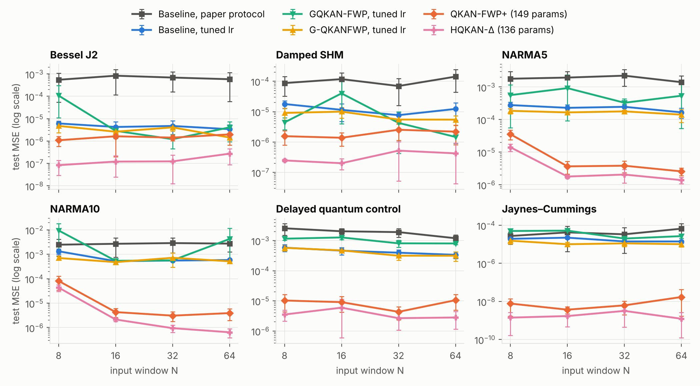

# QKAN-Claude — 改進 Gated QKAN-FWP 的 MSE

針對 [*Gated QKAN-FWP: Scalable Quantum-inspired Sequence Learning*](https://arxiv.org/abs/2605.06734)
（arXiv:2605.06734）的重現、分析與改進實驗。

**完整分析與結果請看 [`REPORT.md`](REPORT.md)。**

## 主要結果

比較規則：方法必須是 QKAN-based、參數量不超過論文的模型、論文用到的每個 dataset 都比、每個 baseline 都調過
learning rate。

| 我們的模型 | 參數量（論文） | 結果（5 seeds） |
|---|---|---|
| **HQKAN-Δ**：靜態 HQKAN ＋ Δ-token ＋ residual 讀出 | 136（159） | 6 個 time-series dataset × 4 個 window 共 24 格，全部贏過每個 baseline；test MSE 幾何平均比調過 lr 的 baseline 低 129–290 倍 |
| **QKAN-FWP+**：保留論文的 gated fast-weight 架構 | 149（159） | 24/24 格贏過論文主力模型 GQKAN-QKANFWP（比調過 lr 的版本低 45 倍）；和三個 baseline 中最好的相比贏 21/24 格 |
| **QKAN-FWP+（太陽黑子）**：多時間尺度 gate ＋ last-cycle residual 讀出 | 11,732（12,474） | 論文的 split：MSE 0.0184 → 0.0134、PAE 45.2 → 37.8、PTE 29.8 → 17.5 |

兩個要一起看的保留：

- 在六個 time-series 上，沒有 fast weights 的 HQKAN-Δ 比 QKAN-FWP+ 好 2.5 倍（15 seeds）——這組 benchmark 不需要長期記憶。
- 太陽黑子：零參數的「重複上一個週期」就有 0.0156 / 35.9 / 16.2，已優於論文印出的 0.0168 / 39.59 / 21.89；
  我們的模型在 validation 期間比 baseline 差，換 split 後 MSE 的優勢也會消失。

沒有做：MiniGrid RL（論文 Sec. 6.3）與真機實驗。



## 內容

| 路徑 | 說明 |
|---|---|
| `REPORT.md` | 論文分析、改進方向（含近期文獻）、實驗結果與結論 |
| `qkanfwp/daruan.py` | DARUAN / QKAN layer 的函數式實作（支援每個樣本各自的 fast 角度），與官方 `qkan` 套件數值一致 |
| `qkanfwp/models.py` | Gated fast-weight programmer（論文 Eq. 3–4）與本 repo 的擴充：residual 讀出（last value / last cycle）、差分 token、多時間尺度 gate、chrono 初始化、write-first；以及靜態的 HQKAN-Δ |
| `qkanfwp/data.py` | Bessel、Damped SHM、NARMA5/10、Delayed Quantum Control、Jaynes–Cummings、SILSO 太陽黑子 |
| `experiments/run_timeseries.py` | 一步預測 benchmark（論文 Sec. 6.1） |
| `experiments/run_solar.py` | 太陽黑子週期 direct multi-step 預測（論文 Sec. 6.2） |
| `experiments/make_figures.py` | 由 `results/*.jsonl` 產生 `figures/`、`results/tables_final.md`、`results/tables_stage1.md` |
| `experiments/run_all.sh` | 重現所有數字的完整指令 |
| `results/` | 所有 run 的原始結果（JSON lines） |
| `tests/` | 單元測試（DARUAN 與官方 solver 等價、closed-form memory kernel 與逐步遞迴等價、有界性…） |

## 快速開始

```bash
pip install -r requirements.txt
python -m pytest tests -q

# 單一比較：baseline（論文協定 / 調過 lr）vs QKAN-FWP+ vs HQKAN-Δ，NARMA10、window 16、5 seeds
python experiments/run_timeseries.py --datasets narma10 --windows 16 \
    --variants base base@cos30 pmx_diff8_edge_h3l2@cos30 ar_hqkan8@cos30 --out results/quick.jsonl
python experiments/aggregate.py results/quick.jsonl

# 全部重現（約 14 CPU core-hours，可中斷續跑）
bash experiments/run_all.sh
```

Variant 名稱後的 `@cos30` 表示「cosine schedule、初始 lr = 30e-3」，`@lr3` 表示固定 lr = 3e-3；
不加則是論文的 lr（time-series 1e-3、solar 2.5e-3）。

## 資料來源

太陽黑子資料來自 WDC-SILSO（Royal Observatory of Belgium, Brussels），CC BY-NC 4.0，見 `data/README.md`。
