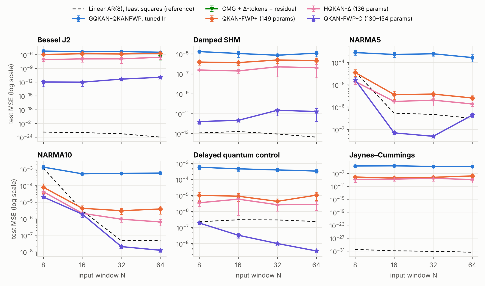
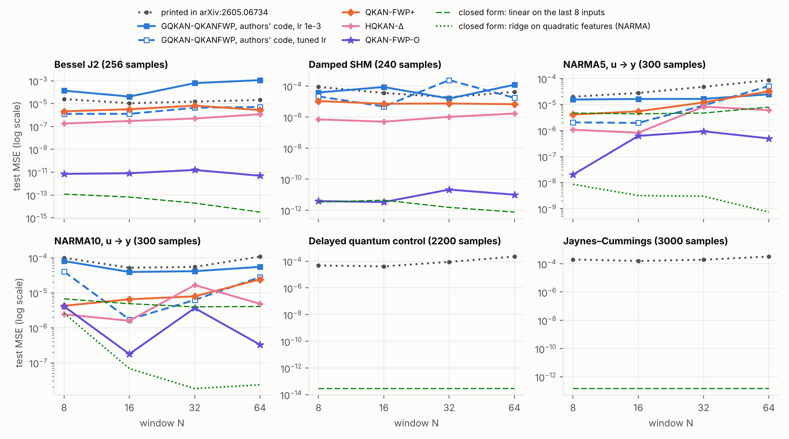
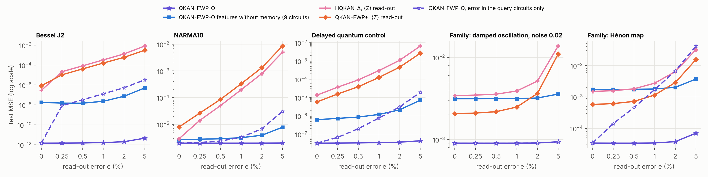

# QKAN-Claude

[*Gated QKAN-FWP: Scalable Quantum-inspired Sequence Learning*](https://arxiv.org/abs/2605.06734)（arXiv:2605.06734）的
獨立重新實作、分析與改進。**完整的分析與所有結果在 [`REPORT.md`](REPORT.md)。**

論文把 fast-weight programmer 的 slow／fast 兩個網路都換成 QKAN（edge activation 是單 qubit 的 data re-uploading 電路），
並用 scalar gate 更新 fast weights。這個 repo 包含：

- 只依論文文字的重新實作：論文模型（GQKAN-QKANFWP 與另外兩個 QKAN 變體）以及後續論文的 CMG gate（arXiv:2607.27945）；
- 依[作者公開程式碼](https://github.com/MatthewPeng57/Gated-QKAN-FWP)的設定所做的對照：程式碼和論文的文字有幾處不同
  （NARMA 讀的是驅動訊號 u 而不是 y、各序列的取樣點數、模型的細節），所以資料集與 baseline 模型都另外照程式碼做了一份；
- 三個 QKAN-based、參數量不超過論文（159）的模型：

  | 模型 | 是什麼 | 參數量 |
  |---|---|---|
  | **QKAN-FWP+** | 論文的 gated fast-weight 架構 ＋ 差分 token ＋ residual 讀出 ＋ 每個電路一個 gate | 149 |
  | **HQKAN-Δ** | 同樣的 token 與讀出，但沒有 fast weights 的靜態網路（對照組） | 136 |
  | **QKAN-FWP-O** | Fast weights 是電路的**量測算符**而不是旋轉角；QKAN 對量測算符是線性的，所以 context 可以用 gated 最小平方以封閉形式寫入 | 130–154 |

- 隔離收益來源的對照：同一個記憶換成古典特徵（Fourier、tanh、二次多項式、小型 MLP）、同樣的特徵換成別的記憶規則
  （RLS、delta rule、不用 gate）、參數量相當的靜態模型；
- 放上量子硬體的代價與性質（模擬）：電路執行次數與古典成本、有限量測次數、由 context 決定的量測基底、對靜態硬體誤差的 in-context 校正；
- 對 benchmark 的檢查：線性 AR 參考線、與論文印出數字的可比性、資料切分與實作選擇的影響。

## 主要結果



論文的六個一步預測 benchmark（test MSE，對 window N ∈ {8, 16, 32, 64} 取幾何平均，5 seeds，同一份資料與同一個 pipeline；
所有模型與參考線都以 float32 的 targets 評分，低於約 1e-15 的數字是 targets 的捨入誤差）：

| 資料集 | 兩篇論文印出的最佳數字 | 重新實作的 GQKAN-QKANFWP（調過 lr） | QKAN-FWP+ | HQKAN-Δ | **QKAN-FWP-O** | 線性 AR(8)（9 參數，最小平方） |
|---|---|---|---|---|---|---|
| Bessel J2 | 5.3e-06 | 4.5e-06 | 1.5e-06 | 1.4e-07 | **2.8e-12** | 8.4e-17 |
| Damped SHM | 8.8e-06 | 1.2e-05 | 1.9e-06 | 3.2e-07 | **5.9e-12** | 9.0e-14 |
| NARMA5 | 6.5e-06 | 2.3e-04 | 6.0e-06 | 2.9e-06 | **4.0e-07** | 1.3e-06 |
| NARMA10 | 9.5e-06 | 6.9e-04 | 8.1e-06 | 2.7e-06 | **3.2e-07** | 1.7e-06 |
| Delayed quantum control | 5.5e-06 | 4.4e-04 | 8.0e-06 | 3.5e-06 | **2.2e-08** | 2.6e-07 |
| Jaynes–Cummings | 7.6e-06 | 1.7e-05 | 7.4e-09 | 1.7e-09 | **4.7e-13** | 2.4e-16 |

同樣六個 benchmark，資料、切分與 baseline 模型改依作者公開的程式碼（NARMA 讀 u 預測 y、不正規化；baseline 是從程式碼移植的
159 參數模型，在這組設定下它重現了論文印出的數字：重跑 ÷ 印出的幾何平均是 1.1 倍）：

| 資料集（作者程式碼的設定） | 兩篇論文印出的最佳數字 | 作者模型，lr 1e-3 | 作者模型，調過 lr | QKAN-FWP+ | HQKAN-Δ | **QKAN-FWP-O** | 封閉形式的參考線 |
|---|---|---|---|---|---|---|---|
| Bessel J2（256 點） | 5.3e-06 | 2.5e-04 | 2.5e-06 | 3.4e-06 | 4.3e-07 | **8.2e-12** | 2.7e-14（線性） |
| Damped SHM（240 點） | 8.8e-06 | 5.0e-05 | 2.6e-05 | 8.0e-06 | 9.0e-07 | **7.3e-12** | 2.0e-12（線性） |
| NARMA5，u → y | 6.5e-06 | 1.8e-05 | 6.6e-06 | 9.7e-06 | 2.6e-06 | **2.8e-07** | 2.8e-09（二次特徵的 ridge） |
| NARMA10，u → y | 9.5e-06 | 5.2e-05 | 1.1e-05 | 8.5e-06 | 4.2e-06 | **9.7e-07** | 9.4e-08（二次特徵的 ridge） |
| Delayed quantum control（2200 點） | 5.5e-06 | 5.9e-05 | 5.6e-05 | 4.7e-09 | 1.3e-08 | **3.5e-13** | 2.8e-14（線性） |
| Jaynes–Cummings（3000 點） | 7.6e-06 | 8.8e-05 | 4.9e-05 | 5.9e-09 | 6.4e-09 | **2.1e-12** | 1.5e-13（線性） |



**1. 在 QKAN-based 的架構之間，閉迴路的量測算符記憶明顯較準。**
依論文文字的設定：QKAN-FWP-O 在 24 格全部低於重新實作的 GQKAN-QKANFWP、CMG 與 QKAN-FWP+；對沒有記憶的 HQKAN-Δ 是 23 格較低、1 格輸（NARMA5，N = 8）。
差距依資料集而定：對 HQKAN-Δ，NARMA 低 7–9 倍，DQC 低約 160 倍，Bessel 與 Damped SHM 低四到五個數量級。
依作者程式碼的設定：QKAN-FWP-O 在 24 格全部低於調過 learning rate 的作者模型（NARMA 低 11–24 倍，其餘四條序列低五到八個數量級），
23 格低於 HQKAN-Δ。作者版的 NARMA 視窗裡只有 u、沒有 y，context 沒有目標可寫，那裡的 QKAN-FWP-O 是用同一個封閉形式、
由訓練集的歷史解量測算符的版本。
在「每條序列物理參數都不同」的系統族上（模型必須從 16 步的視窗辨識系統；`qkanfwp/families.py`），它在 10 格中的 9 格比其他架構低：
沒有雜訊時低 15 倍到約 2 萬倍，有雜訊時低 1.1–2.3 倍。

**2. 收益來自閉迴路的記憶，不是特徵映射。**
reps = 1 的 Bloch 特徵恰好是一次諧波的 Fourier 特徵。把它換成古典特徵而先驗、gate 與求解完全不變：

| 同一個記憶，特徵換成 | 論文 benchmark 的五個 300 點序列（test MSE 對 QKAN-FWP-O 的倍數，<1 較好） | 系統族 |
|---|---|---|
| cos u、sin u（同一個函數空間，不需要電路） | 1.1× | 1.2× |
| tanh | 0.95× | 1.0× |
| 二次多項式 | 1.2× | 1.7×（Hénon map 上好 9 倍） |
| 小型 MLP | 0.89× | 0.47× |

| 同樣的特徵，記憶換成 | 論文 benchmark 的五個 300 點序列 | 系統族 |
|---|---|---|
| 沒有記憶、參數量相當的靜態模型 | 164× | 23× |
| Normalised delta rule（掃 1 次／4 次） | 62×／59× | 7.4×／4.6× |
| 先驗只當初始值的 RLS | 0.54× | 0.71× |
| 不用 gate | 1.7× | 1.5× |

**3. 把 fast weights 放在量測算符，對量子 FWP 帶來的可驗證性質**（硬體相關的部分都是模擬）：

- 最佳寫入有封閉形式，充分統計量服從論文的 gated 遞迴（Eq. 4、凸包、prefix scan 都保留）。
- 電路與記憶無關：不需要逐次載入 fast 角度，多輸出不增加電路。代價是三個量測基底、每個視窗 350 個數字的古典狀態與一次 25×25 的求解；
  一步預測的量子成本並不比角度空間的模型低。
- Query 的量測基底由 context 決定（fast weights 在硬體上就是量測軸），讀出的 shot 變異數有封閉形式。
- 對靜態硬體誤差的 in-context 校正：模型用理想電路訓練、測試時加入誤差而不重新訓練，

  | test MSE ÷ 理想裝置（五個任務的幾何平均） | 讀出誤差 1% | 讀出誤差 5% | 去極化 5% | 過旋轉 5% |
  |---|---|---|---|---|
  | QKAN-FWP-O | 1.0× | 1.6× | 1.1× | 1.1× |
  | HQKAN-Δ（⟨Z⟩ 讀出） | 20× | 289× | 11× | 21× |
  | QKAN-FWP+（⟨Z⟩ 讀出） | 13× | 192× | 19× | 21× |

  把同一個誤差只放在 query 的電路，Bessel 的 MSE 差 8 萬倍：誤差是因為同時出現在 context 與 query 才被最小平方吸收。

  

**4. 論文型態的記憶（由 slow programmer 產生旋轉角）在這些 benchmark 上沒有幫助**：沒有 fast weights 的 HQKAN-Δ 在每一格都比
QKAN-FWP+ 好，也在 24 格中的 21 格比給了相同 token 的 CMG 好（依論文文字的設定）；依作者程式碼的設定，它在六個資料集都比調過
learning rate 的作者模型低（2.5 倍到近四個數量級）。

**5. 太陽黑子週期預測**：論文對 sliding window 的索引做切分，相鄰 split 的 targets 重疊 131 個月。改成依 target 時間切分之後，
沒有模型穩定贏過零參數的「重複上一個週期」；QKAN-FWP-O 的靜態版本以 496 個參數（論文模型的 4%）在三種切分上都比重新實作的 baseline 低
（7–28%），有記憶的版本比靜態版本差。改用作者程式碼的資料檔（3,265 筆）與移植的 12,474 參數模型，結論相同：移植的模型在作者的切法下
重現了論文的 0.0168（0.0169 ± 0.0017）；依 target 時間切分時，靜態版本比它低 14%。

## 解讀時要注意

- **不主張量子優勢，特徵映射也不是貢獻。** 模型可以古典模擬；同一個記憶配上古典特徵一樣好或更好，而且不需要量測。
  QKAN 的表述帶來的是上面第 3 點的性質：一個要在量子硬體上執行的 FWP，fast weights 該放在哪裡、代價是什麼。
- **這些 benchmark 用封閉形式的最小平方就能解得更好**：一步預測的序列幾乎是線性問題，9 個參數的線性 AR(8)（不需要訓練）在 24 格中的
  21 格贏過兩篇論文印出的最佳數字，對 QKAN-FWP-O 是 13 格較低、11 格較高。作者版的 NARMA 是二次回歸問題：對最近 12 個 u 的二次特徵做
  ridge 比所有模型（包括 QKAN-FWP-O）低 10 倍以上。
- **論文的文字和作者的程式碼不一致**（REPORT 4.6 節）：NARMA 在文字裡是讀 y 預測下一個 y，在程式碼裡是讀 u 預測 y 且不正規化；
  取樣點數、太陽黑子檔案的長度（3,326 對 3,265 筆）與模型細節也不同。兩組設定都跑了，數字不能互相比較。
- **和論文印出數字的關係**：只依論文文字的重新實作沒有重現印出的數字（論文協定下差 21 倍）；改用程式碼的資料設定與移植的模型之後重現了
  （幾何平均 1.1 倍）。所有倍數都是同一組設定內的比較。
- In-context 最小平方本身是既有方法（ALPaCA、mesa-layer、delta rule）；新的部分是把它接到量子 FWP 上以及由此得到的硬體性質。
- **有限量測次數**（每個電路的 shot 預算在 X／Y／Z 三個基底間平分，binomial 抽樣）：以精確期望值訓練的 QKAN-FWP-O 對量測雜訊很敏感，
  訓練時加入量測雜訊可以修正；在需要非線性特徵的 Hénon map 上，每個電路約 10⁴ 次量測以上才優於靜態模型，10² 次時反而較差。
- 硬體誤差只模擬了靜態的讀出誤差、去極化與過旋轉；in-context 校正只對一個視窗內不變的誤差成立。
- 沒有做：MiniGrid 強化學習、真機實驗、以多 qubit VQC 為 fast programmer 的模型。

## 內容

| 路徑 | 說明 |
|---|---|
| `REPORT.md` | 論文機制、相關研究、模型、實驗設定、所有結果與限制 |
| `qkanfwp/daruan.py` | DARUAN / QKAN layer 的函數式實作（支援每個樣本各自的角度、Bloch vector 輸出、有限量測次數與靜態硬體誤差的模擬），與官方 `qkan` 套件數值一致 |
| `qkanfwp/models.py` | Gated fast-weight programmer（論文 Eq. 3–4；scalar／分組／CMG gate）、差分 token、residual 讀出、HQKAN-Δ、LSTM 對照 |
| `qkanfwp/authors.py` | 依作者公開的程式碼移植的 GQKAN-QKANFWP（time-series 159 參數、太陽黑子 12,474 參數） |
| `qkanfwp/obsmem.py` | QKAN-FWP-O：以量測算符為 fast weights 的閉迴路記憶（一步與 direct multi-step），以及古典特徵與其他記憶規則的對照 |
| `qkanfwp/data.py`, `qkanfwp/families.py` | 論文的資料集（依論文文字，以及依作者程式碼的 `c_*` 版本）；參數逐序列隨機的系統族 |
| `experiments/run_timeseries.py` | 一步預測 benchmark（論文 Sec. 6.1） |
| `experiments/run_family.py` | 系統族上的 in-context 預測與封閉形式的參考線 |
| `experiments/run_solar.py` | 太陽黑子週期 direct multi-step 預測（論文 Sec. 6.2）；`--purge` 依 target 時間切分 |
| `experiments/shot_noise.py` | 有限量測次數的敏感度、Gram 矩陣條件數、shot 雜訊來源的分解 |
| `experiments/device_noise.py` | 測試時加入靜態硬體誤差（不重新訓練） |
| `experiments/cost.py`, `experiments/resources.py` | 讀出規則的計時；每次預測的電路執行次數、量測設定與古典成本 |
| `experiments/memory_probe.py` | QKAN-FWP-O 學到的記憶權重（每個 context 配對的權重） |
| `experiments/reference_baselines.py` | 線性 AR 參考線 |
| `experiments/make_figures.py`, `experiments/make_om_report.py`, `experiments/make_code_report.py` | 由 `results/*.jsonl` 產生表格與 `figures/` |
| `experiments/check_authors_port.py` | 在有作者程式碼的環境下，直接比對移植的模型與作者的模型（選用） |
| `experiments/report/` | `REPORT.md` 的文字來源與組裝程式 |
| `experiments/run_all.sh` | 重現所有數字的完整指令 |
| `results/` | 所有 run 的原始結果（說明見 `results/README.md`） |
| `tests/` | 單元測試 |

## 快速開始

```bash
pip install -r requirements.txt
python -m pytest tests -q

# NARMA10、window 16、5 seeds：論文協定的 baseline、調過 lr 的 baseline、HQKAN-Δ、QKAN-FWP-O
python experiments/run_timeseries.py --datasets narma10 --windows 16 \
    --variants base base@cos30 ar_hqkan8@cos30 om_c0h6r1_p5@cos30 --out results/quick.jsonl
python experiments/aggregate.py results/quick.jsonl

# 全部重現（約 45 CPU core-hours，可中斷續跑）
bash experiments/run_all.sh
```

Variant 名稱後的 `@cos30` 表示 cosine schedule、初始 learning rate 30e-3；不加則是論文的設定（1e-3、固定）。

## 資料來源

太陽黑子資料來自 WDC-SILSO（Royal Observatory of Belgium, Brussels），CC BY-NC 4.0，見 `data/README.md`。
`data/authors/jaynes_cummings.csv` 來自作者公開的程式碼（Apache-2.0），見 `data/authors/README.md`。
