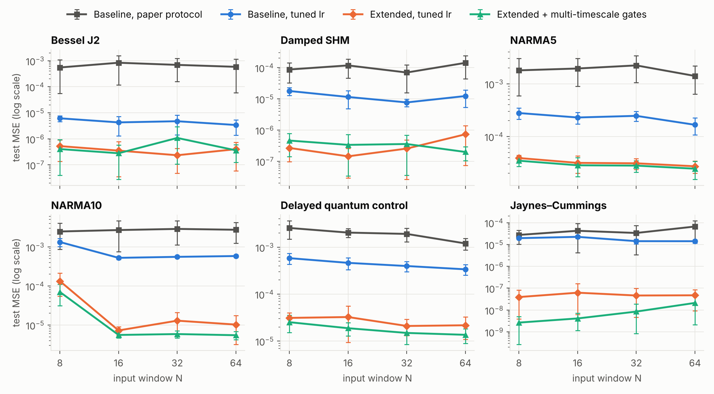
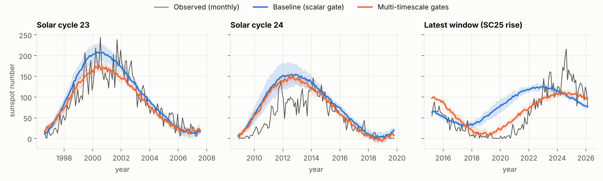
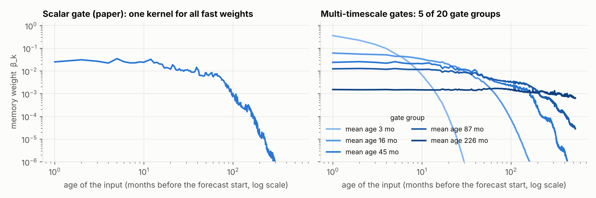
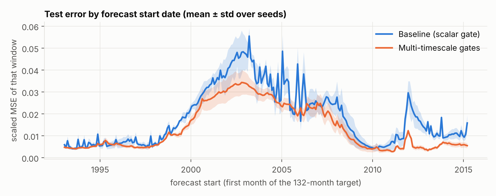
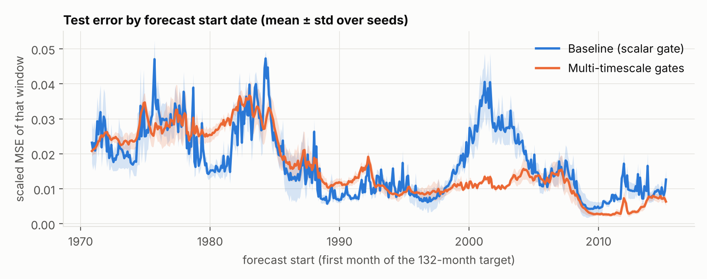

# Gated QKAN-FWP：論文分析、改進方向與實驗驗證

對象論文：*Gated QKAN-FWP: Scalable Quantum-inspired Sequence Learning*（arXiv:2605.06734）。
本報告做三件事：(1) 整理論文機制與其限制；(2) 提出可降低 MSE 的改進方向，並對應近期文獻；
(3) 以重現的 baseline 為基準做實驗，驗證哪些改進有效、哪些無效。

> 所有數字皆由本 repo 的程式產生（`results/*.jsonl`），重現指令見第 10 節。
> 第 4–6 節是依「公平比較」規則做的最終結果；較早、參數量較大的第一階段結果保留在附錄 A。

## 摘要

### 比較規則

1. **方法必須是 QKAN-based**：所有「我們的」模型都只由 HQKAN（Linear → QKAN/DARUAN → Linear）構成。
2. **參數量不超過論文的模型**，也不超過我重現的 baseline。
3. **論文用到的每個 dataset 都要比**：6 個 time-series × 4 個 window，加上太陽黑子。
4. **每個 baseline 都調過 learning rate**（和我們的模型用同一套 validation 流程），包含論文的另外兩個 QKAN 變體。

| | 論文的 GQKAN-QKANFWP | 我重現的 baseline | 我們的模型 |
|---|---|---|---|
| Time-series 參數量 | 159 | 152 | **QKAN-FWP+：149**　**HQKAN-Δ：136** |
| 太陽黑子參數量 | 12,474 | 12,423 | **QKAN-FWP+：11,732** |

### Time-series：六個 dataset 全部勝出

Test MSE，對四個 window 取幾何平均，5 seeds。「Best tuned baseline」是三個重現的論文模型（GQKAN-QKANFWP、
GQKAN-FWP、G-QKANFWP，各自調過 lr）中最好的那個。

| Dataset | Baseline, paper protocol | Best tuned baseline | QKAN-FWP+ (149 params) | HQKAN-Δ (136 params) | QKAN-FWP+ vs best tuned baseline | HQKAN-Δ vs best tuned baseline |
|---|---|---|---|---|---|---|
| Bessel J2 | 6.55e-04 | 2.93e-06 | 1.50e-06 | 1.36e-07 | 2× lower | 21× lower |
| Damped SHM | 1.01e-04 | 5.77e-06 | 1.86e-06 | 3.24e-07 | 3× lower | 18× lower |
| NARMA5 | 1.82e-03 | 1.67e-04 | 5.99e-06 | 2.91e-06 | 28× lower | 57× lower |
| NARMA10 | 2.70e-03 | 5.96e-04 | 8.07e-06 | 2.74e-06 | 74× lower | 217× lower |
| Delayed quantum control | 1.86e-03 | 4.05e-04 | 8.05e-06 | 3.52e-06 | 50× lower | 115× lower |
| Jaynes–Cummings | 4.03e-05 | 1.16e-05 | 7.40e-09 | 1.75e-09 | 1569× lower | 6646× lower |

- **HQKAN-Δ（136 參數，沒有 fast weights）在全部 24 格（dataset × window）都贏過每一個 baseline**，
  幾何平均比 tuned baseline 低 129–290 倍；也低於論文自己印出的 GQKAN-QKANFWP 數字（24/24 格）。
- **QKAN-FWP+（149 參數，保留論文的 gated fast-weight 架構）在全部 24 格都贏過論文的主力模型
  GQKAN-QKANFWP**（不論它用論文協定或調過 lr），幾何平均低 45 倍；若和「三個 tuned baseline 中最好的」比，
  24 格中贏 21 格，另外 3 格（Bessel N=32、64 與 Damped SHM N=64，都在 1e-6 等級）在 seed 誤差內持平。

### 太陽黑子：論文的 split 上三個指標都勝出，但這個 benchmark 鑑別力有限

論文協定（80/10/10、best-validation checkpoint、5 seeds）下的 test 指標：

| 模型 | 參數量 | Scaled MSE | PAE | PTE |
|---|---|---|---|---|
| 重現的 baseline（lr 依論文做法由 validation 選：1e-3） | 12,423 | 0.0177 ± 0.0010 | 45.8 ± 2.8 | 26.1 ± 2.2 |
| **QKAN-FWP+（同樣由 validation 選 lr：1e-3）** | **11,732** | **0.0146 ± 0.0010** | **36.0 ± 0.4** | **18.6 ± 1.7** |
| 論文印出的數字 | 12,474 | 0.0168 ± 0.0016 | 39.59 ± 2.82 | 21.89 ± 1.57 |
| 參考：直接重複上一個週期（13 個月平滑，不需訓練） | 0 | 0.0156 | 35.9 | 16.2 |

三個 lr（1e-3、2e-3、2.5e-3）下我們的模型都在三個指標上贏過同 lr 的 baseline。**但要注意**：
(a) 一個零參數的「重複上一個週期」預測就已經贏過論文印出的模型，我們的模型主要是在它之上把 MSE 再降一些；
(b) 在 validation 期間我們的模型比 baseline 差；換成另外兩種 split 後，PAE 仍然較好（−14% ～ −20%），
但 MSE 的優勢縮小到 −7%（70/15/15）或消失（60/20/20：+5%，不顯著）。詳見第 6 節。

### 需要知道的事

1. **在這六個序列上，fast-weight 記憶不是必要的。** 把同樣的 Δ-token 與 residual 讀出給一個靜態 HQKAN
   （HQKAN-Δ），結果比有 fast weights 的 QKAN-FWP+ 好 2.5 倍（15 個 seed），而且更小、seed 間也更穩定。
   如果目標是「QKAN-based、MSE 最低」，應該用 HQKAN-Δ；如果目標是「留在 FWP 架構內」，用 QKAN-FWP+。
2. **和論文印出的數字相比**（資料取樣細節論文沒有全給，所以這個比較只能參考）：HQKAN-Δ 在 24/24 格低於論文的
   GQKAN-QKANFWP，21/24 格低於論文任何模型的最佳數字；沒過的 3 格都是 NARMA 的短 window
   （NARMA5 N=8、NARMA10 N=8 與 N=16，後兩格差距在 7% 以內）。
3. **沒有做的部分**：MiniGrid 強化學習（論文 Sec. 6.3）——它不是 MSE 指標，而且照論文設定（A3C、80 workers、
   10,000 episodes × 4 種地圖 × 5 seeds）超出這次的 CPU 預算；真機實驗也沒有做。

---

## 1. 論文在做什麼

**機制。** Fast Weight Programmer（FWP）不用 hidden state，而是讓 *slow programmer* 每一步產生
*fast programmer* 的參數更新。論文把兩個 programmer 都換成 HQKAN（Linear → QKAN → Linear，QKAN 的
edge activation 是單一 qubit 的 data re-uploading 電路 DARUAN），並把更新規則從相加改成 scalar gate：

```
y_t        = F(x_t; W_t)                      # fast programmer
(ΔW_t, g_t) = S(x_t)                          # slow programmer，只看當下輸入
W_{t+1}    = g_t · W_t + (1 − g_t) · ΔW_t     # Eq. 3，g_t ∈ [0,1] 是純量
```

**理論。** 因為 `(ΔW_t, g_t)` 不依賴 `W_{t-1}`，遞迴可展開成
`W_{T} = β_0 W_1 + Σ_k β_k ΔW_k`，`β_k = (1−g_k) Π_{s>k} g_s`（adaptive memory kernel）；
`W` 永遠落在歷史 proposals 的 convex hull 內（有界）；可用 prefix scan 平行計算；時間方向的梯度只經過
純量 `β`，不會爆炸（但論文 App. B.4 自己指出可能 vanish）。

**實驗與主要數字。**

| 實驗 | 設定 | 論文中 GQKAN-QKANFWP 的數字 |
|---|---|---|
| 6 個 time-series benchmark（Bessel、Damped SHM、NARMA5/10、DQC、Jaynes–Cummings） | 一步預測，window N ∈ {8,16,32,64}，[-1,1] 正規化，80/20 split，50 epochs、batch 4、lr 1e-3、5 seeds，報 final test MSE | 約 1e-5 ~ 3e-4（Table 3–6），159 個參數 |
| 太陽黑子週期（主結果） | 528 個月 → 132 個月 direct multi-step，80/10/10，peak-aware loss，100 epochs、batch 32 | scaled MSE **0.0168 ± 0.0016**、PAE 39.59、PTE 21.89，12,474 個參數 |
| MiniGrid RL、IonQ/IBM 真機推論 | — | 本報告未涉及 |

---

---

## 2. 可以改進的地方（與對應的近期研究）

下表是讀完論文後整理出的弱點。「實測」欄標示本報告是否做了實驗。

| # | 論文的做法 | 問題 | 改進方向 | 相關文獻 | 實測 |
|---|---|---|---|---|---|
| A1 | 訓練固定 lr = 1e-3、50 epochs、無 schedule，報最後一個 epoch | 模型遠未收斂；Table 3–6 的 std 常與 mean 同量級，就是訓練不足＋最後一步雜訊 | 調 learning rate ＋ cosine decay（同樣 epoch 數） | — | ✅ |
| A2 | 讀出 `y = F(x_T; W_T)` 要自己合成絕對數值 | 一步預測的主成分就是「上一個值」，網路容量花在學 identity | Residual 讀出 `ŷ = x_T + F(x_T; W_T)` | NLinear/DLinear（2205.13504）、RevIN | ✅ |
| A3 | Slow/fast programmer 每一步只看到一個純量 `x_t` | Proposal 與 gate 是 *context-free*：同一個數值在上升段與下降段得到完全相同的 `ΔW_t`、`g_t`；斜率資訊只能靠 gate 的 EMA 間接編碼 | Token 化：把 `x_t` 換成因果 patch。本報告提出用**差分座標** `(x_t, Δx_t, Δ²x_t)`（離散的相空間座標，各階差分正規化到單位變異） | PatchTST（2211.14730）；Takens delay embedding | ✅ |
| B1 | 單一純量 gate | 所有 fast weights 共用同一個記憶時間尺度；一次強寫入會把所有舊記憶一起洗掉 | 分組（vector）gate：每個 DARUAN 電路/每層一個 gate → 多時間尺度記憶；Eq. 4、有界性、平行 scan 逐組仍成立 | RWKV-7 vector-valued gating（2503.14456）、Mamba selective per-channel decay（2312.00752）、xLSTM（2405.04517）、HGRN（2311.04823） | ✅ |
| B2 | Gate 用預設初始化（g ≈ 0.5） | 初始記憶長度只有 ~2 步：`β_k ≈ 2^{-(T-k)}`，N=64 或 528 時早期輸入的梯度一開始就消失 | Chrono initialization：把 gate bias 設成對數等距的時間尺度 τ ∈ [2, N]，`g = 1 − 1/τ` | Tallec & Ollivier（1804.11188）、UR-LSTM（1910.09890）、LRU（2303.06349） | ✅ |
| B3 | 寫入與遺忘綁在一起（convex combination）；`β_k` 對年齡單調遞減 | 無法「只改寫某個 key 對應的內容」；無法選擇性記住特定 lag | Delta rule / 解耦的 erase key；momentum（二階）記憶；複數（旋轉）gate | Gated DeltaNet（2412.06464）、RWKV-7、DeltaProduct（2502.10297）、Titans（2501.00663）、Fast Weight Attention（2608.27763）、test-time regression（2501.12352） | ❌（第 7 節討論） |
| B4 | `ΔW_t` 與 fast network 的預測誤差無關 | 沒有「surprise」訊號；fast weights 不會因為預測錯了而更新更多 | 把上一步的預測誤差回饋給 slow programmer（recurrent FWP；會失去平行性） | Recurrent FWP（2106.06295）、Titans、MesaNet（2506.05233） | ❌ |
| C1 | 只有最後一步有 loss | 每個 window 只有一個監督訊號 | 每個 prefix 都算 loss（dense supervision） | — | ❌ |
| C2 | Slow decoder 直接輸出所有 fast weights | 太陽黑子模型 12.5k 參數中約 8.8k 在這個線性層 | Low-rank / outer-product / chunked hypernetwork | QFWP 的 `L ⊗ Q`（2402.17760） | ❌ |
| D1 | Sec. 6.1 沒有 classical baseline、沒有列出各層大小 | 無法判斷 benchmark 是否真的需要記憶機制；難以重現 | 加入同參數量的 LSTM 與「無記憶」對照組 | — | ✅ |

FWP 文獻整體脈絡可參考 Irie 的 review（2508.08435）與「Linear Transformers Are Secretly FWPs」
（2102.11174）：論文的 gated update 其實就是對 proposal 做 delta-rule
`W ← W + (1−g)(ΔW − W)`，而近兩年線性 RNN / state-space 模型的進展（Gated DeltaNet、RWKV-7、Mamba、
xLSTM）幾乎都集中在「更新規則的 gate 怎麼設計、怎麼初始化」——正是 B1–B3。

**第二輪新增的兩項改動**（依公平比較規則重做時加入）：把 Δ-token 從 3 維加長到 8 維
（`(x_t, Δx_t, …, Δ⁷x_t)`），以及太陽黑子用的「上一個週期」residual 讀出——它是 A2 在 multi-step 預測上的對應版本。

---

## 3. 實驗設定

### 3.1 重現 baseline

論文沒有公開 FWP 的程式，只說 QKAN 來自 [`qkan`](https://github.com/Jim137/qkan) 套件，所以本 repo 重新實作：

- **DARUAN / QKAN layer**（`qkanfwp/daruan.py`）：fast programmer 需要「每個樣本各自一組角度」，官方套件
  只支援共享參數，因此寫成 `(x, θ)` 的純函數。`tests/test_daruan.py` 驗證與官方 `torch_exact_solver`
  （`pz_encoding` ansatz）數值一致。
- **Gated FWP**（`qkanfwp/models.py`）：照論文 Eq. 3，先讀後寫（`y_T = F(x_T; W_T)`，`W_T` 只依賴
  `x_1..x_{T-1}`）。用 Eq. 4 的 closed form 在 log 空間計算 `β_k`，並測試與逐步遞迴等價。
- **層的大小論文沒有列出**，只有總參數量。我在 validation split 上比較了 5 種 ~160 參數的配置
  （`results/dev_baseline_arch.jsonl`），選最強的當 baseline，避免拿弱 baseline 當稻草人：

  | Benchmark | Slow HQKAN | Fast HQKAN | 參數量（論文） |
  |---|---|---|---|
  | Time-series | 1 → 3 → 3，reps 3 | 1 → 2 → 1，reps 3（16 個 fast 角度） | 152（159） |
  | Solar | 1 → 10 → 10，reps 3 | 1 → 10 → 20，reps 1（200 個 DARUAN 電路＝論文的數量，800 個 fast 角度）→ 132 | 12,423（12,474） |

  （一開始試的 1→6→3 / 1→2→2、reps 1 配置剛好是 159 個參數，但 validation MSE 是上表配置的 3.6 倍。）
- **資料**（`qkanfwp/data.py`）：方程式與參數照論文。論文沒寫 Bessel / SHM / DQC 的取樣點數，這裡統一用
  300 點（NARMA 的 M = 300 是論文給的；JC 3000 點也是）。因此 **time-series 的 MSE 絕對值不能直接和論文
  Table 3–6 比**，只能比同一份資料上的相對差異。太陽黑子用的是同一份 SILSO V2.0 月資料前 3,326 筆，
  絕對值可以和論文 Table 7 比。

### 3.2 兩種訓練協定

- **Paper protocol**：完全照論文（time-series：Adam、lr 1e-3、50 epochs、batch 4、報最後一個 epoch 的
  test MSE；solar：lr 2.5e-3、100 epochs、batch 32、取 validation loss 最低的 checkpoint）。
- **Tuned protocol**（只用在 time-series）：同樣 50 epochs、batch 4，但 lr 用 cosine decay 到 0，初始 lr
  由 validation 選（{1, 3, 10, 30, 100}×1e-3）。**Baseline 與改進模型各自選最好的 lr**，確保比較公平。
  選出的結果：baseline 3e-2（Jaynes–Cummings 為 1e-2）、Extended 3e-2、LSTM 1e-1、LSTM＋residual＋Δ-token 3e-2。

### 3.3 避免在 test set 上挑模型

所有設計決定（baseline 配置、要不要某個改進、lr）都只用 **dev protocol**：70/10/20 split 的 validation
部分、seeds 100–102。最終數字用論文的 80/20 split、**seeds 0–4**，這些 run 沒有參與任何決定。
Solar 照論文本來就有 validation split；pilot 用 seeds 100–101，最終用 seeds 0–4。

### 3.4 公平比較的規則（最終結果）

- **QKAN-based**：我們的模型只用 HQKAN。LSTM 只作為對照組出現，不是我們的方法。
- **參數量**：time-series ≤ 152（重現的 baseline；論文是 159），太陽黑子 ≤ 12,423（論文 12,474）。
- **Baseline 都調過 lr**：重現的 GQKAN-QKANFWP、GQKAN-FWP、G-QKANFWP 各自在 validation 上選 cosine 的初始 lr
  （候選 1e-2、3e-2、1e-1，必要時再往外一格），Jaynes–Cummings 另外單獨選。選出的結果：

  | 模型 | 5 個 300 點序列 | Jaynes–Cummings |
  |---|---|---|
  | GQKAN-QKANFWP（152） | 3e-2 | 1e-2 |
  | GQKAN-FWP（114） | 1e-1 | 3e-2 |
  | G-QKANFWP（175） | 3e-2 | 1e-2 |
  | 我們的兩個模型 | 3e-2 | 3e-2 |

- **模型選擇只用 validation**：候選的 token 長度、gate 分組、寬度都在 dev protocol（seeds 100–102）上選
  （`results/dev_param_matched.jsonl`），最終數字用 seeds 0–4。
- 論文的 QFWP / G-QFWP / GQKAN-QFWP（fast programmer 是多 qubit VQC）沒有重現，所以不在 baseline 之列。

---

## 4. 最終模型

### 4.1 Time-series：兩個 QKAN-based 模型

兩個模型共用三樣東西：

- **Δ-token**：每一步的輸入不是純量 `x_t`，而是 `(x_t, Δx_t, Δ²x_t, …, Δ⁷x_t)`（最近 8 個值的 backward
  differences）。各階差分除以它在訓練集上的標準差（對 window 內所有位置計算，包含開頭 replicate padding
  補出來的位置；這使高階差分在平滑序列上被縮得比單位變異小，見 5.4 節的說明）。
- **Residual 讀出**：`ŷ = x_T + 網路輸出`。
- **訓練**：和論文一樣 50 epochs、batch 4、Adam、MSE，只把固定 lr 1e-3 換成 cosine（初始 3e-2）。

| | **QKAN-FWP+**（149 參數） | **HQKAN-Δ**（136 參數） |
|---|---|---|
| 架構 | 論文的 gated fast-weight programmer | 單一 HQKAN，沒有 fast weights、沒有記憶 |
| Slow programmer | HQKAN 8 → 3 → 2（reps 3）→ 16 個 fast 角度 + 2 個 gate | — |
| Fast programmer / 主網路 | HQKAN 8 → 2 → 1（reps 3），2 個 DARUAN 電路（與 baseline 相同） | HQKAN 8 → 4 → 3 → 1（reps 3），12 個 DARUAN 電路，參數固定 |
| 記憶規則 | 論文 Eq. 3，但每個 DARUAN 電路各一個 gate（chrono 初始化） | 無（只看最後一個 token） |
| 參數分配 | slow 27 + 48 + 54，fast 18 + 2 | 36 + 96 + 4 |

**QKAN-FWP+ write-first** 是 QKAN-FWP+ 的一個變體：先寫入再讀出（`y_T = F(x_T; W_{T+1})`），讓最新的 token
也經過 slow programmer。論文是先讀後寫，所以最新的 token 只會經過很小的 fast programmer。

### 4.2 太陽黑子：QKAN-FWP+（11,732 參數）

在重現的 baseline（slow HQKAN 1 → 10 → 10，fast HQKAN 1 → 10 → 20 → 132，200 個 DARUAN 電路）上改三處：

- **多時間尺度 gate**：fast QKAN 的 20 個輸出節點各一個 gate（論文是全部共用一個 scalar gate），
  chrono 初始化成對數等距的記憶長度 τ ∈ [2, 528] 個月。
- **Last-cycle residual 讀出**：`ŷ = smooth₁₃(最近 132 個月) + 網路輸出`，decoder 初始化為 0，
  所以未訓練的模型就是「重複上一個週期」。
- **Slow latent 10 → 9**：把上面多出來的 gate 參數抵掉，總參數量 11,732 < 12,423。

Fast programmer 的 200 個單 qubit 電路與訓練協定（100 epochs、batch 32、peak-aware loss、best-validation
checkpoint）都和論文相同。

---

## 5. 結果：time-series（論文 Sec. 6.1 的六個 dataset）

### 5.1 全部 24 格（論文的 80/20 split，seeds 0–4，test MSE，mean ± std）


| Dataset | N | Baseline GQKAN-QKANFWP, paper protocol (152 params) | Baseline GQKAN-QKANFWP, tuned lr (152 params) | GQKAN-FWP, tuned lr (114 params) | G-QKANFWP, tuned lr (175 params) | QKAN-FWP+ (ours) (149 params) | QKAN-FWP+ write-first (ours) (149 params) | HQKAN-Δ, no fast weights (ours) (136 params) |
|---|---|---|---|---|---|---|---|---|
| Bessel J2 | 8 | 5.49e-04 ± 5.2e-04 | 6.14e-06 ± 1.5e-06 | 1.08e-04 ± 1.9e-04 | 4.77e-06 ± 2.4e-06 | 1.09e-06 ± 5.2e-07 | 7.64e-07 ± 6.0e-07 | **8.39e-08 ± 5.4e-08** |
| Bessel J2 | 16 | 8.35e-04 ± 7.2e-04 | 4.27e-06 ± 3.0e-06 | 2.87e-06 ± 1.4e-06 | 2.62e-06 ± 2.8e-07 | 1.64e-06 ± 1.4e-06 | 1.78e-06 ± 1.7e-06 | **1.21e-07 ± 9.7e-08** |
| Bessel J2 | 32 | 6.90e-04 ± 5.3e-04 | 4.74e-06 ± 3.3e-06 | 1.22e-06 ± 7.7e-07 | 4.10e-06 ± 1.3e-06 | 1.43e-06 ± 4.0e-07 | 1.53e-06 ± 3.3e-07 | **1.24e-07 ± 1.1e-07** |
| Bessel J2 | 64 | 5.81e-04 ± 5.8e-04 | 3.39e-06 ± 2.0e-06 | 4.09e-06 ± 3.2e-06 | 1.44e-06 ± 3.1e-07 | 2.00e-06 ± 1.3e-06 | 1.61e-06 ± 7.7e-07 | **2.74e-07 ± 1.9e-07** |
| Damped SHM | 8 | 8.72e-05 ± 5.5e-05 | 1.78e-05 ± 5.0e-06 | 4.42e-06 ± 1.9e-06 | 9.08e-06 ± 3.8e-06 | 1.56e-06 ± 7.6e-07 | 1.52e-06 ± 8.3e-07 | **2.48e-07 ± 2.5e-08** |
| Damped SHM | 16 | 1.18e-04 ± 7.2e-05 | 1.15e-05 ± 6.7e-06 | 3.99e-05 ± 7.7e-05 | 1.00e-05 ± 3.8e-06 | 1.38e-06 ± 6.5e-07 | 1.12e-06 ± 1.2e-06 | **2.01e-07 ± 7.8e-08** |
| Damped SHM | 32 | 6.98e-05 ± 5.4e-05 | 7.67e-06 ± 2.0e-06 | 4.27e-06 ± 5.6e-06 | 5.49e-06 ± 1.6e-06 | 2.54e-06 ± 1.4e-06 | 2.53e-06 ± 1.1e-06 | **5.21e-07 ± 5.1e-07** |
| Damped SHM | 64 | 1.42e-04 ± 9.8e-05 | 1.23e-05 ± 7.0e-06 | 1.47e-06 ± 5.6e-07 | 5.46e-06 ± 1.9e-06 | 2.20e-06 ± 1.4e-06 | 2.22e-06 ± 2.4e-06 | **4.24e-07 ± 4.9e-07** |
| NARMA5 | 8 | 1.79e-03 ± 1.2e-03 | 2.78e-04 ± 6.6e-05 | 5.63e-04 ± 6.0e-04 | 1.85e-04 ± 3.6e-05 | 3.55e-05 ± 1.2e-05 | 1.69e-05 ± 5.5e-06 | **1.41e-05 ± 3.6e-06** |
| NARMA5 | 16 | 1.94e-03 ± 1.1e-03 | 2.29e-04 ± 5.7e-05 | 9.22e-04 ± 1.4e-03 | 1.66e-04 ± 2.3e-05 | 3.67e-06 ± 1.5e-06 | 2.96e-06 ± 8.6e-07 | **1.79e-06 ± 2.2e-07** |
| NARMA5 | 32 | 2.23e-03 ± 1.2e-03 | 2.46e-04 ± 5.1e-05 | 3.28e-04 ± 1.1e-04 | 1.78e-04 ± 1.7e-05 | 3.84e-06 ± 1.5e-06 | 3.69e-06 ± 1.9e-06 | **2.05e-06 ± 9.2e-07** |
| NARMA5 | 64 | 1.40e-03 ± 7.7e-04 | 1.67e-04 ± 5.9e-05 | 5.38e-04 ± 8.0e-04 | 1.42e-04 ± 6.0e-05 | 2.57e-06 ± 6.6e-07 | 3.34e-06 ± 7.1e-07 | **1.39e-06 ± 3.1e-07** |
| NARMA10 | 8 | 2.48e-03 ± 1.6e-03 | 1.33e-03 ± 3.1e-04 | 9.50e-03 ± 8.4e-03 | 7.07e-04 ± 9.7e-05 | 8.14e-05 ± 4.7e-05 | 8.17e-05 ± 3.2e-05 | **4.34e-05 ± 1.3e-05** |
| NARMA10 | 16 | 2.70e-03 ± 1.9e-03 | 5.24e-04 ± 4.5e-05 | 5.43e-04 ± 3.6e-05 | 4.79e-04 ± 9.5e-06 | 4.31e-06 ± 1.7e-06 | 5.06e-06 ± 2.3e-06 | **2.14e-06 ± 3.3e-07** |
| NARMA10 | 32 | 2.89e-03 ± 1.8e-03 | 5.56e-04 ± 3.1e-05 | 5.67e-04 ± 4.7e-05 | 7.21e-04 ± 4.2e-04 | 3.09e-06 ± 1.3e-06 | 2.79e-06 ± 1.6e-06 | **9.47e-07 ± 3.1e-07** |
| NARMA10 | 64 | 2.75e-03 ± 1.5e-03 | 5.83e-04 ± 5.1e-05 | 4.26e-03 ± 7.4e-03 | 5.18e-04 ± 2.4e-05 | 3.92e-06 ± 2.0e-06 | 2.84e-06 ± 1.7e-06 | **6.43e-07 ± 2.6e-07** |
| Delayed quantum control | 8 | 2.56e-03 ± 1.1e-03 | 5.83e-04 ± 1.5e-04 | 1.16e-03 ± 1.2e-04 | 5.75e-04 ± 1.3e-04 | 1.02e-05 ± 5.9e-06 | 1.14e-05 ± 6.9e-06 | **3.51e-06 ± 1.4e-06** |
| Delayed quantum control | 16 | 2.04e-03 ± 4.3e-04 | 4.63e-04 ± 1.3e-04 | 1.27e-03 ± 1.9e-04 | 4.72e-04 ± 6.8e-05 | 9.03e-06 ± 4.8e-06 | 9.91e-06 ± 3.5e-06 | **5.92e-06 ± 5.4e-06** |
| Delayed quantum control | 32 | 1.91e-03 ± 6.1e-04 | 3.96e-04 ± 9.7e-05 | 8.12e-04 ± 2.1e-04 | 3.15e-04 ± 9.4e-05 | 4.31e-06 ± 2.0e-06 | 8.26e-06 ± 6.3e-06 | **2.65e-06 ± 1.6e-06** |
| Delayed quantum control | 64 | 1.20e-03 ± 3.3e-04 | 3.37e-04 ± 8.5e-05 | 8.04e-04 ± 7.4e-05 | 3.15e-04 ± 1.1e-04 | 1.05e-05 ± 5.6e-06 | 7.10e-06 ± 3.3e-06 | **2.80e-06 ± 1.6e-06** |
| Jaynes–Cummings | 8 | 2.75e-05 ± 1.7e-05 | 1.95e-05 ± 2.5e-06 | 5.04e-05 ± 1.1e-05 | 1.55e-05 ± 4.8e-06 | 7.71e-09 ± 6.0e-09 | 4.43e-09 ± 4.1e-09 | **1.41e-09 ± 1.2e-09** |
| Jaynes–Cummings | 16 | 4.25e-05 ± 4.8e-05 | 2.24e-05 ± 3.5e-06 | 5.25e-05 ± 2.1e-06 | 1.01e-05 ± 2.6e-06 | 3.68e-09 ± 1.5e-09 | 7.99e-09 ± 9.0e-09 | **1.70e-09 ± 1.2e-09** |
| Jaynes–Cummings | 32 | 3.38e-05 ± 4.1e-05 | 1.42e-05 ± 3.6e-06 | 2.02e-05 ± 4.1e-06 | 1.13e-05 ± 3.8e-06 | 6.20e-09 ± 4.2e-09 | 6.62e-09 ± 5.3e-09 | **3.17e-09 ± 2.7e-09** |
| Jaynes–Cummings | 64 | 6.66e-05 ± 5.4e-05 | 1.42e-05 ± 2.6e-06 | 2.71e-05 ± 6.1e-06 | 1.02e-05 ± 2.9e-06 | 1.71e-08 ± 2.6e-08 | 1.03e-08 ± 1.5e-08 | **1.22e-09 ± 1.4e-09** |

每一列的粗體是該格最好的模型。

### 5.2 對每個 baseline 的勝負

**HQKAN-Δ（136 參數）：**

| Baseline | Params | Ours ÷ baseline (geo-mean test MSE) | Cells where ours is better | Smallest / largest factor |
|---|---|---|---|---|
| Baseline GQKAN-QKANFWP, paper protocol | 152 | 0.00067 (**1495× lower**) | 24/24 | 57.2× / 54415× |
| Baseline GQKAN-QKANFWP, tuned lr | 152 | 0.0057 (**175× lower**) | 24/24 | 12.4× / 13879× |
| GQKAN-FWP, tuned lr | 114 | 0.0035 (**290× lower**) | 24/24 | 3.5× / 35763× |
| G-QKANFWP, tuned lr | 175 | 0.0078 (**129× lower**) | 24/24 | 5.3× / 11042× |

Better than the best of all re-implemented baselines in 24/24 cells.

**QKAN-FWP+（149 參數）：**

| Baseline | Params | Ours ÷ baseline (geo-mean test MSE) | Cells where ours is better | Smallest / largest factor |
|---|---|---|---|---|
| Baseline GQKAN-QKANFWP, paper protocol | 152 | 0.0026 (**380× lower**) | 24/24 | 27.5× / 11572× |
| Baseline GQKAN-QKANFWP, tuned lr | 152 | 0.022 (**45× lower**) | 24/24 | 1.7× / 6099× |
| GQKAN-FWP, tuned lr | 114 | 0.014 (**74× lower**) | 22/24 | 0.7× / 14282× |
| G-QKANFWP, tuned lr | 175 | 0.031 (**33× lower**) | 23/24 | 0.7× / 2757× |

Better than the best of all re-implemented baselines in 21/24 cells.

**QKAN-FWP+ write-first（149 參數）：**

| Baseline | Params | Ours ÷ baseline (geo-mean test MSE) | Cells where ours is better | Smallest / largest factor |
|---|---|---|---|---|
| Baseline GQKAN-QKANFWP, paper protocol | 152 | 0.0025 (**403× lower**) | 24/24 | 27.6× / 6469× |
| Baseline GQKAN-QKANFWP, tuned lr | 152 | 0.021 (**47× lower**) | 24/24 | 2.1× / 4408× |
| GQKAN-FWP, tuned lr | 114 | 0.013 (**78× lower**) | 22/24 | 0.7× / 11359× |
| G-QKANFWP, tuned lr | 175 | 0.029 (**35× lower**) | 23/24 | 0.9× / 3507× |

Better than the best of all re-implemented baselines in 21/24 cells.

- HQKAN-Δ 對每個 baseline 都是 24/24，最小的差距也有 3.5 倍；它在 24 格中也都贏過 QKAN-FWP+ 與 write-first 變體。
- QKAN-FWP+ 對論文的主力模型 GQKAN-QKANFWP 是 24/24（調過 lr 的版本最小差距 1.7 倍）。對另外兩個調過 lr
  的變體各輸 1–2 格，都在 Bessel / Damped SHM 的 1e-6 等級、且在 seed 標準差之內
  （例如 Bessel N=32：1.43e-6 ± 4.0e-7 對 1.22e-6 ± 7.7e-7）。
- Write-first 變體和 QKAN-FWP+ 幾乎一樣（24 格的幾何平均是它的 0.94 倍，13 格較好），主要差別在 N = 8（0.77 倍）；
  它讓「低於論文印出的 GQKAN-QKANFWP 數字」從 23/24 變成 24/24。

### 5.3 和論文印出的數字比較

下表把論文 Table 4–6 的數字直接並列。**這個比較只能參考**：論文沒有給 Bessel / SHM / DQC 的取樣點數，
而且我重現的論文模型在同一份資料上得到的數字和論文印的差了 0.3–180 倍（方向不一），表示兩邊的資料或實作
細節並不相同。粗體表示低於論文所有模型在該格的最佳數字。

| Dataset | N | Paper: GQKAN-QKANFWP | Paper: best of its models | QKAN-FWP+ (ours) | QKAN-FWP+ write-first (ours) | HQKAN-Δ, no fast weights (ours) |
|---|---|---|---|---|---|---|
| Bessel J2 | 8 | 2.5e-05 | 2.5e-05 | **1.09e-06 ± 5.2e-07** | **7.64e-07 ± 6.0e-07** | **8.39e-08 ± 5.4e-08** |
| Bessel J2 | 16 | 1.1e-05 | 1.1e-05 | **1.64e-06 ± 1.4e-06** | **1.78e-06 ± 1.7e-06** | **1.21e-07 ± 9.7e-08** |
| Bessel J2 | 32 | 1.5e-05 | 1.5e-05 | **1.43e-06 ± 4.0e-07** | **1.53e-06 ± 3.3e-07** | **1.24e-07 ± 1.1e-07** |
| Bessel J2 | 64 | 2.1e-05 | 2.1e-05 | **2.00e-06 ± 1.3e-06** | **1.61e-06 ± 7.7e-07** | **2.74e-07 ± 1.9e-07** |
| Damped SHM | 8 | 8.9e-05 | 8.9e-05 | **1.56e-06 ± 7.6e-07** | **1.52e-06 ± 8.3e-07** | **2.48e-07 ± 2.5e-08** |
| Damped SHM | 16 | 3.6e-05 | 3.6e-05 | **1.38e-06 ± 6.5e-07** | **1.12e-06 ± 1.2e-06** | **2.01e-07 ± 7.8e-08** |
| Damped SHM | 32 | 1.9e-05 | 1.9e-05 | **2.54e-06 ± 1.4e-06** | **2.53e-06 ± 1.1e-06** | **5.21e-07 ± 5.1e-07** |
| Damped SHM | 64 | 4.3e-05 | 4.3e-05 | **2.20e-06 ± 1.4e-06** | **2.22e-06 ± 2.4e-06** | **4.24e-07 ± 4.9e-07** |
| NARMA5 | 8 | 2.0e-05 | 5.0e-06 | 3.55e-05 ± 1.2e-05 | 1.69e-05 ± 5.5e-06 | 1.41e-05 ± 3.6e-06 |
| NARMA5 | 16 | 2.8e-05 | 1.2e-05 | **3.67e-06 ± 1.5e-06** | **2.96e-06 ± 8.6e-07** | **1.79e-06 ± 2.2e-07** |
| NARMA5 | 32 | 4.8e-05 | 1.1e-05 | **3.84e-06 ± 1.5e-06** | **3.69e-06 ± 1.9e-06** | **2.05e-06 ± 9.2e-07** |
| NARMA5 | 64 | 8.7e-05 | 1.0e-05 | **2.57e-06 ± 6.6e-07** | **3.34e-06 ± 7.1e-07** | **1.39e-06 ± 3.1e-07** |
| NARMA10 | 8 | 1.0e-04 | 4.3e-05 | 8.14e-05 ± 4.7e-05 | 8.17e-05 ± 3.2e-05 | 4.34e-05 ± 1.3e-05 |
| NARMA10 | 16 | 5.2e-05 | 2.0e-06 | 4.31e-06 ± 1.7e-06 | 5.06e-06 ± 2.3e-06 | 2.14e-06 ± 3.3e-07 |
| NARMA10 | 32 | 5.5e-05 | 1.6e-05 | **3.09e-06 ± 1.3e-06** | **2.79e-06 ± 1.6e-06** | **9.47e-07 ± 3.1e-07** |
| NARMA10 | 64 | 1.1e-04 | 2.0e-05 | **3.92e-06 ± 2.0e-06** | **2.84e-06 ± 1.7e-06** | **6.43e-07 ± 2.6e-07** |
| Delayed quantum control | 8 | 4.8e-05 | 3.3e-05 | **1.02e-05 ± 5.9e-06** | **1.14e-05 ± 6.9e-06** | **3.51e-06 ± 1.4e-06** |
| Delayed quantum control | 16 | 4.1e-05 | 4.1e-05 | **9.03e-06 ± 4.8e-06** | **9.91e-06 ± 3.5e-06** | **5.92e-06 ± 5.4e-06** |
| Delayed quantum control | 32 | 8.9e-05 | 5.3e-05 | **4.31e-06 ± 2.0e-06** | **8.26e-06 ± 6.3e-06** | **2.65e-06 ± 1.6e-06** |
| Delayed quantum control | 64 | 2.2e-04 | 1.2e-04 | **1.05e-05 ± 5.6e-06** | **7.10e-06 ± 3.3e-06** | **2.80e-06 ± 1.6e-06** |
| Jaynes–Cummings | 8 | 2.0e-04 | 9.2e-05 | **7.71e-09 ± 6.0e-09** | **4.43e-09 ± 4.1e-09** | **1.41e-09 ± 1.2e-09** |
| Jaynes–Cummings | 16 | 1.6e-04 | 7.0e-05 | **3.68e-09 ± 1.5e-09** | **7.99e-09 ± 9.0e-09** | **1.70e-09 ± 1.2e-09** |
| Jaynes–Cummings | 32 | 2.0e-04 | 2.0e-04 | **6.20e-09 ± 4.2e-09** | **6.62e-09 ± 5.3e-09** | **3.17e-09 ± 2.7e-09** |
| Jaynes–Cummings | 64 | 3.2e-04 | 3.7e-05 | **1.71e-08 ± 2.6e-08** | **1.03e-08 ± 1.5e-08** | **1.22e-09 ± 1.4e-09** |

- QKAN-FWP+ (ours): below the paper's GQKAN-QKANFWP number in 23/24 cells, below the paper's best number in 21/24 cells (bold).
- QKAN-FWP+ write-first (ours): below the paper's GQKAN-QKANFWP number in 24/24 cells, below the paper's best number in 21/24 cells (bold).
- HQKAN-Δ, no fast weights (ours): below the paper's GQKAN-QKANFWP number in 24/24 cells, below the paper's best number in 21/24 cells (bold).

沒過的格子都在 NARMA 的短 window。這兩個序列的 M = 300 點包含從 0 起跳的暫態；N = 8 時暫態會進入訓練目標，
是我們的模型在該格變差的原因（HQKAN-Δ 只看最後 8 個值，N = 16 以上時 NARMA5 是 1.4–2.1e-6，N = 8 卻是 1.4e-5）。

### 5.4 Ablation：QKAN-FWP+ 的每個部分貢獻多少

5 個 300 點序列 × N ∈ {16, 64}；數字是 seed-mean test MSE ÷ 論文協定 baseline 的幾何平均（越小越好）。


| Variant | Params | Geo-mean MSE ratio vs baseline | Cells better than baseline | Bessel J2 | Damped SHM | NARMA5 | NARMA10 | Delayed quantum control |
|---|---|---|---|---|---|---|---|---|
| Baseline GQKAN-QKANFWP, tuned lr | 152 | **0.079** | 10/10 | 0.0055 | 0.092 | 0.12 | 0.2 | 0.25 |
| GQKAN-FWP, tuned lr | 114 | **0.13** | 9/10 | 0.0049 | 0.059 | 0.43 | 0.56 | 0.65 |
| G-QKANFWP, tuned lr | 175 | **0.058** | 10/10 | 0.0028 | 0.057 | 0.093 | 0.18 | 0.25 |
| QKAN-FWP+ (ours) | 149 | **0.0036** | 10/10 | 0.0026 | 0.013 | 0.0019 | 0.0015 | 0.0062 |
| QKAN-FWP+ write-first (ours) | 149 | **0.0033** | 10/10 | 0.0024 | 0.012 | 0.0019 | 0.0014 | 0.0054 |
| Ours without residual read-out | 149 | **0.029** | 10/10 | 0.03 | 0.096 | 0.015 | 0.0062 | 0.083 |
| Ours without Δ-tokens (scalar input) | 114 | **0.064** | 10/10 | 0.0031 | 0.019 | 0.2 | 0.29 | 0.33 |
| Ours with 3-dim instead of 8-dim Δ-tokens | 124 | **0.0048** | 10/10 | 0.00048 | 0.0064 | 0.018 | 0.003 | 0.015 |
| Ours with float32 differences | 149 | **0.0036** | 10/10 | 0.0026 | 0.013 | 0.0018 | 0.0016 | 0.0062 |
| Ours with the paper's scalar gate | 146 | **0.0031** | 10/10 | 0.0019 | 0.0099 | 0.0027 | 0.0016 | 0.0035 |
| HQKAN-Δ: no fast weights (static HQKAN, same tokens) | 136 | **0.00091** | 10/10 | 0.00026 | 0.0023 | 0.00095 | 0.00043 | 0.0026 |
| LSTM with the same tokens and residual (not QKAN) | 160 | **0.00093** | 10/10 | 0.0004 | 0.0013 | 0.0012 | 0.0006 | 0.0018 |

- **Residual 讀出**：拿掉後變差 8 倍（0.0036 → 0.029）。
- **Δ-token**：拿掉（回到純量輸入）變差 18 倍（→ 0.064）。8 維比 3 維整體好 1.3 倍：NARMA 與 DQC 好 2–10 倍，
  Bessel 與 SHM 反而差 2–5 倍。
- **Float64 差分**：沒有可量測的效果（0.0036 對 0.0036）。原因是 4.1 節提到的 scale：高階差分在平滑序列上被縮到
  接近 0，rounding 雜訊也跟著被縮掉。程式保留這個選項，但它不是改進來源。
- **多時間尺度 gate**：在這個最終模型裡沒有幫助——換回論文的 scalar gate 是 0.0031，略好於分組 gate 的 0.0036。
  （第一階段 3 維 token 的模型裡分組 gate 有 0.75 倍的增益，見附錄 A；token 變長後這個增益消失。）
- **Fast weights 本身**：拿掉整個 fast-weight 機制、把參數直接用在一個靜態 HQKAN 上（HQKAN-Δ）是 0.00091，
  在這 5 個 seed 上比 QKAN-FWP+ 好 4 倍。因為這個結論很重要，我對兩者各加跑 10 個 seed
  （`results/extra_seeds.jsonl`）：**15 個 seed 合計 HQKAN-Δ 好 2.5 倍，10 格中贏 9 格**，150 組同 seed 的配對中
  有 105 組較好。QKAN-FWP+ 的 seed 間變異也比較大（同一格內最差與最好 seed 的 MSE 比值，中位數是 37 倍，
  HQKAN-Δ 是 12 倍）。要注意的是，選模型時用的 3 個 dev seed 上 QKAN-FWP+ 反而略好（1.3–1.9 倍），
  所以只看少數 seed 會得到相反的結論。
- **對照（非 QKAN）**：160 參數的 LSTM 用同樣的 token 與 residual 是 0.00093，和 HQKAN-Δ 打平。

### 5.5 這代表什麼

1. 論文 Sec. 6.1 的六個序列本質上是「局部自迴歸」問題：最近 8 個值加上 residual 讀出就足以把 MSE 壓到 1e-6
   甚至 1e-9 等級，不需要跨整個 window 的記憶。
2. 在固定 ~150 個參數的預算下，把參數花在「由 slow programmer 產生 fast programmer 的角度」不如直接訓練一個
   靜態 QKAN。論文的 read-before-write 順序讓最新的 token 只經過 2 個 DARUAN 電路；write-first 變體針對這點，
   但只在 N = 8 有明顯幫助，不足以補上和 HQKAN-Δ 的差距。
3. 因此這組 benchmark 可以證明「QKAN + 好的輸入表徵」很有效，但**不能**用來證明 gated fast-weight 記憶的價值。
   要檢驗記憶機制，需要真正長程相依的任務（太陽黑子的 528 步輸入、或 RL）。

---

## 6. 結果：太陽黑子週期預測（論文 Sec. 6.2）

### 6.1 論文的 split 與協定（80/10/10，test 目標期間 1993–2026）

| Model | Params | Scaled MSE ↓ | PAE ↓ | PTE ↓ | Val. loss |
|---|---|---|---|---|---|
| Baseline GQKAN-QKANFWP (scalar gate) | 12,423 | 0.0184 ± 0.0005 | 45.2 ± 2.1 | 29.8 ± 2.9 | 2.53 ± 0.05 |
| Ours: multi-timescale gates + last-cycle residual read-out | 11,732 | 0.0134 ± 0.0008 | 37.8 ± 2.4 | 17.5 ± 1.5 | 3.75 ± 0.19 |
| Ours without the last-cycle read-out (gates only) | 11,732 | 0.0139 ± 0.0008 | 40.9 ± 0.7 | 27.0 ± 2.4 | 2.60 ± 0.05 |
| Ours without multi-timescale gates (read-out only) | 12,423 | 0.0179 ± 0.0006 | 34.2 ± 0.4 | 19.6 ± 0.9 | 2.80 ± 0.05 |
| *Reference: repeat the last cycle, 13-month smoothed (no training)* | 0 | 0.0156 | 35.9 | 16.2 | – |
| *Paper's reported GQKAN-QKANFWP* | 12,474 | 0.0168 ± 0.0016 | 39.59 ± 2.82 | 21.89 ± 1.57 | – |

- Ours vs baseline, MSE: -26.8% (Welch p = 2.2e-05)
- Ours vs baseline, PAE: -16.2% (Welch p = 0.0017)
- Ours vs baseline, PTE: -41.2% (Welch p = 0.00032)


- 在論文選用的 lr 2.5e-3 下，QKAN-FWP+（11,732 參數）三個指標都比重現的 baseline（12,423 參數）好：
  MSE −27%、PAE −16%、PTE −41%，也都優於論文印出的 0.0168 / 39.59 / 21.89。
- 兩個部分的分工很清楚：**多時間尺度 gate 降 MSE**（gates only：0.0139，PAE / PTE 只小幅改善）；
  **last-cycle 讀出改善峰值指標**（read-out only：PAE 34.2、PTE 19.6，但 MSE 沒變）；兩者合起來三個指標都好。
- **零參數的參考線**（重複上一個週期、13 個月平滑）就有 0.0156 / 35.9 / 16.2，已經優於論文印出的模型。
  我們的模型在它之上把 MSE 再降 14%，PAE / PTE 則略遜於它。

論文的做法是從 {1, 2, 2.5}×1e-3 中用 validation loss 選 lr。兩個模型的完整結果：

| Model | lr | Val. loss (selection criterion) | Scaled MSE | PAE | PTE |
|---|---|---|---|---|---|
| Baseline | 1e-3 | 2.509 ← selected | 0.0177 ± 0.0010 | 45.8 ± 2.8 | 26.1 ± 2.2 |
| Baseline | 2e-3 | 2.535 | 0.0177 ± 0.0010 | 44.9 ± 2.3 | 28.6 ± 3.3 |
| Baseline | 2.5e-3 | 2.534 | 0.0184 ± 0.0005 | 45.2 ± 2.1 | 29.8 ± 2.9 |
| Ours | 1e-3 | 3.290 ← selected | 0.0146 ± 0.0010 | 36.0 ± 0.4 | 18.6 ± 1.7 |
| Ours | 2e-3 | 3.756 | 0.0129 ± 0.0006 | 37.1 ± 2.3 | 19.1 ± 1.8 |
| Ours | 2.5e-3 | 3.749 | 0.0134 ± 0.0008 | 37.8 ± 2.4 | 17.5 ± 1.5 |

不論用哪個 lr，或各自用 validation 選出的 lr（兩者都是 1e-3），我們的模型在三個 test 指標上都比較好。

### 6.2 這個結果有多穩？

**Validation 與 test 的排序相反。** 上表的 Val. loss 欄：我們的模型是 3.3–3.8，baseline 是 2.5。也就是說，在
validation 期間（目標 1971–2004，SC21–23 等強週期）我們的模型明顯較差，在 test 期間（1993–2026，含偏弱的 SC24）
則明顯較好；被選中的 checkpoint 多半在前幾個 epoch（平均第 1–3 個），表示訓練主要是在微調「重複上一個週期」
這個起點。

換兩種 chronological split 再看一次（同樣的協定、lr 2.5e-3）：

**60/20/20（test 目標 1971–2026，五個週期，5 seeds）**

| Model | Params | Scaled MSE ↓ | PAE ↓ | PTE ↓ | Val. loss |
|---|---|---|---|---|---|
| Baseline GQKAN-QKANFWP (scalar gate) | 12,423 | 0.0175 ± 0.0006 | 76.2 ± 6.6 | 29.1 ± 2.0 | 4.04 ± 0.16 |
| Ours: multi-timescale gates + last-cycle residual read-out | 11,732 | 0.0184 ± 0.0012 | 65.9 ± 4.2 | 27.2 ± 1.5 | 4.17 ± 0.16 |
| Multi-timescale gates only (12,632-parameter version) | 12,632 | 0.0162 ± 0.0010 | 79.8 ± 5.0 | 31.3 ± 0.5 | 3.49 ± 0.19 |
| *Reference: repeat the last cycle, 13-month smoothed* | 0 | 0.0166 | 53.1 | 18.7 | – |

- Ours vs baseline, MSE: +5.1% (Welch p = 0.23)
- Ours vs baseline, PAE: -13.6% (Welch p = 0.035)
- Ours vs baseline, PTE: -6.5% (Welch p = 0.17)

**70/15/15（test 目標 1982–2026，四個週期，3 seeds）**

| Model | Params | Scaled MSE ↓ | PAE ↓ | PTE ↓ | Val. loss |
|---|---|---|---|---|---|
| Baseline GQKAN-QKANFWP (scalar gate) | 12,423 | 0.0168 ± 0.0005 | 56.1 ± 5.1 | 26.5 ± 2.0 | 3.85 ± 0.15 |
| Ours: multi-timescale gates + last-cycle residual read-out | 11,732 | 0.0156 ± 0.0004 | 44.8 ± 3.3 | 24.1 ± 0.7 | 4.60 ± 0.26 |
| *Reference: repeat the last cycle, 13-month smoothed* | 0 | 0.0168 | 38.5 | 18.8 | – |

- Ours vs baseline, MSE: -7.0% (Welch p = 0.071)
- Ours vs baseline, PAE: -20.2% (Welch p = 0.067)
- Ours vs baseline, PTE: -8.8% (Welch p = 0.23)


三種 split 的 test 指標（baseline → 我們的模型）：

| Split | Test 目標期間 | Scaled MSE | PAE | PTE |
|---|---|---|---|---|
| 80/10/10（論文） | 1993–2026 | 0.0184 → 0.0134（−27%，p < 0.001） | −16%（p = 0.002） | −41%（p < 0.001） |
| 70/15/15 | 1982–2026 | 0.0168 → 0.0156（−7%，p = 0.07） | −20%（p = 0.07） | −9%（p = 0.23） |
| 60/20/20 | 1971–2026 | 0.0175 → 0.0184（+5%，p = 0.23） | −14%（p = 0.035） | −6.5%（p = 0.17） |

- **PAE 在三種 split 都比較好**；PTE 方向一致但只有論文的 split 顯著；**MSE 的優勢只在論文的 split 明顯**，
  在 60/20/20 上消失。
- 零參數的參考線在三種 split 的 PAE / PTE 都比兩個模型好，MSE（0.0156 / 0.0168 / 0.0166）也和我們的模型相當。
- 第一階段只加多時間尺度 gate 的 12,632 參數模型，在 60/20/20 上的 MSE 是 0.0162（−7%），但 PAE / PTE 沒有改善
  （上表第三列與附錄 A）。

### 6.3 判斷

- 依論文自己的協定與 split，我們的 QKAN-based、參數更少的模型在 scaled MSE、PAE、PTE 上都勝過重現的 baseline
  與論文印出的數字。這一點成立。
- 但這個 benchmark 的 test 只涵蓋兩個半太陽週期，不同期間的排序會翻轉，而且零參數的 seasonal-naive 就在同一個水準。
  所以它**不足以**證明哪個模型的預測能力真的比較好——這個保留同樣適用於論文 Table 7 中各模型之間 10–30% 的差距。
- 若要把太陽黑子的結果寫進論文，建議至少：加入 seasonal-naive 當 baseline、用多個 rolling-origin split 取平均、
  並同時報 validation 期間的指標。

---

## 7. 沒有效果、或要小心的地方

| 想法 | 結果 | 說明 |
|---|---|---|
| 多時間尺度 gate（time-series 最終模型） | 0.0036 對 scalar gate 的 0.0031 | Token 夠長之後，這些序列不需要多個記憶時間尺度；它的價值在長輸入（太陽黑子的 MSE） |
| Float64（精確）差分 | 無差別 | 見 5.4 節 |
| 原始 lag patch（不做差分），長度 3–10 | validation MSE 是 Δ-token 的 5–20 倍，NARMA5 甚至比 baseline 差 | 相鄰值幾乎相同，斜率資訊量級太小，50 epochs 內學不出來 |
| Write-first（先寫後讀） | 整體幾乎沒差：validation 0.94 倍、test 0.94 倍；N = 8 時 0.75–0.77 倍 | 讓最新 token 經過 slow programmer，只在 window 很短時有用 |
| 從 lr 1e-3 開始的 cosine decay | validation MSE 變 2 倍 | 本來就訓練不足；要搭配更大的初始 lr |
| 固定大 lr（3e-2）不 decay | 比 cosine 差 13 倍 | 後期在最小值附近震盪 |
| Solar：單獨的 chrono 初始化（scalar gate） | 0.0185 對 0.0184 | 一個 gate 只有一個時間尺度 |
| Solar：平滑的輸出基底（132 個輸出改成 16–40 個 cosine mode） | validation 與 test 都沒有改善 | 省 2,000 個參數，但不降誤差 |
| Solar：年尺度 patch token | validation 略好、test MSE 略差 | 與其他改動一樣，排序隨期間翻轉 |
| Solar：調高 lr（cosine 5e-3 / 1e-2） | validation 變差 | Solar 是 generalization-limited |

另外兩個實作上的注意事項：

- **Δ-token 在 window 開頭的 padding**：前 7 個位置的差分是用 replicate padding 算的，並不是真正的差分，
  卻仍然被寫進 fast-weight 記憶，也影響 scale 的計算。只用完整的 token（並搭配 write-first）是明顯的下一步，尚未測。
- **NARMA 的起始暫態**：M = 300 的序列從 0 起跳；N = 8 時暫態樣本會進入訓練集並主導 loss。

---

## 8. 還沒做、但值得做的方向

1. **MiniGrid RL（論文 Sec. 6.3）。** 這次沒有做。它需要 A3C 與上千萬個環境步數，而且本報告的主要改動
   （residual 讀出、Δ-token、lr）是為了回歸問題設計的；RL 上值得先試的是多時間尺度 gate 與 write-first。
2. **只用完整 token ＋ write-first** 的 QKAN-FWP（第 7 節），預期能縮小它和 HQKAN-Δ 的差距。
3. **需要真正長期記憶的 benchmark。** 第 5.5 節的結論是現有六個序列無法鑑別記憶機制；可以用延遲更長的 NARMA
   （例如 NARMA30 配 N ≥ 64）、copy / adding task，或把 DQC 的脈衝間隔拉長。
4. **太陽黑子的評估方式**：seasonal-naive baseline、rolling-origin 多 split、同時報 validation 指標（6.3 節）。
5. **記憶規則的其他設計**：delta-rule / keyed 寫入（Gated DeltaNet、RWKV-7）、momentum 記憶（Titans）、
   預測誤差回饋（Recurrent FWP）、dense supervision、low-rank proposal。這些在第 2 節的表中標為未實測。
6. **硬體相容性**：所有改動都在古典側（token 進入古典 encoder、residual 是古典加法、gate 作用在角度上）；
   QKAN-FWP+ 的 fast programmer 電路與論文相同，HQKAN-Δ 則是 12 個固定角度的單 qubit 電路。真機沒有實測。

## 9. 限制

- 這是**獨立重現**，不是官方程式；層的大小、取樣點數等論文未給的細節是我選的（3.1 節），所以 time-series 的
  絕對 MSE 與論文表格的比較只能參考（5.3 節）。
- 論文以多 qubit VQC 為 fast programmer 的三個模型（QFWP、G-QFWP、GQKAN-QFWP）沒有重現。
- lr 只掃了 cosine schedule 下的少數幾個值；最終模型是在約 20 個參數量相近的候選中用 3 個 dev seed 選的，
  候選之間的差距有些在 seed 雜訊之內。
- 太陽黑子的結論受評估期間影響很大（第 6 節）。
- 沒有做 MiniGrid RL 與真機實驗；論文 Table 7 的 classical baselines（LSTM、WaveNet-LSTM、MESN…）也沒有重跑。

## 10. 重現

```bash
pip install -r requirements.txt
python -m pytest tests -q          # 41 個測試
bash experiments/run_all.sh        # 全部實驗（約 14 CPU core-hours；已完成的 job 會自動跳過）
python experiments/make_figures.py # 產生 figures/、results/tables_final.md、results/tables_stage1.md
```

最終模型的 variant 名稱：`pmx_diff8_edge_h3l2@cos30`（QKAN-FWP+）、`pmx_diff8_edge_h3l2_wf@cos30`（write-first）、
`ar_hqkan8@cos30`（HQKAN-Δ）、太陽黑子的 `mtg_cyc_pm`。

環境：Python 3.13、PyTorch 2.15（CPU）、`qkan` 0.2.3（只用於測試對照）。

---

## 附錄 A：第一階段結果（參數量較大的模型）

這一節是加入「參數量不得超過論文」這條規則之前的結果，保留下來是因為其中的 ablation 與對照組仍然有參考價值。
這裡的「Extended」是 3 維 Δ-token ＋ residual（162 參數），「Extended ＋ multi-timescale gates」是 190 參數；
太陽黑子的多時間尺度 gate 模型是 12,632 參數。**最終結果請以第 4–6 節為準。**

### A.1 Time-series（第一階段）

比較四個模型：

- **Baseline, paper protocol**：重現的 GQKAN-QKANFWP，lr 1e-3（152 參數）。
- **Baseline, tuned lr**：同一個模型，只換訓練協定（A1）。
- **Extended**：＋ residual 讀出（A2）＋ Δ-token（A3），162 參數（多的 10 個是 encoder 接 3 維 token 的權重）。
- **Extended ＋ multi-timescale gates**：再加分組 gate 與 chrono 初始化（B1、B2），190 參數。

四者的 fast programmer 電路完全相同（2 個 DARUAN 電路、16 個 fast 角度）。「Extended」是在 validation 上選定的
模型；最終 test 顯示再加多時間尺度 gate 還能更好，所以兩者都列出。

#### A.1.1 主結果（論文的 80/20 split，seeds 0–4，test MSE，mean ± std）



| Dataset | N | Baseline, paper protocol (lr 1e-3) | Baseline, tuned lr | Extended (residual + Δ-tokens), tuned lr | Extended + multi-timescale gates, tuned lr |
|---|---|---|---|---|---|
| Bessel J2 | 8 | 5.49e-04 ± 5.2e-04 | 6.14e-06 ± 1.5e-06 | 5.25e-07 ± 3.9e-07 | **4.05e-07 ± 5.3e-07** |
| Bessel J2 | 16 | 8.35e-04 ± 7.2e-04 | 4.27e-06 ± 3.0e-06 | 3.52e-07 ± 4.3e-07 | **2.79e-07 ± 3.0e-07** |
| Bessel J2 | 32 | 6.90e-04 ± 5.3e-04 | 4.74e-06 ± 3.3e-06 | **2.34e-07 ± 1.9e-07** | 1.08e-06 ± 1.8e-06 |
| Bessel J2 | 64 | 5.81e-04 ± 5.8e-04 | 3.39e-06 ± 2.0e-06 | 4.00e-07 ± 3.4e-07 | **3.61e-07 ± 2.4e-07** |
| Damped SHM | 8 | 8.72e-05 ± 5.5e-05 | 1.78e-05 ± 5.0e-06 | **2.67e-07 ± 1.7e-07** | 4.60e-07 ± 3.2e-07 |
| Damped SHM | 16 | 1.18e-04 ± 7.2e-05 | 1.15e-05 ± 6.7e-06 | **1.44e-07 ± 1.1e-07** | 3.34e-07 ± 3.9e-07 |
| Damped SHM | 32 | 6.98e-05 ± 5.4e-05 | 7.67e-06 ± 2.0e-06 | **2.54e-07 ± 2.3e-07** | 3.56e-07 ± 3.3e-07 |
| Damped SHM | 64 | 1.42e-04 ± 9.8e-05 | 1.23e-05 ± 7.0e-06 | 7.30e-07 ± 6.6e-07 | **1.98e-07 ± 9.4e-08** |
| NARMA5 | 8 | 1.79e-03 ± 1.2e-03 | 2.78e-04 ± 6.6e-05 | 3.91e-05 ± 4.9e-06 | **3.47e-05 ± 7.7e-06** |
| NARMA5 | 16 | 1.94e-03 ± 1.1e-03 | 2.29e-04 ± 5.7e-05 | 3.16e-05 ± 1.2e-05 | **2.84e-05 ± 1.1e-05** |
| NARMA5 | 32 | 2.23e-03 ± 1.2e-03 | 2.46e-04 ± 5.1e-05 | 3.10e-05 ± 7.2e-06 | **2.81e-05 ± 6.9e-06** |
| NARMA5 | 64 | 1.40e-03 ± 7.7e-04 | 1.67e-04 ± 5.9e-05 | 2.72e-05 ± 7.2e-06 | **2.45e-05 ± 9.1e-06** |
| NARMA10 | 8 | 2.48e-03 ± 1.6e-03 | 1.33e-03 ± 3.1e-04 | 1.33e-04 ± 7.9e-05 | **7.02e-05 ± 3.9e-05** |
| NARMA10 | 16 | 2.70e-03 ± 1.9e-03 | 5.24e-04 ± 4.5e-05 | 7.26e-06 ± 1.8e-06 | **5.57e-06 ± 9.3e-07** |
| NARMA10 | 32 | 2.89e-03 ± 1.8e-03 | 5.56e-04 ± 3.1e-05 | 1.29e-05 ± 7.9e-06 | **5.87e-06 ± 1.2e-06** |
| NARMA10 | 64 | 2.75e-03 ± 1.5e-03 | 5.83e-04 ± 5.1e-05 | 1.03e-05 ± 7.1e-06 | **5.48e-06 ± 1.3e-06** |
| Delayed quantum control | 8 | 2.56e-03 ± 1.1e-03 | 5.83e-04 ± 1.5e-04 | 3.12e-05 ± 8.8e-06 | **2.53e-05 ± 1.0e-05** |
| Delayed quantum control | 16 | 2.04e-03 ± 4.3e-04 | 4.63e-04 ± 1.3e-04 | 3.25e-05 ± 2.3e-05 | **1.88e-05 ± 5.9e-06** |
| Delayed quantum control | 32 | 1.91e-03 ± 6.1e-04 | 3.96e-04 ± 9.7e-05 | 2.10e-05 ± 8.0e-06 | **1.49e-05 ± 6.4e-06** |
| Delayed quantum control | 64 | 1.20e-03 ± 3.3e-04 | 3.37e-04 ± 8.5e-05 | 2.17e-05 ± 1.1e-05 | **1.36e-05 ± 4.6e-06** |
| Jaynes–Cummings | 8 | 2.75e-05 ± 1.7e-05 | 1.95e-05 ± 2.5e-06 | 3.93e-08 ± 4.2e-08 | **2.66e-09 ± 2.4e-09** |
| Jaynes–Cummings | 16 | 4.25e-05 ± 4.8e-05 | 2.24e-05 ± 3.5e-06 | 6.22e-08 ± 9.9e-08 | **4.12e-09 ± 3.0e-09** |
| Jaynes–Cummings | 32 | 3.38e-05 ± 4.1e-05 | 1.42e-05 ± 3.6e-06 | 4.63e-08 ± 5.2e-08 | **8.50e-09 ± 1.1e-08** |
| Jaynes–Cummings | 64 | 6.66e-05 ± 5.4e-05 | 1.42e-05 ± 2.6e-06 | 4.73e-08 ± 3.8e-08 | **2.12e-08 ± 3.4e-08** |

24 個 (dataset, N) 組合的幾何平均：

| 比較 | Test MSE 比值（幾何平均） | 勝出格數 |
|---|---|---|
| Baseline tuned lr ÷ baseline paper protocol | 0.117（**低 8.5 倍**） | 24 / 24 |
| Extended ÷ baseline paper protocol | 0.0039（**低 259 倍**） | 24 / 24 |
| Extended ÷ baseline tuned lr | 0.033（**低 30 倍**） | 24 / 24 |
| Extended＋multi-timescale gates ÷ Extended | 0.64（低 1.6 倍） | 20 / 24 |
| Extended＋multi-timescale gates ÷ baseline tuned lr | 0.021（**低 48 倍**） | 24 / 24 |
| Extended＋multi-timescale gates ÷ baseline paper protocol | 0.0025（**低 408 倍**） | 24 / 24 |

- 最保守的比較（兩邊都用各自最好的 lr）下，Extended 在每一格都贏，最小差距 6 倍（NARMA5, N=64），
  最大約 500 倍（Jaynes–Cummings）；加上多時間尺度 gate 後是 4.4 倍到約 7000 倍。
- **光是調 lr 就讓 baseline 的 MSE 低 8.5 倍**，且 seed 間的 std/mean 中位數從 0.64 降到 0.25。這表示在本重現中，
  論文協定（lr 1e-3、50 epochs）下的數字主要反映「還沒訓練完」，而不是模型的表達能力；論文 Table 3–6 中
  std ≈ mean 的現象，以及 Appendix C 提到訓練到 100 epochs 仍在進步，都與此一致。

#### A.1.2 Ablation：每個元件貢獻多少

5 個 300 點序列 × N ∈ {16, 64}，數字是「該 variant 的 seed-mean test MSE ÷ 論文協定 baseline」的幾何平均
（越小越好；大點＝幾何平均，小點＝單一 dataset）。


| Variant | Params | Geo-mean MSE ratio vs baseline | Cells better than baseline | Bessel J2 | Damped SHM | NARMA5 | NARMA10 | Delayed quantum control |
|---|---|---|---|---|---|---|---|---|
| Ungated (additive) FWP, lr 1e-3 | 148 | **4** | 3/10 | 1.8 | 24 | 3.1 | 1.4 | 5.5 |
| Baseline + multi-timescale gates, lr 1e-3 | 180 | **0.53** | 8/10 | 0.081 | 0.67 | 0.62 | 0.72 | 1.7 |
| Baseline + residual read-out, lr 1e-3 | 152 | **0.18** | 8/10 | 0.013 | 0.16 | 0.2 | 0.36 | 1.2 |
| Baseline + Δ-tokens, lr 1e-3 | 162 | **0.3** | 8/10 | 0.33 | 2.7 | 0.18 | 0.044 | 0.38 |
| Extended (residual + Δ-tokens), lr 1e-3 | 162 | **0.035** | 10/10 | 0.011 | 0.062 | 0.052 | 0.02 | 0.073 |
| Baseline, tuned lr | 152 | **0.079** | 10/10 | 0.0055 | 0.092 | 0.12 | 0.2 | 0.25 |
| Larger baseline (193 params), tuned lr | 193 | **0.074** | 10/10 | 0.0038 | 0.092 | 0.11 | 0.2 | 0.28 |
| Baseline + multi-timescale gates, tuned lr | 180 | **0.056** | 10/10 | 0.005 | 0.064 | 0.12 | 0.058 | 0.24 |
| Baseline + residual read-out, tuned lr | 152 | **0.062** | 10/10 | 0.0023 | 0.02 | 0.18 | 0.26 | 0.43 |
| Baseline + residual + multi-timescale gates, tuned lr | 180 | **0.038** | 10/10 | 0.0013 | 0.0091 | 0.19 | 0.1 | 0.34 |
| Baseline + Δ-tokens, tuned lr | 162 | **0.019** | 10/10 | 0.0092 | 0.047 | 0.032 | 0.005 | 0.033 |
| Extended (residual + Δ-tokens), tuned lr | 162 | **0.0042** | 10/10 | 0.00054 | 0.0025 | 0.018 | 0.0032 | 0.017 |
| Extended + multi-timescale gates, tuned lr | 190 | **0.0031** | 10/10 | 0.00046 | 0.002 | 0.016 | 0.002 | 0.01 |
| No fast-weight memory: HQKAN on last Δ-token, tuned lr | 149 | **0.0078** | 10/10 | 0.00032 | 0.0086 | 0.027 | 0.015 | 0.026 |
| LSTM (hidden 5), tuned lr | 166 | **0.03** | 10/10 | 0.00098 | 0.061 | 0.091 | 0.068 | 0.068 |
| LSTM + residual + Δ-tokens, tuned lr | 149 | **0.0034** | 10/10 | 0.00042 | 0.0023 | 0.013 | 0.0042 | 0.0088 |

讀法：

- **Gate 是必要的。** 拿掉 gate（論文的 ungated FWP）MSE 變 4 倍，重現了論文「gated > ungated」的結論。
- **A1 學習率**：0.079，是單一最大的因素。把 baseline 加大到 193 個參數幾乎沒差（0.074），所以後面的增益不是
  來自參數變多。
- **A3 Δ-token** 單獨就有 0.019（比 tuned baseline 低 4 倍），**A2 residual** 單獨是 0.062；兩者合起來 0.0042，
  遠好於各自——residual 把「上一個值」交給 skip path，Δ-token 提供斜率與曲率，fast programmer 只需要學增量。
- **B1+B2 多時間尺度 gate**：在論文協定下有 0.53（主要是 chrono 初始化讓梯度一開始就能傳到早期輸入）；調好 lr
  後單獨加只剩 0.71 倍的額外增益（0.079 → 0.056）；疊在 Extended 上則是穩定的 0.75 倍（0.0042 → 0.0031，
  9/10 格變好）。
- **在論文協定（lr 1e-3）下**，Extended 也有 0.035（低 29 倍，10/10 格），所以結構上的改進不依賴調 lr。

#### A.1.3 對照組：這些 benchmark 真的需要 fast-weight 記憶嗎？

| 比較（tuned lr；同 10 格） | Test MSE 比值 | 勝出格數 |
|---|---|---|
| Extended ÷ 無記憶對照組（靜態 HQKAN 只看最後一個 Δ-token，149 參數） | 0.54 | 9 / 10 |
| Extended＋多時間尺度 gate ÷ 無記憶對照組 | 0.40 | 9 / 10 |
| LSTM（hidden 5，166 參數）÷ baseline FWP | 0.38 | 9 / 10 |
| Extended ÷ LSTM＋residual＋Δ-token（149 參數） | 1.23 | 3 / 10 |
| Extended＋多時間尺度 gate ÷ LSTM＋residual＋Δ-token | 0.92 | 5 / 10 |

- **記憶有用，但不是主角。** 只用最後三個值的無記憶模型就已經達到 0.0078；fast-weight 記憶再帶來 1.9–2.5 倍，
  集中在需要較長歷史的 NARMA10（4.8–7 倍）、Damped SHM（3.4–4.3 倍）與 DQC；Bessel 上無記憶模型反而略好。
  也就是說，論文 Sec. 6.1 的 benchmark 大部分是「局部 AR(3)」問題，不太能鑑別長期記憶機制的好壞。
- **調好 lr 後，同大小的普通 LSTM 比 baseline GQKAN-QKANFWP 好 2.6 倍。** 論文 Sec. 6.1 沒有放 classical
  baseline，這點值得補上。
- **把同樣的 residual＋Δ-token 給 LSTM，它和改進後的 FWP 打平**（0.92–1.23 倍，互有勝負）。所以 A2/A3 是
  通用的輸入/讀出改進，不是 FWP 專屬；改進後的 QKAN-FWP 在準確度上「追平」而非「超越」同大小 LSTM，它的賣點
  仍是論文強調的平行性與單 qubit 電路。

#### A.1.4 論文的其他 variant 也受益

N = 16、5 seeds。GQKAN-FWP（HQKAN slow＋linear fast）與 G-QKANFWP（classical slow＋HQKAN fast）套用同樣的
residual＋Δ-token：

| Dataset | N | GQKAN-FWP, paper protocol | GQKAN-FWP, tuned lr | GQKAN-FWP extended, tuned lr | G-QKANFWP, paper protocol | G-QKANFWP, tuned lr | G-QKANFWP extended, tuned lr |
|---|---|---|---|---|---|---|---|
| Bessel J2 | 16 | 1.68e-03 ± 1.5e-03 | 6.23e-06 ± 5.6e-06 | **1.10e-07 ± 1.1e-07** | 3.56e-04 ± 4.8e-04 | 2.62e-06 ± 2.8e-07 | 2.47e-07 ± 1.4e-07 |
| Damped SHM | 16 | 1.01e-03 ± 1.2e-03 | 2.71e-06 ± 2.5e-06 | **1.67e-07 ± 1.4e-07** | 5.80e-05 ± 5.3e-05 | 1.00e-05 ± 3.8e-06 | 4.39e-07 ± 2.9e-07 |
| NARMA5 | 16 | 1.65e-03 ± 7.3e-04 | 3.87e-04 ± 2.0e-04 | 2.85e-05 ± 5.2e-06 | 1.54e-03 ± 7.0e-04 | 1.66e-04 ± 2.3e-05 | **2.67e-05 ± 6.0e-06** |
| NARMA10 | 16 | 2.53e-03 ± 1.2e-03 | 6.28e-04 ± 1.2e-04 | **5.97e-06 ± 1.3e-06** | 2.01e-03 ± 1.1e-03 | 4.79e-04 ± 9.5e-06 | 6.54e-06 ± 3.2e-06 |
| Delayed quantum control | 16 | 2.53e-02 ± 3.5e-02 | 1.55e-03 ± 2.4e-04 | 3.10e-05 ± 5.1e-06 | 1.63e-03 ± 8.7e-04 | 4.72e-04 ± 6.8e-05 | **2.03e-05 ± 4.4e-06** |

三種架構的結論一致：先調 lr（低一到兩個數量級），再加 residual＋Δ-token（再低一到兩個數量級）。


### A.2 太陽黑子（第一階段）

這個任務的輸入長度是 528，是真正考驗記憶機制的地方。Δ-token 在月資料上雜訊太大，所以這裡測的是
**記憶機制的改動**：多時間尺度 gate（fast QKAN 的 20 個輸出節點各一個 gate，chrono 初始化 τ ∈ [2, 528] 個月）、
單獨的 chrono 初始化、以及年尺度 patch token（12 個月一個 token、stride 12）。訓練協定完全照論文
（lr 2.5e-3、100 epochs、batch 32、peak-aware loss、取 validation loss 最低的 checkpoint）。

#### A.2.1 論文的 split（80/10/10，test 目標期間 1993–2026）

| Model | Params | Scaled MSE ↓ | PAE ↓ | PTE ↓ | Val. loss ↓ | Seeds |
|---|---|---|---|---|---|---|
| GQKAN-QKANFWP baseline (scalar gate) | 12,423 | 0.0184 ± 0.0005 | 45.17 ± 2.10 | 29.76 ± 2.93 | 2.534 ± 0.053 | 5 |
| + chrono gate initialisation (scalar gate) | 12,423 | 0.0185 ± 0.0016 | 46.27 ± 2.13 | 29.63 ± 2.26 | 2.520 ± 0.057 | 5 |
| + multi-timescale gates (20 groups, chrono init) | 12,632 | **0.0135 ± 0.0013** | 42.19 ± 0.92 | 29.59 ± 4.13 | 2.651 ± 0.151 | 5 |
| + multi-timescale gates + yearly patch tokens | 12,852 | 0.0139 ± 0.0009 | 40.94 ± 1.81 | 25.24 ± 4.86 | 2.627 ± 0.130 | 5 |
| Baseline, lr 1e-3 | 12,423 | 0.0177 ± 0.0010 | 45.78 ± 2.77 | 26.06 ± 2.16 | 2.509 ± 0.112 | 5 |
| + multi-timescale gates, lr 1e-3 | 12,632 | 0.0137 ± 0.0011 | **40.84 ± 1.68** | **23.32 ± 6.34** | 2.666 ± 0.116 | 5 |

（前四列用論文選的 lr 2.5e-3；Val. loss 是選 checkpoint 用的 peak-aware validation loss。相對第一列 baseline 的
scaled MSE 變化與 Welch t-test：chrono +0.9%（p = 0.85）、多時間尺度 gate −26.7%（p = 0.0008）、
＋年尺度 patch −24.3%（p = 0.0001）、baseline lr 1e-3 −3.4%（p = 0.29）、多時間尺度 gate lr 1e-3 −25.2%（p = 0.0004）。）



- **重現的 baseline：0.0184 ± 0.0005**；論文報告自己的模型是 0.0168 ± 0.0016（PAE 39.59、PTE 21.89）。量級一致，
  但 PAE / PTE 我的重現比論文差，所以下面的改進幅度是「相對於我重現的 baseline」。
- **多時間尺度 gate：0.0135 ± 0.0013，−27%（Welch p = 0.0008）**，只多 209 個參數（+1.7%）。PAE 也改善
  （45.2 → 42.2，p = 0.04），PTE 沒變。用論文 lr 候選中的 1e-3 結論相同（0.0177 → 0.0137，−23%，p = 0.0006）。
- **單獨的 chrono 初始化沒有用**（0.0185）：純量 gate 即使初始化成長記憶，仍然只有一個時間尺度。增益來自
  「分組」而不是「初始化」。
- **年尺度 patch token** 沒有進一步降低 MSE（0.0139），但 PAE（40.9）與 PTE（25.2）最好，而且序列長度從 528
  降到 44，訓練快約 40%。

學到的 memory kernel（最後一個 test window、seed 0）直接顯示差異：純量 gate 只有一個約 40–80 個月的時間尺度，
分組 gate 則同時保有從 3 個月到約 19 年的多個尺度。



#### A.2.2 這個結果有多穩？

Test 期間只涵蓋約兩個半太陽週期，所以我另外做了三個檢查：換 lr、不做 checkpoint 選擇（看最後一個 epoch）、
以及換成 test 涵蓋五個週期的 60/20/20 split。**結論是：方向大致一致，但幅度沒有 −27% 那麼穩。**

60/20/20 split（lr 2.5e-3、best-val checkpoint、5 seeds）：

| Model | Params | Scaled MSE ↓ | PAE ↓ | PTE ↓ | Val. loss ↓ | Seeds |
|---|---|---|---|---|---|---|
| GQKAN-QKANFWP baseline (scalar gate) | 12,423 | 0.0175 ± 0.0006 | **76.19 ± 6.64** | **29.13 ± 2.03** | 4.039 ± 0.165 | 5 |
| + multi-timescale gates (20 groups, chrono init) | 12,632 | **0.0162 ± 0.0010** | 79.85 ± 5.03 | 31.35 ± 0.49 | 3.494 ± 0.191 | 5 |

彙整所有檢查（數字皆為 test scaled MSE）：

| 檢查 | Baseline | 多時間尺度 gate | 差異 |
|---|---|---|---|
| 論文 split、best-val checkpoint、lr 2.5e-3（＝A.2.1） | 0.0184 ± 0.0005 | 0.0135 ± 0.0013 | −27%（p = 0.0008） |
| 論文 split、best-val checkpoint、lr 1e-3 | 0.0177 ± 0.0010 | 0.0137 ± 0.0011 | −23%（p = 0.0006） |
| 論文 split、**最後一個 epoch**、lr 1e-3 | 0.0148 ± 0.0017 | 0.0123 ± 0.0010 | −17%（p = 0.04） |
| 論文 split、**最後一個 epoch**、lr 2.5e-3 | 0.0164 ± 0.0016 | 0.0168 ± 0.0042 | +2%（p = 0.86，無差異） |
| 論文 split、**validation 期間**的 MSE（lr 2.5e-3） | 0.0136 ± 0.0004 | 0.0139 ± 0.0007 | +2%（p = 0.41，無差異） |
| **60/20/20 split**（test 目標 1971–2026，五個週期）、best-val | 0.0175 ± 0.0006 | 0.0162 ± 0.0010 | −7%（p = 0.07） |




- 分組 gate 的模型**學得快很多**（最佳 epoch 約 31，baseline 約 78），之後開始 overfit；lr 2.5e-3 訓練滿
  100 epochs 時優勢消失；在 60/20/20 split 上不做 checkpoint 選擇的話甚至明顯變差（最後一個 epoch 的 test MSE
  0.03–0.07，baseline 約 0.019）。所以它需要 early stopping 或較小的 lr。
- 在 60/20/20 split 上，增益集中在 2000 年後開始的預測（SC24、SC25），1977–1982 與 1989–1992 開始的預測反而
  略差；PAE / PTE 沒有改善。
- 論文 split 的 validation loss 本身並不偏好分組 gate（2.65 vs 2.53）；它在 60/20/20 split 上才偏好（3.49 vs 4.04）。

**我的判斷：** 多時間尺度 gate 在 solar 上是「有希望、但證據中等」的改進——上表 6 個比較中 3 個顯著較好、
1 個邊緣（p = 0.07）、2 個無差異；而不做 early stopping 時它可能更差。它不像 time-series 的結果那樣在每個條件下
都成立。要寫進論文，建議用 rolling-origin 的多個 split 加上固定的 early-stopping 規則再確認一次。

---

## 參考文獻

- Gated QKAN-FWP — arXiv:2605.06734；後續應用：traffic-matrix forecasting — arXiv:2606.27821
- QKAN / DARUAN — arXiv:2509.14026；QKAN-LSTM — arXiv:2512.05049；QFWP — arXiv:2402.17760
- FWP 與 linear transformer：arXiv:2102.11174、2106.06295、review 2508.08435
- Gate / 更新規則：Gated Linear Attention 2312.06635、Gated DeltaNet 2412.06464、RWKV-7 2503.14456、
  DeltaProduct 2502.10297、Titans 2501.00663、Fast Weight Attention 2608.27763、test-time regression
  2501.12352、Longhorn 2407.14207、MesaNet 2506.05233
- 多時間尺度 / 初始化：chrono init 1804.11188、UR-LSTM 1910.09890、HGRN 2311.04823、LRU 2303.06349、
  Mamba 2312.00752、xLSTM 2405.04517
- Time-series 表徵：PatchTST 2211.14730、DLinear/NLinear 2205.13504
- 資料：SILSO World Data Center, Royal Observatory of Belgium（monthly mean total sunspot number V2.0）
