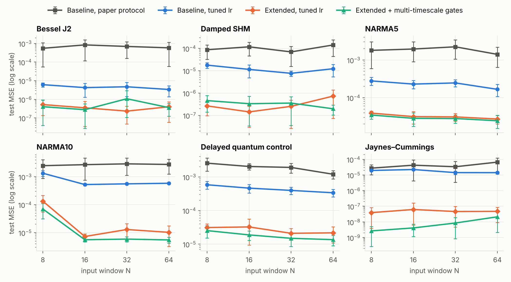
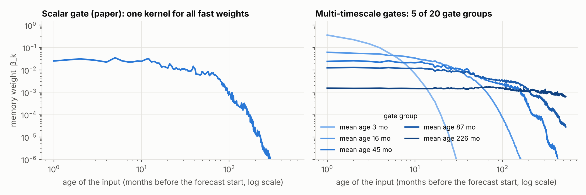

# Gated QKAN-FWP：論文分析、改進方向與實驗驗證

對象論文：*Gated QKAN-FWP: Scalable Quantum-inspired Sequence Learning*（arXiv:2605.06734）。
本報告做三件事：(1) 整理論文機制與其限制；(2) 提出可降低 MSE 的改進方向，並對應近期文獻；
(3) 以重現的 baseline 為基準做實驗，驗證哪些改進有效、哪些無效。

> 所有數字皆由本 repo 的程式產生（`results/*.jsonl`），重現指令見第 9 節。

## 摘要

| # | 發現 | 證據（最終數字皆為 5 seeds） |
|---|---|---|
| 1 | **論文協定下 baseline 嚴重訓練不足。** 模型與 epoch 數不變，只把 lr 換成 cosine schedule（初始 3e-2）。 | Time-series test MSE 幾何平均低 **8.5 倍**，24/24 格都變好 |
| 2 | **Residual 讀出 ＋ Δ-token**（把每步輸入從 `x_t` 換成 `(x_t, Δx_t, Δ²x_t)`）。 | 相對「已調好 lr 的 baseline」再低 **30 倍**（24/24）；相對論文協定低 259 倍 |
| 3 | **再加多時間尺度 gate**（每個 DARUAN 電路的每層一個 gate，chrono 初始化）。 | 再低 1.6 倍（20/24 格）；合計相對 tuned baseline 低 **48 倍**、相對論文協定低 **408 倍**（24/24） |
| 4 | **Solar：多時間尺度 gate。** | 論文的 split 上 scaled MSE **0.0184 → 0.0135（−27%，p < 0.001）**，低於論文報告的 0.0168；但換成 60/20/20 split 只剩 −7%（p = 0.07），效果大小依賴 split 與 early stopping |
| 5 | **對照組。** | 同參數量 LSTM 在調好 lr 後比 baseline FWP 好 2.6 倍；把同樣的 residual＋Δ-token 給 LSTM，表現與改進後的 FWP 相當。拿掉 fast-weight 記憶則差 1.9–2.5 倍 |
| 6 | **沒效的想法。** | 原始 lag patch（不做差分）、從 1e-3 開始的 cosine decay、solar 上單獨的 chrono init |

一句話：**在這些 benchmark 上，MSE 的瓶頸不是 gated fast-weight 記憶本身，而是（a）訓練協定、（b）讀出要自己
合成絕對數值、（c）programmer 每步只看到一個純量。** 修掉這三點後，記憶機制的改進（多時間尺度 gate）才看得出效果。

---

## 1. 論文在做什麼

**機制。** Fast Weight Programmer（FWP）不用 hidden state，而是讓 *slow programmer* 每一步產生
*fast programmer* 的參數更新。論文把兩個 programmer 都換成 HQKAN（Linear → QKAN → Linear，QKAN 的
edge activation 是單一 qubit 的 data re-uploading 電路 DARUAN），並把更新規則從相加改成 scalar gate：

```
y_t        = F(x_t; W_t)                      # fast programmer
(ΔW_t, g_t) = S(x_t)                          # slow programmer，只看當下輸入
W_{t+1}    = g_t · W_t + (1 − g_t) · ΔW_t     # Eq. 3，g_t ∈ [0,1] 是純量
```

**理論。** 因為 `(ΔW_t, g_t)` 不依賴 `W_{t-1}`，遞迴可展開成
`W_{T} = β_0 W_1 + Σ_k β_k ΔW_k`，`β_k = (1−g_k) Π_{s>k} g_s`（adaptive memory kernel）；
`W` 永遠落在歷史 proposals 的 convex hull 內（有界）；可用 prefix scan 平行計算；時間方向的梯度只經過
純量 `β`，不會爆炸（但論文 App. B.4 自己指出可能 vanish）。

**實驗與主要數字。**

| 實驗 | 設定 | 論文中 GQKAN-QKANFWP 的數字 |
|---|---|---|
| 6 個 time-series benchmark（Bessel、Damped SHM、NARMA5/10、DQC、Jaynes–Cummings） | 一步預測，window N ∈ {8,16,32,64}，[-1,1] 正規化，80/20 split，50 epochs、batch 4、lr 1e-3、5 seeds，報 final test MSE | 約 1e-5 ~ 3e-4（Table 3–6），159 個參數 |
| 太陽黑子週期（主結果） | 528 個月 → 132 個月 direct multi-step，80/10/10，peak-aware loss，100 epochs、batch 32 | scaled MSE **0.0168 ± 0.0016**、PAE 39.59、PTE 21.89，12,474 個參數 |
| MiniGrid RL、IonQ/IBM 真機推論 | — | 本報告未涉及 |

---

## 2. 可以改進的地方（與對應的近期研究）

下表是讀完論文後整理出的弱點。「實測」欄標示本報告是否做了實驗。

| # | 論文的做法 | 問題 | 改進方向 | 相關文獻 | 實測 |
|---|---|---|---|---|---|
| A1 | 訓練固定 lr = 1e-3、50 epochs、無 schedule，報最後一個 epoch | 模型遠未收斂；Table 3–6 的 std 常與 mean 同量級，就是訓練不足＋最後一步雜訊 | 調 learning rate ＋ cosine decay（同樣 epoch 數） | — | ✅ |
| A2 | 讀出 `y = F(x_T; W_T)` 要自己合成絕對數值 | 一步預測的主成分就是「上一個值」，網路容量花在學 identity | Residual 讀出 `ŷ = x_T + F(x_T; W_T)` | NLinear/DLinear（2205.13504）、RevIN | ✅ |
| A3 | Slow/fast programmer 每一步只看到一個純量 `x_t` | Proposal 與 gate 是 *context-free*：同一個數值在上升段與下降段得到完全相同的 `ΔW_t`、`g_t`；斜率資訊只能靠 gate 的 EMA 間接編碼 | Token 化：把 `x_t` 換成因果 patch。本報告提出用**差分座標** `(x_t, Δx_t, Δ²x_t)`（離散的相空間座標，各階差分正規化到單位變異） | PatchTST（2211.14730）；Takens delay embedding | ✅ |
| B1 | 單一純量 gate | 所有 fast weights 共用同一個記憶時間尺度；一次強寫入會把所有舊記憶一起洗掉 | 分組（vector）gate：每個 DARUAN 電路/每層一個 gate → 多時間尺度記憶；Eq. 4、有界性、平行 scan 逐組仍成立 | RWKV-7 vector-valued gating（2503.14456）、Mamba selective per-channel decay（2312.00752）、xLSTM（2405.04517）、HGRN（2311.04823） | ✅ |
| B2 | Gate 用預設初始化（g ≈ 0.5） | 初始記憶長度只有 ~2 步：`β_k ≈ 2^{-(T-k)}`，N=64 或 528 時早期輸入的梯度一開始就消失 | Chrono initialization：把 gate bias 設成對數等距的時間尺度 τ ∈ [2, N]，`g = 1 − 1/τ` | Tallec & Ollivier（1804.11188）、UR-LSTM（1910.09890）、LRU（2303.06349） | ✅ |
| B3 | 寫入與遺忘綁在一起（convex combination）；`β_k` 對年齡單調遞減 | 無法「只改寫某個 key 對應的內容」；無法選擇性記住特定 lag | Delta rule / 解耦的 erase key；momentum（二階）記憶；複數（旋轉）gate | Gated DeltaNet（2412.06464）、RWKV-7、DeltaProduct（2502.10297）、Titans（2501.00663）、Fast Weight Attention（2608.27763）、test-time regression（2501.12352） | ❌（第 7 節討論） |
| B4 | `ΔW_t` 與 fast network 的預測誤差無關 | 沒有「surprise」訊號；fast weights 不會因為預測錯了而更新更多 | 把上一步的預測誤差回饋給 slow programmer（recurrent FWP；會失去平行性） | Recurrent FWP（2106.06295）、Titans、MesaNet（2506.05233） | ❌ |
| C1 | 只有最後一步有 loss | 每個 window 只有一個監督訊號 | 每個 prefix 都算 loss（dense supervision） | — | ❌ |
| C2 | Slow decoder 直接輸出所有 fast weights | 太陽黑子模型 12.5k 參數中約 8.8k 在這個線性層 | Low-rank / outer-product / chunked hypernetwork | QFWP 的 `L ⊗ Q`（2402.17760） | ❌ |
| D1 | Sec. 6.1 沒有 classical baseline、沒有列出各層大小 | 無法判斷 benchmark 是否真的需要記憶機制；難以重現 | 加入同參數量的 LSTM 與「無記憶」對照組 | — | ✅ |

FWP 文獻整體脈絡可參考 Irie 的 review（2508.08435）與「Linear Transformers Are Secretly FWPs」
（2102.11174）：論文的 gated update 其實就是對 proposal 做 delta-rule
`W ← W + (1−g)(ΔW − W)`，而近兩年線性 RNN / state-space 模型的進展（Gated DeltaNet、RWKV-7、Mamba、
xLSTM）幾乎都集中在「更新規則的 gate 怎麼設計、怎麼初始化」——正是 B1–B3。

---

## 3. 實驗設定

### 3.1 重現 baseline

論文沒有公開 FWP 的程式，只說 QKAN 來自 [`qkan`](https://github.com/Jim137/qkan) 套件，所以本 repo 重新實作：

- **DARUAN / QKAN layer**（`qkanfwp/daruan.py`）：fast programmer 需要「每個樣本各自一組角度」，官方套件
  只支援共享參數，因此寫成 `(x, θ)` 的純函數。`tests/test_daruan.py` 驗證與官方 `torch_exact_solver`
  （`pz_encoding` ansatz）數值一致。
- **Gated FWP**（`qkanfwp/models.py`）：照論文 Eq. 3，先讀後寫（`y_T = F(x_T; W_T)`，`W_T` 只依賴
  `x_1..x_{T-1}`）。用 Eq. 4 的 closed form 在 log 空間計算 `β_k`，並測試與逐步遞迴等價。
- **層的大小論文沒有列出**，只有總參數量。我在 validation split 上比較了 5 種 ~160 參數的配置
  （`results/dev_baseline_arch.jsonl`），選最強的當 baseline，避免拿弱 baseline 當稻草人：

  | Benchmark | Slow HQKAN | Fast HQKAN | 參數量（論文） |
  |---|---|---|---|
  | Time-series | 1 → 3 → 3，reps 3 | 1 → 2 → 1，reps 3（16 個 fast 角度） | 152（159） |
  | Solar | 1 → 10 → 10，reps 3 | 1 → 10 → 20，reps 1（200 個 DARUAN 電路＝論文的數量，800 個 fast 角度）→ 132 | 12,423（12,474） |

  （一開始試的 1→6→3 / 1→2→2、reps 1 配置剛好是 159 個參數，但 validation MSE 是上表配置的 3.6 倍。）
- **資料**（`qkanfwp/data.py`）：方程式與參數照論文。論文沒寫 Bessel / SHM / DQC 的取樣點數，這裡統一用
  300 點（NARMA 的 M = 300 是論文給的；JC 3000 點也是）。因此 **time-series 的 MSE 絕對值不能直接和論文
  Table 3–6 比**，只能比同一份資料上的相對差異。太陽黑子用的是同一份 SILSO V2.0 月資料前 3,326 筆，
  絕對值可以和論文 Table 7 比。

### 3.2 兩種訓練協定

- **Paper protocol**：完全照論文（time-series：Adam、lr 1e-3、50 epochs、batch 4、報最後一個 epoch 的
  test MSE；solar：lr 2.5e-3、100 epochs、batch 32、取 validation loss 最低的 checkpoint）。
- **Tuned protocol**（只用在 time-series）：同樣 50 epochs、batch 4，但 lr 用 cosine decay 到 0，初始 lr
  由 validation 選（{1, 3, 10, 30, 100}×1e-3）。**Baseline 與改進模型各自選最好的 lr**，確保比較公平。
  選出的結果：baseline 3e-2（Jaynes–Cummings 為 1e-2）、Extended 3e-2、LSTM 1e-1、LSTM＋residual＋Δ-token 3e-2。

### 3.3 避免在 test set 上挑模型

所有設計決定（baseline 配置、要不要某個改進、lr）都只用 **dev protocol**：70/10/20 split 的 validation
部分、seeds 100–102。最終數字用論文的 80/20 split、**seeds 0–4**，這些 run 沒有參與任何決定。
Solar 照論文本來就有 validation split；pilot 用 seeds 100–101，最終用 seeds 0–4。

---

## 4. 結果一：time-series benchmarks（論文 Sec. 6.1）

比較四個模型：

- **Baseline, paper protocol**：重現的 GQKAN-QKANFWP，lr 1e-3（152 參數）。
- **Baseline, tuned lr**：同一個模型，只換訓練協定（A1）。
- **Extended**：＋ residual 讀出（A2）＋ Δ-token（A3），162 參數（多的 10 個是 encoder 接 3 維 token 的權重）。
- **Extended ＋ multi-timescale gates**：再加分組 gate 與 chrono 初始化（B1、B2），190 參數。

四者的 fast programmer 電路完全相同（2 個 DARUAN 電路、16 個 fast 角度）。「Extended」是在 validation 上選定的
模型；最終 test 顯示再加多時間尺度 gate 還能更好，所以兩者都列出。

### 4.1 主結果（論文的 80/20 split，seeds 0–4，test MSE，mean ± std）



| Dataset | N | Baseline, paper protocol (lr 1e-3) | Baseline, tuned lr | Extended (residual + Δ-tokens), tuned lr | Extended + multi-timescale gates, tuned lr |
|---|---|---|---|---|---|
| Bessel J2 | 8 | 5.49e-04 ± 5.2e-04 | 6.14e-06 ± 1.5e-06 | 5.25e-07 ± 3.9e-07 | **4.05e-07 ± 5.3e-07** |
| Bessel J2 | 16 | 8.35e-04 ± 7.2e-04 | 4.27e-06 ± 3.0e-06 | 3.52e-07 ± 4.3e-07 | **2.79e-07 ± 3.0e-07** |
| Bessel J2 | 32 | 6.90e-04 ± 5.3e-04 | 4.74e-06 ± 3.3e-06 | **2.34e-07 ± 1.9e-07** | 1.08e-06 ± 1.8e-06 |
| Bessel J2 | 64 | 5.81e-04 ± 5.8e-04 | 3.39e-06 ± 2.0e-06 | 4.00e-07 ± 3.4e-07 | **3.61e-07 ± 2.4e-07** |
| Damped SHM | 8 | 8.72e-05 ± 5.5e-05 | 1.78e-05 ± 5.0e-06 | **2.67e-07 ± 1.7e-07** | 4.60e-07 ± 3.2e-07 |
| Damped SHM | 16 | 1.18e-04 ± 7.2e-05 | 1.15e-05 ± 6.7e-06 | **1.44e-07 ± 1.1e-07** | 3.34e-07 ± 3.9e-07 |
| Damped SHM | 32 | 6.98e-05 ± 5.4e-05 | 7.67e-06 ± 2.0e-06 | **2.54e-07 ± 2.3e-07** | 3.56e-07 ± 3.3e-07 |
| Damped SHM | 64 | 1.42e-04 ± 9.8e-05 | 1.23e-05 ± 7.0e-06 | 7.30e-07 ± 6.6e-07 | **1.98e-07 ± 9.4e-08** |
| NARMA5 | 8 | 1.79e-03 ± 1.2e-03 | 2.78e-04 ± 6.6e-05 | 3.91e-05 ± 4.9e-06 | **3.47e-05 ± 7.7e-06** |
| NARMA5 | 16 | 1.94e-03 ± 1.1e-03 | 2.29e-04 ± 5.7e-05 | 3.16e-05 ± 1.2e-05 | **2.84e-05 ± 1.1e-05** |
| NARMA5 | 32 | 2.23e-03 ± 1.2e-03 | 2.46e-04 ± 5.1e-05 | 3.10e-05 ± 7.2e-06 | **2.81e-05 ± 6.9e-06** |
| NARMA5 | 64 | 1.40e-03 ± 7.7e-04 | 1.67e-04 ± 5.9e-05 | 2.72e-05 ± 7.2e-06 | **2.45e-05 ± 9.1e-06** |
| NARMA10 | 8 | 2.48e-03 ± 1.6e-03 | 1.33e-03 ± 3.1e-04 | 1.33e-04 ± 7.9e-05 | **7.02e-05 ± 3.9e-05** |
| NARMA10 | 16 | 2.70e-03 ± 1.9e-03 | 5.24e-04 ± 4.5e-05 | 7.26e-06 ± 1.8e-06 | **5.57e-06 ± 9.3e-07** |
| NARMA10 | 32 | 2.89e-03 ± 1.8e-03 | 5.56e-04 ± 3.1e-05 | 1.29e-05 ± 7.9e-06 | **5.87e-06 ± 1.2e-06** |
| NARMA10 | 64 | 2.75e-03 ± 1.5e-03 | 5.83e-04 ± 5.1e-05 | 1.03e-05 ± 7.1e-06 | **5.48e-06 ± 1.3e-06** |
| Delayed quantum control | 8 | 2.56e-03 ± 1.1e-03 | 5.83e-04 ± 1.5e-04 | 3.12e-05 ± 8.8e-06 | **2.53e-05 ± 1.0e-05** |
| Delayed quantum control | 16 | 2.04e-03 ± 4.3e-04 | 4.63e-04 ± 1.3e-04 | 3.25e-05 ± 2.3e-05 | **1.88e-05 ± 5.9e-06** |
| Delayed quantum control | 32 | 1.91e-03 ± 6.1e-04 | 3.96e-04 ± 9.7e-05 | 2.10e-05 ± 8.0e-06 | **1.49e-05 ± 6.4e-06** |
| Delayed quantum control | 64 | 1.20e-03 ± 3.3e-04 | 3.37e-04 ± 8.5e-05 | 2.17e-05 ± 1.1e-05 | **1.36e-05 ± 4.6e-06** |
| Jaynes–Cummings | 8 | 2.75e-05 ± 1.7e-05 | 1.95e-05 ± 2.5e-06 | 3.93e-08 ± 4.2e-08 | **2.66e-09 ± 2.4e-09** |
| Jaynes–Cummings | 16 | 4.25e-05 ± 4.8e-05 | 2.24e-05 ± 3.5e-06 | 6.22e-08 ± 9.9e-08 | **4.12e-09 ± 3.0e-09** |
| Jaynes–Cummings | 32 | 3.38e-05 ± 4.1e-05 | 1.42e-05 ± 3.6e-06 | 4.63e-08 ± 5.2e-08 | **8.50e-09 ± 1.1e-08** |
| Jaynes–Cummings | 64 | 6.66e-05 ± 5.4e-05 | 1.42e-05 ± 2.6e-06 | 4.73e-08 ± 3.8e-08 | **2.12e-08 ± 3.4e-08** |

24 個 (dataset, N) 組合的幾何平均：

| 比較 | Test MSE 比值（幾何平均） | 勝出格數 |
|---|---|---|
| Baseline tuned lr ÷ baseline paper protocol | 0.117（**低 8.5 倍**） | 24 / 24 |
| Extended ÷ baseline paper protocol | 0.0039（**低 259 倍**） | 24 / 24 |
| Extended ÷ baseline tuned lr | 0.033（**低 30 倍**） | 24 / 24 |
| Extended＋multi-timescale gates ÷ Extended | 0.64（低 1.6 倍） | 20 / 24 |
| Extended＋multi-timescale gates ÷ baseline tuned lr | 0.021（**低 48 倍**） | 24 / 24 |
| Extended＋multi-timescale gates ÷ baseline paper protocol | 0.0025（**低 408 倍**） | 24 / 24 |

- 最保守的比較（兩邊都用各自最好的 lr）下，Extended 在每一格都贏，最小差距 6 倍（NARMA5, N=64），
  最大約 500 倍（Jaynes–Cummings）；加上多時間尺度 gate 後是 4.4 倍到約 7000 倍。
- **光是調 lr 就讓 baseline 的 MSE 低 8.5 倍**，且 seed 間的 std/mean 中位數從 0.64 降到 0.25。這表示在本重現中，
  論文協定（lr 1e-3、50 epochs）下的數字主要反映「還沒訓練完」，而不是模型的表達能力；論文 Table 3–6 中
  std ≈ mean 的現象，以及 Appendix C 提到訓練到 100 epochs 仍在進步，都與此一致。

### 4.2 Ablation：每個元件貢獻多少

5 個 300 點序列 × N ∈ {16, 64}，數字是「該 variant 的 seed-mean test MSE ÷ 論文協定 baseline」的幾何平均
（越小越好；大點＝幾何平均，小點＝單一 dataset）。


| Variant | Params | Geo-mean MSE ratio vs baseline | Cells better than baseline | Bessel J2 | Damped SHM | NARMA5 | NARMA10 | Delayed quantum control |
|---|---|---|---|---|---|---|---|---|
| Ungated (additive) FWP, lr 1e-3 | 148 | **4** | 3/10 | 1.8 | 24 | 3.1 | 1.4 | 5.5 |
| Baseline + multi-timescale gates, lr 1e-3 | 180 | **0.53** | 8/10 | 0.081 | 0.67 | 0.62 | 0.72 | 1.7 |
| Baseline + residual read-out, lr 1e-3 | 152 | **0.18** | 8/10 | 0.013 | 0.16 | 0.2 | 0.36 | 1.2 |
| Baseline + Δ-tokens, lr 1e-3 | 162 | **0.3** | 8/10 | 0.33 | 2.7 | 0.18 | 0.044 | 0.38 |
| Extended (residual + Δ-tokens), lr 1e-3 | 162 | **0.035** | 10/10 | 0.011 | 0.062 | 0.052 | 0.02 | 0.073 |
| Baseline, tuned lr | 152 | **0.079** | 10/10 | 0.0055 | 0.092 | 0.12 | 0.2 | 0.25 |
| Larger baseline (193 params), tuned lr | 193 | **0.074** | 10/10 | 0.0038 | 0.092 | 0.11 | 0.2 | 0.28 |
| Baseline + multi-timescale gates, tuned lr | 180 | **0.056** | 10/10 | 0.005 | 0.064 | 0.12 | 0.058 | 0.24 |
| Baseline + residual read-out, tuned lr | 152 | **0.062** | 10/10 | 0.0023 | 0.02 | 0.18 | 0.26 | 0.43 |
| Baseline + residual + multi-timescale gates, tuned lr | 180 | **0.038** | 10/10 | 0.0013 | 0.0091 | 0.19 | 0.1 | 0.34 |
| Baseline + Δ-tokens, tuned lr | 162 | **0.019** | 10/10 | 0.0092 | 0.047 | 0.032 | 0.005 | 0.033 |
| Extended (residual + Δ-tokens), tuned lr | 162 | **0.0042** | 10/10 | 0.00054 | 0.0025 | 0.018 | 0.0032 | 0.017 |
| Extended + multi-timescale gates, tuned lr | 190 | **0.0031** | 10/10 | 0.00046 | 0.002 | 0.016 | 0.002 | 0.01 |
| No fast-weight memory: HQKAN on last Δ-token, tuned lr | 149 | **0.0078** | 10/10 | 0.00032 | 0.0086 | 0.027 | 0.015 | 0.026 |
| LSTM (hidden 5), tuned lr | 166 | **0.03** | 10/10 | 0.00098 | 0.061 | 0.091 | 0.068 | 0.068 |
| LSTM + residual + Δ-tokens, tuned lr | 149 | **0.0034** | 10/10 | 0.00042 | 0.0023 | 0.013 | 0.0042 | 0.0088 |

讀法：

- **Gate 是必要的。** 拿掉 gate（論文的 ungated FWP）MSE 變 4 倍，重現了論文「gated > ungated」的結論。
- **A1 學習率**：0.079，是單一最大的因素。把 baseline 加大到 193 個參數幾乎沒差（0.074），所以後面的增益不是
  來自參數變多。
- **A3 Δ-token** 單獨就有 0.019（比 tuned baseline 低 4 倍），**A2 residual** 單獨是 0.062；兩者合起來 0.0042，
  遠好於各自——residual 把「上一個值」交給 skip path，Δ-token 提供斜率與曲率，fast programmer 只需要學增量。
- **B1+B2 多時間尺度 gate**：在論文協定下有 0.53（主要是 chrono 初始化讓梯度一開始就能傳到早期輸入）；調好 lr
  後單獨加只剩 0.71 倍的額外增益（0.079 → 0.056）；疊在 Extended 上則是穩定的 0.75 倍（0.0042 → 0.0031，
  9/10 格變好）。
- **在論文協定（lr 1e-3）下**，Extended 也有 0.035（低 29 倍，10/10 格），所以結構上的改進不依賴調 lr。

### 4.3 對照組：這些 benchmark 真的需要 fast-weight 記憶嗎？

| 比較（tuned lr；同 10 格） | Test MSE 比值 | 勝出格數 |
|---|---|---|
| Extended ÷ 無記憶對照組（靜態 HQKAN 只看最後一個 Δ-token，149 參數） | 0.54 | 9 / 10 |
| Extended＋多時間尺度 gate ÷ 無記憶對照組 | 0.40 | 9 / 10 |
| LSTM（hidden 5，166 參數）÷ baseline FWP | 0.38 | 9 / 10 |
| Extended ÷ LSTM＋residual＋Δ-token（149 參數） | 1.23 | 3 / 10 |
| Extended＋多時間尺度 gate ÷ LSTM＋residual＋Δ-token | 0.92 | 5 / 10 |

- **記憶有用，但不是主角。** 只用最後三個值的無記憶模型就已經達到 0.0078；fast-weight 記憶再帶來 1.9–2.5 倍，
  集中在需要較長歷史的 NARMA10（4.8–7 倍）、Damped SHM（3.4–4.3 倍）與 DQC；Bessel 上無記憶模型反而略好。
  也就是說，論文 Sec. 6.1 的 benchmark 大部分是「局部 AR(3)」問題，不太能鑑別長期記憶機制的好壞。
- **調好 lr 後，同大小的普通 LSTM 比 baseline GQKAN-QKANFWP 好 2.6 倍。** 論文 Sec. 6.1 沒有放 classical
  baseline，這點值得補上。
- **把同樣的 residual＋Δ-token 給 LSTM，它和改進後的 FWP 打平**（0.92–1.23 倍，互有勝負）。所以 A2/A3 是
  通用的輸入/讀出改進，不是 FWP 專屬；改進後的 QKAN-FWP 在準確度上「追平」而非「超越」同大小 LSTM，它的賣點
  仍是論文強調的平行性與單 qubit 電路。

### 4.4 論文的其他 variant 也受益

N = 16、5 seeds。GQKAN-FWP（HQKAN slow＋linear fast）與 G-QKANFWP（classical slow＋HQKAN fast）套用同樣的
residual＋Δ-token：

| Dataset | N | GQKAN-FWP, paper protocol | GQKAN-FWP, tuned lr | GQKAN-FWP extended, tuned lr | G-QKANFWP, paper protocol | G-QKANFWP, tuned lr | G-QKANFWP extended, tuned lr |
|---|---|---|---|---|---|---|---|
| Bessel J2 | 16 | 1.68e-03 ± 1.5e-03 | 6.23e-06 ± 5.6e-06 | **1.10e-07 ± 1.1e-07** | 3.56e-04 ± 4.8e-04 | 2.62e-06 ± 2.8e-07 | 2.47e-07 ± 1.4e-07 |
| Damped SHM | 16 | 1.01e-03 ± 1.2e-03 | 2.71e-06 ± 2.5e-06 | **1.67e-07 ± 1.4e-07** | 5.80e-05 ± 5.3e-05 | 1.00e-05 ± 3.8e-06 | 4.39e-07 ± 2.9e-07 |
| NARMA5 | 16 | 1.65e-03 ± 7.3e-04 | 3.87e-04 ± 2.0e-04 | 2.85e-05 ± 5.2e-06 | 1.54e-03 ± 7.0e-04 | 1.66e-04 ± 2.3e-05 | **2.67e-05 ± 6.0e-06** |
| NARMA10 | 16 | 2.53e-03 ± 1.2e-03 | 6.28e-04 ± 1.2e-04 | **5.97e-06 ± 1.3e-06** | 2.01e-03 ± 1.1e-03 | 4.79e-04 ± 9.5e-06 | 6.54e-06 ± 3.2e-06 |
| Delayed quantum control | 16 | 2.53e-02 ± 3.5e-02 | 1.55e-03 ± 2.4e-04 | 3.10e-05 ± 5.1e-06 | 1.63e-03 ± 8.7e-04 | 4.72e-04 ± 6.8e-05 | **2.03e-05 ± 4.4e-06** |

三種架構的結論一致：先調 lr（低一到兩個數量級），再加 residual＋Δ-token（再低一到兩個數量級）。

---

## 5. 結果二：太陽黑子週期預測（論文 Sec. 6.2，主結果）

這個任務的輸入長度是 528，是真正考驗記憶機制的地方。Δ-token 在月資料上雜訊太大，所以這裡測的是
**記憶機制的改動**：多時間尺度 gate（fast QKAN 的 20 個輸出節點各一個 gate，chrono 初始化 τ ∈ [2, 528] 個月）、
單獨的 chrono 初始化、以及年尺度 patch token（12 個月一個 token、stride 12）。訓練協定完全照論文
（lr 2.5e-3、100 epochs、batch 32、peak-aware loss、取 validation loss 最低的 checkpoint）。

### 5.1 論文的 split（80/10/10，test 目標期間 1993–2026）

| Model | Params | Scaled MSE ↓ | PAE ↓ | PTE ↓ | Val. loss ↓ | Seeds |
|---|---|---|---|---|---|---|
| GQKAN-QKANFWP baseline (scalar gate) | 12,423 | 0.0184 ± 0.0005 | 45.17 ± 2.10 | 29.76 ± 2.93 | 2.534 ± 0.053 | 5 |
| + chrono gate initialisation (scalar gate) | 12,423 | 0.0185 ± 0.0016 | 46.27 ± 2.13 | 29.63 ± 2.26 | 2.520 ± 0.057 | 5 |
| + multi-timescale gates (20 groups, chrono init) | 12,632 | **0.0135 ± 0.0013** | 42.19 ± 0.92 | 29.59 ± 4.13 | 2.651 ± 0.151 | 5 |
| + multi-timescale gates + yearly patch tokens | 12,852 | 0.0139 ± 0.0009 | 40.94 ± 1.81 | 25.24 ± 4.86 | 2.627 ± 0.130 | 5 |
| Baseline, lr 1e-3 | 12,423 | 0.0177 ± 0.0010 | 45.78 ± 2.77 | 26.06 ± 2.16 | 2.509 ± 0.112 | 5 |
| + multi-timescale gates, lr 1e-3 | 12,632 | 0.0137 ± 0.0011 | **40.84 ± 1.68** | **23.32 ± 6.34** | 2.666 ± 0.116 | 5 |

（前四列用論文選的 lr 2.5e-3；Val. loss 是選 checkpoint 用的 peak-aware validation loss。相對第一列 baseline 的
scaled MSE 變化與 Welch t-test：chrono +0.9%（p = 0.85）、多時間尺度 gate −26.7%（p = 0.0008）、
＋年尺度 patch −24.3%（p = 0.0001）、baseline lr 1e-3 −3.4%（p = 0.29）、多時間尺度 gate lr 1e-3 −25.2%（p = 0.0004）。）


- **重現的 baseline：0.0184 ± 0.0005**；論文報告自己的模型是 0.0168 ± 0.0016（PAE 39.59、PTE 21.89）。量級一致，
  但 PAE / PTE 我的重現比論文差，所以下面的改進幅度是「相對於我重現的 baseline」。
- **多時間尺度 gate：0.0135 ± 0.0013，−27%（Welch p = 0.0008）**，只多 209 個參數（+1.7%）。PAE 也改善
  （45.2 → 42.2，p = 0.04），PTE 沒變。用論文 lr 候選中的 1e-3 結論相同（0.0177 → 0.0137，−23%，p = 0.0006）。
- **單獨的 chrono 初始化沒有用**（0.0185）：純量 gate 即使初始化成長記憶，仍然只有一個時間尺度。增益來自
  「分組」而不是「初始化」。
- **年尺度 patch token** 沒有進一步降低 MSE（0.0139），但 PAE（40.9）與 PTE（25.2）最好，而且序列長度從 528
  降到 44，訓練快約 40%。

學到的 memory kernel（最後一個 test window、seed 0）直接顯示差異：純量 gate 只有一個約 40–80 個月的時間尺度，
分組 gate 則同時保有從 3 個月到約 19 年的多個尺度。



### 5.2 這個結果有多穩？

Test 期間只涵蓋約兩個半太陽週期，所以我另外做了三個檢查：換 lr、不做 checkpoint 選擇（看最後一個 epoch）、
以及換成 test 涵蓋五個週期的 60/20/20 split。**結論是：方向大致一致，但幅度沒有 −27% 那麼穩。**

60/20/20 split（lr 2.5e-3、best-val checkpoint、5 seeds）：

| Model | Params | Scaled MSE ↓ | PAE ↓ | PTE ↓ | Val. loss ↓ | Seeds |
|---|---|---|---|---|---|---|
| GQKAN-QKANFWP baseline (scalar gate) | 12,423 | 0.0175 ± 0.0006 | **76.19 ± 6.64** | **29.13 ± 2.03** | 4.039 ± 0.165 | 5 |
| + multi-timescale gates (20 groups, chrono init) | 12,632 | **0.0162 ± 0.0010** | 79.85 ± 5.03 | 31.35 ± 0.49 | 3.494 ± 0.191 | 5 |

彙整所有檢查（數字皆為 test scaled MSE）：

| 檢查 | Baseline | 多時間尺度 gate | 差異 |
|---|---|---|---|
| 論文 split、best-val checkpoint、lr 2.5e-3（＝5.1） | 0.0184 ± 0.0005 | 0.0135 ± 0.0013 | −27%（p = 0.0008） |
| 論文 split、best-val checkpoint、lr 1e-3 | 0.0177 ± 0.0010 | 0.0137 ± 0.0011 | −23%（p = 0.0006） |
| 論文 split、**最後一個 epoch**、lr 1e-3 | 0.0148 ± 0.0017 | 0.0123 ± 0.0010 | −17%（p = 0.04） |
| 論文 split、**最後一個 epoch**、lr 2.5e-3 | 0.0164 ± 0.0016 | 0.0168 ± 0.0042 | +2%（p = 0.86，無差異） |
| 論文 split、**validation 期間**的 MSE（lr 2.5e-3） | 0.0136 ± 0.0004 | 0.0139 ± 0.0007 | +2%（p = 0.41，無差異） |
| **60/20/20 split**（test 目標 1971–2026，五個週期）、best-val | 0.0175 ± 0.0006 | 0.0162 ± 0.0010 | −7%（p = 0.07） |


- 分組 gate 的模型**學得快很多**（最佳 epoch 約 31，baseline 約 78），之後開始 overfit；lr 2.5e-3 訓練滿
  100 epochs 時優勢消失；在 60/20/20 split 上不做 checkpoint 選擇的話甚至明顯變差（最後一個 epoch 的 test MSE
  0.03–0.07，baseline 約 0.019）。所以它需要 early stopping 或較小的 lr。
- 在 60/20/20 split 上，增益集中在 2000 年後開始的預測（SC24、SC25），1977–1982 與 1989–1992 開始的預測反而
  略差；PAE / PTE 沒有改善。
- 論文 split 的 validation loss 本身並不偏好分組 gate（2.65 vs 2.53）；它在 60/20/20 split 上才偏好（3.49 vs 4.04）。

**我的判斷：** 多時間尺度 gate 在 solar 上是「有希望、但證據中等」的改進——上表 6 個比較中 3 個顯著較好、
1 個邊緣（p = 0.07）、2 個無差異；而不做 early stopping 時它可能更差。它不像 time-series 的結果那樣在每個條件下
都成立。要寫進論文，建議用 rolling-origin 的多個 split 加上固定的 early-stopping 規則再確認一次。

---

## 6. 沒有效果的想法

| 想法 | 結果 | 可能原因 |
|---|---|---|
| 原始 lag patch `(x_{t-p+1}, …, x_t)`，p = 2, 3, 4（不做差分） | 論文協定下 validation MSE 是 baseline 的 1.0–1.8 倍 | 平滑序列中相鄰值幾乎相同，斜率資訊的量級太小，50 epochs 內學不出大的差分權重；改成單位變異的差分座標後就有效 |
| 從 lr 1e-3 開始的 cosine decay | validation MSE 變 2 倍 | 本來就訓練不足，decay 等於再砍一半有效步數；要搭配更大的初始 lr |
| 固定大 lr（3e-2）不 decay（Extended 模型） | validation MSE 比 cosine 差 13 倍 | 後期在最小值附近震盪 |
| cosine 初始 lr 1e-1 | 比 3e-2 差 3–6 倍 | 太大 |
| Solar：單獨的 chrono 初始化（純量 gate） | 0.0185 vs 0.0184 | 一個 gate 只有一個時間尺度 |
| Solar：調 lr（cosine 5e-3 / 1e-2） | validation 變差 | Solar 是 generalization-limited，不是 optimization-limited |
| Time-series：多時間尺度 gate 單獨加在 tuned baseline 上 | 只有 0.71 倍 | 這些 benchmark 需要的記憶很短（4.3 節） |

（前四列與 solar 調 lr 來自 dev protocol 的 validation 結果，見 `results/dev_screen.jsonl`、`results/dev_solar.jsonl`。）

---

## 7. 還沒做、但值得做的方向

依「預期效益 / 實作成本」排序：

1. **Dense supervision（C1）。** 目前每個 window 只在最後一步算 loss。Eq. 4 的 closed form 可以一次算出所有
   prefix 的 `W_t`（prefix scan），等於每個 window 多出 N−1 個免費的監督訊號，也會強迫 gate 在任何長度
   下都合理。
2. **Innovation / surprise 回饋（B4）。** 本報告的 Δ-token 其實是「預測誤差回饋」的零階近似：有 residual
   讀出時，上一步的預測誤差是 `e_t = Δx_t − F_{t−1}`；把 `F_{t−1}` 當 0 就得到 Δ-token。真正把 `e_t`
   餵回 slow programmer（Recurrent FWP、Titans 的 surprise、Kalman filter 的 innovation）是自然的下一步，
   代價是失去「proposal 不依賴 `W_{t−1}`」這個平行性。可以先在 solar 上試，因為那裡 Δ-token 太吵。
3. **Keyed / delta-rule 寫入（B3）。** 對 linear fast programmer（GQKAN-FWP）可以直接套 Gated DeltaNet 的
   `W ← g·W(I − β k kᵀ) + β v kᵀ`：只擦掉與當前 key 相關的方向，不會整體衰減。對 DARUAN 角度則可以把
   本報告的分組 gate 看成「對角線版本」，再往 low-rank erase 推廣（RWKV-7 的 decoupled removal/addition key）。
4. **Momentum / 二階記憶。** `S_t = η_t S_{t−1} + (1−g_t)(ΔW_t − W_t)`，`W_{t+1} = W_t + S_t`（Titans）。
   仍是 `(W, S)` 的線性遞迴，可用 2×2 的 prefix scan 平行化，且特徵值可為複數 → 振盪型 memory kernel，
   可以選擇特定 lag（目前的 `β_k` 只能隨年齡單調遞減）。
5. **Low-rank proposal（C2）。** Solar 模型有 71% 的參數在 slow decoder（10 → 801）。改成 outer product 或
   chunked hypernetwork 可以把參數挪去加寬 QKAN，或在同參數量下放更多 DARUAN 電路。
6. **把本報告的改進帶到 RL（MiniGrid）與 traffic-matrix（2606.27821）。** 多維輸入下 Δ-token 要逐 channel
   做；多時間尺度 gate 則可直接使用。
7. **硬體相容性。** 本報告所有改動都在古典側（token 進入古典 encoder、residual 是古典加法、gate 作用在角度
   上），fast programmer 執行的單 qubit 電路與論文完全相同，因此論文 Sec. 6.2.1 的真機推論流程不需要改；
   但這點本報告沒有實測。

## 8. 限制

- 這是**獨立重現**，不是官方程式；層的大小、取樣點數等論文未給的細節是我選的（3.1 節）。Time-series 的
  絕對 MSE 不能與論文表格直接比較。
- Tuned protocol 的 lr 只掃了 {1, 3, 10, 30, 100}×1e-3，schedule 只試了 cosine。
- Solar 的 validation 與 test 涵蓋不同的太陽週期，兩者排序不一致（5.2 節），結論要看 5 個 seed 的 test 統計，
  不能只看單一 run。
- 沒有做 MiniGrid RL 與真機實驗；論文 Table 7 的 classical baselines（LSTM、WaveNet-LSTM、MESN…）也沒有重跑。
- Δ-token 假設輸入是純量且夠平滑；在高雜訊資料（如月太陽黑子數）上沒有採用。

## 9. 重現

```bash
pip install -r requirements.txt
python -m pytest tests -q          # 37 個測試
bash experiments/run_all.sh        # 全部實驗（約 7 CPU core-hours；已完成的 job 會自動跳過）
python experiments/make_figures.py # 產生 figures/ 與 results/tables.md
```

環境：Python 3.13、PyTorch 2.15（CPU）、`qkan` 0.2.3（只用於測試對照）。

## 參考文獻

- Gated QKAN-FWP — arXiv:2605.06734；後續應用：traffic-matrix forecasting — arXiv:2606.27821
- QKAN / DARUAN — arXiv:2509.14026；QKAN-LSTM — arXiv:2512.05049；QFWP — arXiv:2402.17760
- FWP 與 linear transformer：arXiv:2102.11174、2106.06295、review 2508.08435
- Gate / 更新規則：Gated Linear Attention 2312.06635、Gated DeltaNet 2412.06464、RWKV-7 2503.14456、
  DeltaProduct 2502.10297、Titans 2501.00663、Fast Weight Attention 2608.27763、test-time regression
  2501.12352、Longhorn 2407.14207、MesaNet 2506.05233
- 多時間尺度 / 初始化：chrono init 1804.11188、UR-LSTM 1910.09890、HGRN 2311.04823、LRU 2303.06349、
  Mamba 2312.00752、xLSTM 2405.04517
- Time-series 表徵：PatchTST 2211.14730、DLinear/NLinear 2205.13504
- 資料：SILSO World Data Center, Royal Observatory of Belgium（monthly mean total sunspot number V2.0）
