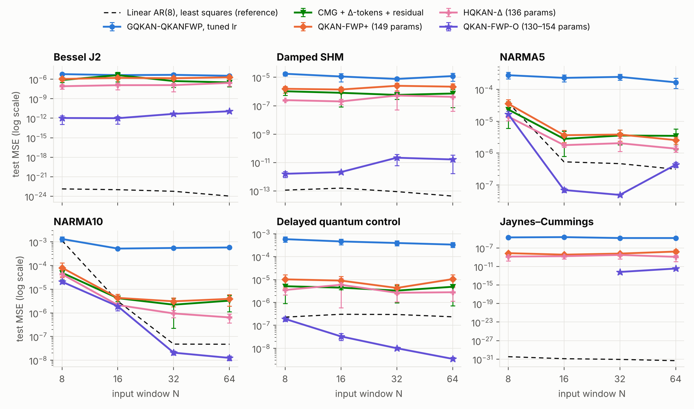
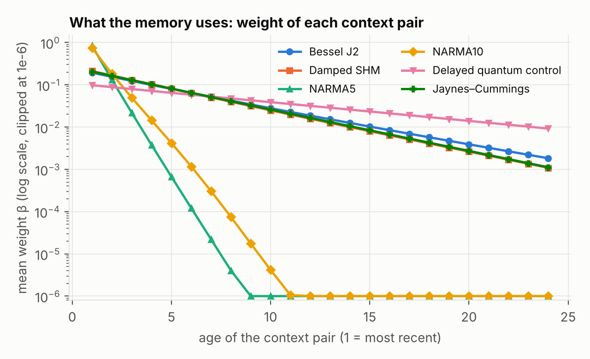
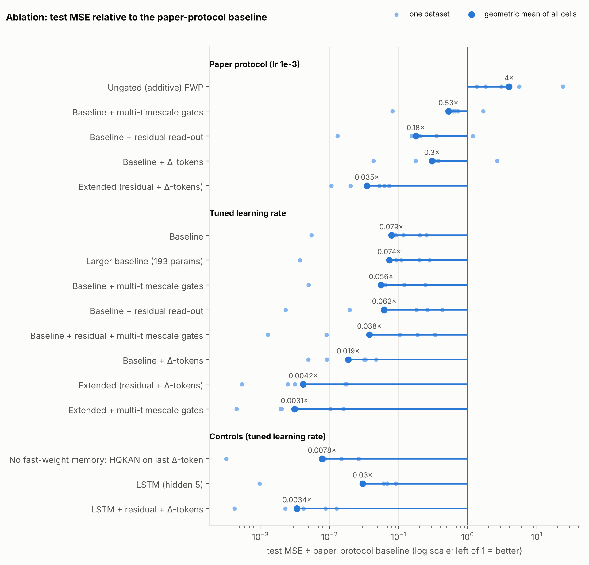
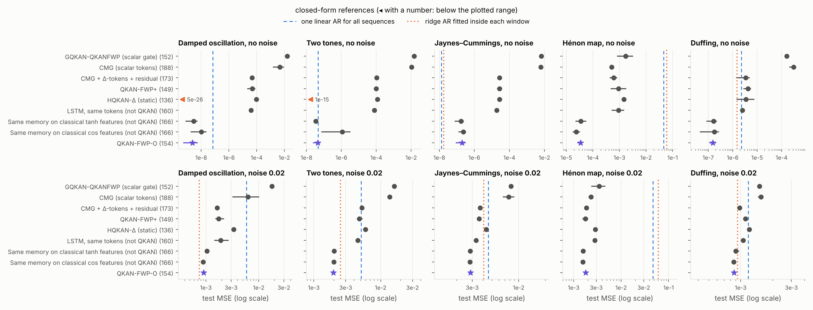
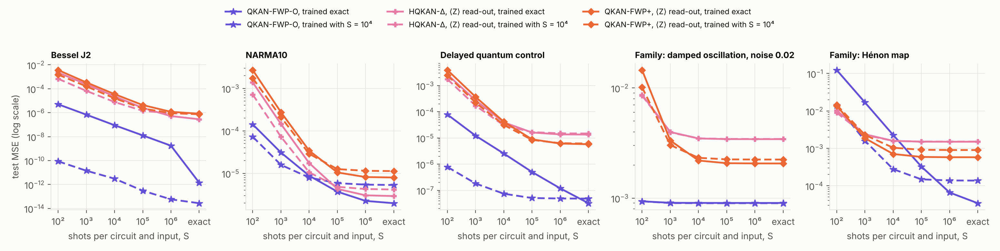
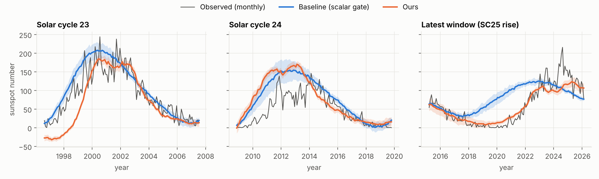
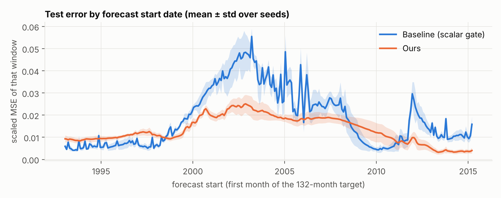
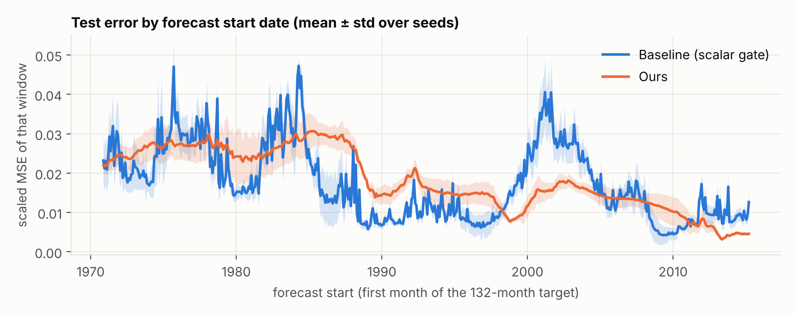

# Gated QKAN-FWP：重現、分析與改進

對象論文：*Gated QKAN-FWP: Scalable Quantum-inspired Sequence Learning*（arXiv:2605.06734）。

這份報告包含四件事：

1. 論文機制的整理，以及一份獨立的重新實作（論文沒有公開 fast-weight programmer 的程式）；
2. 兩個在輸入表徵與讀出上改進的模型：**QKAN-FWP+**（保留論文的 gated fast-weight 架構）與 **HQKAN-Δ**（沒有 fast weights 的對照組）；
3. 一個新的架構 **QKAN-FWP-O**：把 fast weights 從「電路的旋轉角」換成「電路的量測算符」，讓記憶可以用 context 內的預測誤差
   以封閉形式寫入；
4. 對 benchmark 本身的檢查：線性參考線、與論文印出數字的可比性、以及幾個實作選擇的影響。

所有模型都是 QKAN-based，參數量不超過論文的 159 個（太陽黑子：不超過 12,474 個）。
所有數字皆由本 repo 的程式產生（`results/*.jsonl`），重現方式見第 11 節。

## 摘要

### 模型

| 模型 | 是什麼 | 參數量（論文的 GQKAN-QKANFWP：159） |
|---|---|---|
| 重新實作的 GQKAN-QKANFWP、CMG | Baseline：論文的 scalar gate，以及後續論文的逐座標互補 gate（arXiv:2607.27945） | 152、188 |
| **QKAN-FWP+** | 論文的 gated fast-weight 架構 ＋ Δ-token ＋ residual 讀出 ＋ 每個電路一個 gate | 149 |
| **HQKAN-Δ** | 同樣的 token 與讀出，但沒有 fast weights 的靜態 HQKAN（對照組） | 136 |
| **QKAN-FWP-O** | Fast weights 是 DARUAN 電路的**量測算符**；context 以 gated 最小平方寫入（閉迴路），封閉形式沿用論文的 gated 遞迴 | 130–154 |

### 主要結果

論文的六個 benchmark（test MSE，對四個 window 取幾何平均，5 seeds）：

| Dataset | Best printed in the two papers | GQKAN-QKANFWP, tuned lr (152) | CMG, tuned lr (188) | CMG + Δ-tokens + residual (173) | QKAN-FWP+ (149) | HQKAN-Δ (136) | QKAN-FWP-O (130–154) | *Linear AR(8) (9)* |
|---|---|---|---|---|---|---|---|---|
| Bessel J2 | 5.3e-06 | 4.5e-06 | 2.7e-06 | 8.6e-07 | 1.5e-06 | 1.4e-07 | **2.8e-12** | *5.3e-24* |
| Damped SHM | 8.8e-06 | 1.2e-05 | 2.5e-06 | 7.7e-07 | 1.9e-06 | 3.2e-07 | **5.9e-12** | *9.0e-14* |
| NARMA5 | 6.5e-06 | 2.3e-04 | 2.8e-04 | 5.4e-06 | 6.0e-06 | 2.9e-06 | **4.0e-07** | *1.3e-06* |
| NARMA10 | 9.5e-06 | 6.9e-04 | 7.6e-04 | 6.3e-06 | 8.1e-06 | 2.7e-06 | **3.2e-07** | *1.7e-06* |
| Delayed quantum control | 5.5e-06 | 4.4e-04 | 7.5e-04 | 4.4e-06 | 8.0e-06 | 3.5e-06 | **2.2e-08** | *2.6e-07* |
| Jaynes–Cummings | 7.6e-06 | 1.7e-05 | – | – | 7.4e-09 | **1.7e-09** | – | *1.1e-31* |

1. **QKAN-FWP-O 在論文的 benchmark 上比其他所有訓練出來的模型低兩到五個數量級**（5.1 節），參數量不超過論文。
   消融顯示收益來自閉迴路的記憶：拿掉 fast weights 差兩個數量級，把封閉形式的最小平方換成逐步的 delta rule 也差不多退回原點（5.4 節）。
2. **論文型態的記憶（由 slow programmer 產生旋轉角）在這些 benchmark 上沒有幫助**：沒有 fast weights 的 HQKAN-Δ
   在每一格都比 QKAN-FWP+ 好（15 個 seed 合計 2.5 倍），也比給了相同 token 的 CMG 好。有用的是記憶的型態，不是有沒有記憶。
3. **在每條序列物理參數都不同的系統族上**（第 6 節：模型必須從 16 步的視窗辨識系統），QKAN-FWP-O 在 10 格中的 9 格最低、
   1 格打平：沒有雜訊時比其他神經模型低 15 倍到 2 萬倍，有雜訊時低 1.1–2.3 倍；在非線性的 Hénon map 上比兩條線性參考線低
   30–1300 倍，在有雜訊的線性族上與「在視窗內擬合 ridge AR」的 oracle 相當或更好。
4. **太陽黑子**（第 8 節）：QKAN-FWP-O 的參數化以約 500 個參數（論文模型的 4%）在三種 split 上都得到比 baseline 低 19–25% 的 MSE
   （validation 與 test 一致）；這個收益不是來自記憶。

### 解讀這些數字時必須知道的事

1. **六個 benchmark 幾乎是線性問題。** 一個 9 參數的線性 AR(8)（最小平方，不需要訓練）在大多數格子贏過兩篇論文印出的
   最佳數字，也贏過 QKAN-FWP+ 與 HQKAN-Δ；QKAN-FWP-O 只在 NARMA 與 DQC 上低於它（5.2 節）。QKAN-FWP-O 對其他神經模型的
   巨大差距，主要是「在 context 內直接解最小平方」對「用 SGD 逼近線性映射」的差距。
2. **量子電路的特徵只在非線性系統上有貢獻。** 在論文的 benchmark 與線性的系統族上，只留線性項的古典對照組和完整模型差不多
   （無雜訊的線性族上甚至更準）；在 Hénon map 上拿掉 Bloch 特徵則差 22–1164 倍（5.4、6 節）。整個模型可以古典模擬，不主張量子優勢。
3. **沒有重現論文印出的 baseline 數字。** 重新實作的 GQKAN-QKANFWP 在論文協定下比論文印出的數字差 21 倍（幾何平均），
   調過 lr 後差 1.9 倍；原因沒有找到（5.3 節）。所有「低幾倍」的結論都是同一個 pipeline 內的比較。
4. **In-context 最小平方不是新方法**（ALPaCA、R2D2、mesa-layer、delta rule）。本報告的貢獻是指出 QKAN 層對量測算符是線性的，
   因此 QKAN-FWP 可以有封閉形式的閉迴路寫入，而且它的充分統計量服從論文的 gated 遞迴（3.3 節）。
5. **有限量測次數會被線性求解放大**（第 7 節）；真機沒有測。
6. **太陽黑子**：零參數的「重複上一個週期」就優於論文印出的模型，峰值指標沒有模型穩定贏過它；QKAN-FWP+ 的優勢會隨評估期間改變；
   沒有證據顯示記憶在這個任務上有用（第 8 節）。

沒有做的部分（MiniGrid RL、真機實驗、以多 qubit VQC 為 fast programmer 的模型）列在第 10 節。

---

## 1. 論文在做什麼

**機制。** Fast Weight Programmer（FWP）不用 hidden state，而是讓 *slow programmer* 每一步產生
*fast programmer* 的參數更新。論文把兩個 programmer 都換成 HQKAN（Linear → QKAN → Linear，QKAN 的
edge activation 是單一 qubit 的 data re-uploading 電路 DARUAN），並把更新規則從相加改成 scalar gate：

```
y_t         = F(x_t; W_t)                      # fast programmer
(ΔW_t, g_t) = S(x_t)                           # slow programmer，只看當下輸入
W_{t+1}     = g_t · W_t + (1 − g_t) · ΔW_t     # Eq. 3，g_t ∈ [0,1] 是純量
```

**理論。** 因為 `(ΔW_t, g_t)` 不依賴 `W_{t-1}`，遞迴可展開成
`W_T = β_0 W_1 + Σ_k β_k ΔW_k`，`β_k = (1−g_k) Π_{s>k} g_s`（adaptive memory kernel）；
`W` 永遠落在歷史 proposals 的 convex hull 內（有界）；可用 prefix scan 平行計算；時間方向的梯度只經過
純量 `β`，不會爆炸（但論文 App. B.4 自己指出可能 vanish）。

**實驗與主要數字。**

| 實驗 | 設定 | 論文中 GQKAN-QKANFWP 的數字 |
|---|---|---|
| 6 個 time-series benchmark（Bessel、Damped SHM、NARMA5/10、DQC、Jaynes–Cummings） | 一步預測，window N ∈ {8,16,32,64}，[-1,1] 正規化，80/20 split，50 epochs、batch 4、lr 1e-3、5 seeds，報 final test MSE | 約 1e-5 ~ 3e-4（Table 3–6），159 個參數 |
| 太陽黑子週期（主結果） | 528 個月 → 132 個月 direct multi-step，80/10/10，peak-aware loss，100 epochs、batch 32 | scaled MSE **0.0168 ± 0.0016**、PAE 39.59、PTE 21.89，12,474 個參數 |
| MiniGrid RL、IonQ/IBM 真機推論 | — | 本報告未涉及 |

**同一團隊的後續工作**都在改更新規則：Self-Modulating QFWP（arXiv:2606.24933，對新寫入與舊記憶做逐元素調變）、
它的有界版本（arXiv:2607.02363，對舊記憶分支加 tanh），以及 Complementary Matrix-Gated QKAN-FWP
（**CMG**，arXiv:2607.27945）：把 scalar gate 換成逐座標的互補 gate `Θ_t = G_t⊙Θ_{t−1} + (1−G_t)⊙Δ_t`，
`G_t = σ(m^P (m^Q)^⊤)` 由兩個 head 的外積產生；逐座標仍有凸組合有界與 affine prefix scan。
本報告把 CMG 也重新實作並當作 baseline（3.1 節）。

---

## 2. 論文的弱點與對應的研究

「對應」欄標示本報告用哪個模型或實驗處理了這一點。

| # | 論文的做法 | 問題 | 改進方向 | 相關文獻 | 對應 |
|---|---|---|---|---|---|
| A1 | 訓練固定 lr = 1e-3、50 epochs、無 schedule，報最後一個 epoch | 在本報告的實作中模型遠未收斂；Table 3–6 的 std 常與 mean 同量級 | 調 learning rate ＋ cosine decay（同樣 epoch 數） | — | 所有模型（4.2 節） |
| A2 | 讀出 `y = F(x_T; W_T)` 要自己合成絕對數值 | 一步預測的主成分就是「上一個值」，網路容量花在學 identity | Residual 讀出 `ŷ = x_T + F(·)` | NLinear/DLinear（2205.13504）、RevIN | QKAN-FWP+、HQKAN-Δ、QKAN-FWP-O |
| A3 | 每一步只看到一個純量 `x_t` | Proposal 與 gate 是 *context-free*：同一個數值在上升段與下降段得到完全相同的 `ΔW_t`、`g_t` | 把 `x_t` 換成因果 patch，並用**差分座標** `(x_t, Δx_t, Δ²x_t, …)`（各階差分正規化到單位變異） | PatchTST（2211.14730）；Takens delay embedding | 同上 |
| B1 | 單一純量 gate | 所有 fast weights 共用同一個記憶時間尺度 | 分組／逐座標 gate | **CMG（2607.27945）**；RWKV-7（2503.14456）、Mamba（2312.00752）、xLSTM（2405.04517）、HGRN（2311.04823） | QKAN-FWP+（每個電路一個 gate）；CMG baseline |
| B2 | Gate 用預設初始化（g ≈ 0.5） | 初始記憶長度只有約 2 步，N 大時早期輸入的梯度一開始就消失 | Chrono initialization：gate bias 設成對數等距的時間尺度 | Tallec & Ollivier（1804.11188）、UR-LSTM（1910.09890）、LRU（2303.06349） | QKAN-FWP+、QKAN-FWP-O |
| B3 | 更新是實數、逐元素的 `Θ_t = A_t⊙Θ_{t−1} + B_t`，`A_t ≥ 0` | 逐元素相乘可交換，記不住順序；每個座標只是一條指數移動平均 | 複數／旋轉／非交換的轉移 | Grazzi et al.（ICLR 2025）、DeltaProduct（2502.10297）、AUSSM、HyperSSM（2611.17162） | 未實作，理由見 2.1 節 |
| B4 | `ΔW_t`、`g_t` 與 fast network 的預測誤差無關（**開迴路**） | 記憶是「每個 token 各猜一次再加權平均」；預測從未和下一個觀測值比較 | 誤差驅動的寫入：delta rule、in-context 最小平方 | Schlag et al.（2102.11174）、DeltaNet（2406.06484）、Titans（2501.00663）、MesaNet（2506.05233）、ALPaCA（1807.08912） | **QKAN-FWP-O**（3.3 節） |
| C1 | 只有最後一步有 loss | 每個 window 只有一個監督訊號 | Context 內每一步都是一個監督配對 | — | QKAN-FWP-O（配對用在寫入，不是 loss） |
| C2 | Slow decoder 直接輸出所有 fast weights | 太陽黑子模型 12.5k 參數中約 8.8k 在這個線性層 | Low-rank／outer-product hypernetwork；或讓 fast weights 不需要由網路產生 | QFWP 的 `L ⊗ Q`（2402.17760） | QKAN-FWP-O（太陽黑子約 500 個參數） |
| D1 | Sec. 6.1 沒有 classical baseline、沒有列出各層大小 | 無法判斷 benchmark 是否真的需要記憶機制 | 加入無記憶的對照組、同參數量的 LSTM、線性 AR | — | HQKAN-Δ、LSTM、線性 AR（5.2 節） |

### 2.1 一個考慮過但沒有實作的方向：旋轉（SU(2)）gate

原論文、Self-Modulating 與 CMG 的 `A_t` 都是實數、逐元素的。fast programmer 的每個電路本來就是 SU(2) 的元素，
所以針對 B3 最自然的推廣是讓 gate 也是旋轉（單位四元數）：$q_t = g_t\,p_t \otimes q_{t-1} + (1-g_t)\,d_t$，
CMG 是 $p_t = 1$ 的特例，有界性與 prefix scan 都還在。這個方向在線性遞迴模型的文獻裡已經被完整處理：

| 文獻 | 內容 |
|---|---|
| Grazzi et al., ICLR 2025 | 對角線性 RNN 做 parity 需要負的特徵值，mod-m 計數需要複數特徵值 |
| arXiv:2508.07395、AUSSM、arXiv:2605.07755、CSP（2608.03425）、Selective RoPE（2511.17388） | 輸入相依的複數／單位模轉移；旋轉與衰減都需要 |
| HyperSSM（arXiv:2611.17162） | 每個通道是結合代數（ℝ、ℂ、ℍ）上的 affine 遞迴 $x_k = a(u_k)x_{k-1} + \bar B(u_k)u_k$；證明能追蹤非交換群的最小通道是四元數；實驗包含「一串 qubit gate 之後的 Bloch vector」 |

也就是說，四元數 gate（衰減＋旋轉＋輸入項＋prefix scan）在 QFWP 上雖然沒有人做，但只是把既有結果搬過來；
而且一步預測並不需要非交換的記憶。本報告因此沒有實作它，而是處理另一個缺口 B4。

---

## 3. 模型

### 3.1 重新實作的 baseline 與 CMG

論文沒有公開 FWP 的程式，只說 QKAN 來自 [`qkan`](https://github.com/Jim137/qkan) 套件，所以本 repo 重新實作：

- **DARUAN / QKAN layer**（`qkanfwp/daruan.py`）：fast programmer 需要「每個樣本各自一組角度」，官方套件
  只支援共享參數，因此寫成 `(x, θ)` 的純函數。`tests/test_daruan.py` 驗證與官方 `torch_exact_solver`
  （`pz_encoding` ansatz）數值一致。
- **Gated FWP**（`qkanfwp/models.py`）：照論文 Eq. 3，先讀後寫（`y_T = F(x_T; W_T)`，`W_T` 只依賴
  `x_1..x_{T-1}`）。用 Eq. 4 的 closed form 在 log 空間計算 `β_k`，並測試與逐步遞迴等價。
- **層的大小論文沒有列出**，只有總參數量。這裡在 validation split 上比較了 5 種約 160 參數的配置
  （`results/dev_baseline_arch.jsonl`），選最強的當 baseline：

  | Benchmark | Slow HQKAN | Fast HQKAN | 參數量（論文） |
  |---|---|---|---|
  | Time-series | 1 → 3 → 3，reps 3 | 1 → 2 → 1，reps 3（16 個 fast 角度） | 152（159） |
  | 太陽黑子 | 1 → 10 → 10，reps 3 | 1 → 10 → 20，reps 1（200 個 DARUAN 電路＝論文的數量，800 個 fast 角度）→ 132 | 12,423（12,474） |

  （1→6→3 / 1→2→2、reps 1 的配置剛好是 159 個參數，但 validation MSE 是上表配置的 3.6 倍。）
- **論文的另外兩個 QKAN 變體**：GQKAN-FWP（HQKAN slow、線性 fast，114 參數）與 G-QKANFWP（MLP slow、HQKAN fast，175 參數）。
  以多 qubit VQC 為 fast programmer 的三個模型（QFWP、G-QFWP、GQKAN-QFWP）沒有重新實作。
- **CMG**（`gate='cmg'`）：fast 角度排成 $P\times Q$（電路數 × 每個電路的角度數），slow programmer 多輸出
  $m^P\in\mathbb R^P$、$m^Q\in\mathbb R^Q$，逐權重的 gate 是 $\sigma(m^P_p m^Q_q)$；依 CMG 論文的敘述採先寫後讀。
  同樣的 baseline 配置下是 188 個參數。另外也跑一個給了 Δ-token 與 residual 讀出的版本（173 參數），
  作為 CMG 在本報告設定下最強的形式。

### 3.2 QKAN-FWP+ 與 HQKAN-Δ：改輸入表徵與讀出

兩個模型共用三樣東西：

- **Δ-token**：每一步的輸入不是純量 `x_t`，而是 `(x_t, Δx_t, Δ²x_t, …, Δ⁷x_t)`（最近 8 個值的 backward
  differences），各階差分除以它在訓練集上的標準差。
- **Residual 讀出**：`ŷ = x_T + 網路輸出`（無參數）。
- **訓練**：和論文一樣 50 epochs、batch 4、Adam、MSE，只把固定 lr 1e-3 換成 cosine（初始 3e-2）。

| | **QKAN-FWP+**（149 參數） | **HQKAN-Δ**（136 參數） |
|---|---|---|
| 架構 | 論文的 gated fast-weight programmer | 單一 HQKAN，沒有 fast weights、沒有記憶 |
| Slow programmer | HQKAN 8 → 3 → 2（reps 3）→ 16 個 fast 角度 + 2 個 gate | — |
| Fast programmer / 主網路 | HQKAN 8 → 2 → 1（reps 3），2 個 DARUAN 電路（與 baseline 相同） | HQKAN 8 → 4 → 3 → 1（reps 3），12 個 DARUAN 電路，參數固定 |
| 記憶規則 | 論文 Eq. 3，但每個 DARUAN 電路各一個 gate（chrono 初始化） | 無（只看最後一個 token） |

HQKAN-Δ 的用途是回答「這些 benchmark 需不需要 fast-weight 記憶」：它和 QKAN-FWP+ 用同樣的 token 與讀出，只是把參數全部
放進一個靜態網路。

### 3.3 QKAN-FWP-O：以量測算符為 fast weights 的閉迴路記憶

**動機。** 論文（以及 CMG 等後續工作）的寫入是開迴路：`(ΔW_t, g_t) = S(x_t)` 只看當下的 token，所以
`W_T = Σ_k β_k ΔW(x_k)` 是「每個 token 各自猜一次該寫什麼，再做加權平均」，fast programmer 的預測從來沒有和下一個觀測值
比較過。對時間序列這特別可惜：context 裡的每一步都自帶答案（token $t$ 之後實際出現的 $x_{t+1}$）。

**關鍵觀察：QKAN 對量測算符是線性的。** DARUAN 的 activation 是 $\phi(u) = \langle 0|U^\dagger(u)\,O\,U(u)|0\rangle$。
論文把 $U$ 裡的旋轉角當 fast weights，$\phi$ 對它們是高度非線性的，「給定 context，最好的 fast weights 是什麼」沒有封閉解，
只能讓 slow programmer 去猜。但把單 qubit 的量測算符寫成 $O = r_0 I + \mathbf r\cdot\boldsymbol\sigma$，則

$$\phi(u) = r_0 + \mathbf r\cdot\mathbf n(u),\qquad \mathbf n(u) = (\langle X\rangle,\langle Y\rangle,\langle Z\rangle)\ \text{是電路輸出的 Bloch vector}.$$

同一個電路、同一組角度，activation 對 $(r_0,\mathbf r)$ 是線性的；整個 QKAN 層（各 edge 相加）也是。
於是把 fast weights 從旋轉角換成量測算符之後，「給定 context 的最佳 fast weights」就是一個加權最小平方問題。

**架構**（`qkanfwp/obsmem.py`）。令 $\tau_t$ 為第 $t$ 步的 Δ-token，

- 特徵：$u_t = E\tau_t + e$（HQKAN 的古典 encoder），$k_t = \big[1,\ u_t,\ \mathbf n_1(u_{t,1}),\dots,\mathbf n_h(u_{t,h})\big]$。
  $h$ 個單 qubit DARUAN 電路的角度是**慢參數**（不隨輸入改變）；中間的 $u_t$ 是 QKAN 的 base-activation 項
  （`qkan` 套件的 `base_activation`，這裡取恆等函數）。
- Context 內的配對：$(k_t,\ y_t)$，$y_t = x_{t+1}-x_t$，只用 token 完整的那些 $t$。
- 記憶——論文的 scalar-gated 遞迴，作用在充分統計量上：

$$C_t = g_t\,C_{t-1} + (1-g_t)\,(\Lambda_0 + k_t k_t^\top),\qquad b_t = g_t\,b_{t-1} + (1-g_t)\,(\Lambda_0 R_0 + k_t\,y_t),$$

  $C_0 = \Lambda_0$、$b_0 = \Lambda_0 R_0$；gate $g_t = \sigma(w_g\cdot k_t + c_g)$ 是同一批電路上的另一個量測算符。
- 讀出：fast observable $R_T = C_T^{-1} b_T$，預測 $\hat x_{T+1} = x_T + s_y\,k_T\cdot R_T$。

可訓練的慢參數只有 $E, e$、電路角度、先驗 $(R_0, \Lambda_0)$（$\Lambda_0$ 為對角）與 gate 的 $(w_g, c_g)$。
用論文的權重 $\beta_t = (1-g_t)\prod_{s>t} g_s$ 可以把遞迴寫成封閉形式：

$$R_T \;=\; R_0 + \Big(\Lambda_0 + \sum_t \beta_t k_t k_t^\top\Big)^{-1} \sum_t \beta_t\,k_t\,\underbrace{(y_t - k_t\cdot R_0)}_{\text{先驗 observable 的預測誤差}} .$$

這就是「閉迴路」的意思：寫進記憶的量由預測誤差決定。gate 全關（$\beta_t = 0$）時模型退化成一個量測算符可訓練的靜態 QKAN。

| 性質 | 論文（scalar gate）／CMG | QKAN-FWP-O |
|---|---|---|
| fast weights | DARUAN 的旋轉角 | DARUAN 的量測算符（每個電路 $\mathbf r\in\mathbb R^3$，加上 base 項係數） |
| 讀出對 fast weights | 非線性 | 線性 |
| 寫入 | 開迴路：$\Delta_t, g_t$ 只看 $x_t$ | 閉迴路：由 context 內的預測誤差決定 |
| 遞迴 | $\Theta_t = g\Theta_{t-1} + (1-g)\Delta_t$ | 同一個遞迴，作用在 $(C, b)$ |
| 封閉形式（Eq. 4）／prefix scan | 有 | 有（對 $(C,b)$；最後多一次 $F\times F$ 的線性求解，$F \le 25$） |
| 有界性 | $\Theta_T$ 在 proposal 的凸包內 | $C_T$ 在 $\{\Lambda_0 + k_tk_t^\top\}$ 的凸包內，且 $C_T \succeq \Lambda_0 \succ 0$，求解恆為良態 |
| 量子電路是否依賴記憶 | 是（fast 角度逐樣本不同） | 否：所有 token 跑同一組固定電路、量 X／Y／Z 三個基底，記憶只出現在古典後處理 |
| 電路深度與 $T$ | 無關 | 無關 |

兩個實作細節，不做會出問題：

- **每次寫入都要帶著先驗**（上式的 $\Lambda_0$ 出現在 proposal 裡）。若寫成 $C_t = gC_{t-1} + (1-g)k_tk_t^\top$，
  只要有一個 gate 關到 0，先驗就和舊證據一起被忘掉，求解變成秩不足；NARMA10 的起始暫態會讓 3 個 seed 裡 2 個發散。
- **只寫入完整的 token**。用補值的 token（視窗開頭）寫入，在五個資料集的 validation 上都比較差。因此 token 長度取
  $\min(8, N/2)$，保證視窗至少有一半能形成完整配對。

最終設定：6 個電路、reps = 1；N = 8 時 130 個參數，N ≥ 16 時 154 個（token 長度不同）。訓練同 3.2 節，另加梯度範數裁剪（1.0）。

**定位。**

- *不新*：在學到的特徵上做 in-context 最小平方／Bayesian 線性回歸——ALPaCA（Harrison et al., 2018）、R2D2
  （Bertinetto et al., 2019）、mesa-layer（von Oswald et al., 2023）；誤差驅動的 fast-weight 寫入——delta rule
  （Schlag et al., 2021）、DeltaNet、Titans；可訓練或由網路產生的量測算符——arXiv:2505.13525（開迴路）。
- *本報告的貢獻*（以文獻搜尋所及為限）：(i) 指出 QKAN 層對量測算符是線性的，所以 QKAN-FWP 的 fast weights 可以有封閉形式的
  最佳寫入；(ii) 這個寫入的充分統計量恰好服從論文的 gated 遞迴，因此 Eq. 4、凸包有界與 prefix scan 都保留；
  (iii) QFWP 這一系列模型中第一個閉迴路的寫入規則。
- *不主張量子優勢*：reps = 1 時每個電路的三個特徵就是 $u$ 的一次諧波，整個模型可以古典模擬。
  QKAN 特徵在哪裡有用、哪裡沒用，5.4 與 6 節的消融有直接的答案。

### 3.4 太陽黑子用的模型

**QKAN-FWP+（11,732 參數）。** 在重新實作的 baseline（slow HQKAN 1 → 10 → 10，fast HQKAN 1 → 10 → 20 → 132，200 個 DARUAN 電路）上改三處：

- 分組 gate：fast QKAN 的 20 個輸出節點各一個 gate，chrono 初始化成對數等距的記憶長度 τ ∈ [2, 528] 個月；
- Last-cycle residual 讀出：`ŷ = smooth₁₃(最近 132 個月) + 網路輸出`，decoder 初始化為 0，所以未訓練的模型就是「重複上一個週期」；
- Slow latent 10 → 9，把多出來的 gate 參數抵掉。

**QKAN-FWP-O（547 參數）。** Token 是最近 11 個年平均；寫入的配對是（第 $t$ 個月的 token，之後 132 個月減去到 $t$ 為止的
last-cycle anchor），取視窗內後繼 132 個月都已知的每第三個月（89 個配對）；回歸目標是 132 個月在 16 個 cosine mode 上的係數。
6 個電路、reps = 1。拿掉記憶的靜態版本是 496 個參數。

---

## 4. 實驗設定

### 4.1 資料

`qkanfwp/data.py`：方程式與參數照論文。論文沒寫 Bessel / SHM / DQC 的取樣點數，這裡統一用 300 點
（NARMA 的 M = 300 與 JC 的 3000 點是論文給的）。因此 **time-series 的 MSE 絕對值不能直接和論文 Table 3–6 比**（5.3 節）。
太陽黑子用的是同一份 SILSO V2.0 月資料前 3,326 筆，絕對值可以和論文 Table 7 比。

### 4.2 訓練協定

- **論文協定**：time-series 用 Adam、lr 1e-3、50 epochs、batch 4、報最後一個 epoch 的 test MSE（80/20 split）；
  太陽黑子用 lr ∈ {1, 2, 2.5}×1e-3（由 validation 選）、100 epochs、batch 32、peak-aware loss、取 validation loss 最低的 checkpoint。
- **調過 lr 的協定**（time-series）：同樣 50 epochs、batch 4，但 lr 用 cosine decay 到 0，初始 lr 由 validation 選。
  每個模型各自選：

  | 模型 | 5 個 300 點序列 | Jaynes–Cummings |
  |---|---|---|
  | GQKAN-QKANFWP（152） | 3e-2 | 1e-2 |
  | GQKAN-FWP（114） | 1e-1 | 3e-2 |
  | G-QKANFWP（175） | 3e-2 | 1e-2 |
  | CMG（188）、CMG＋Δ-token＋residual（173） | 3e-2（沿用上面兩類模型選出的值） | 1e-2／3e-2 |
  | QKAN-FWP+、HQKAN-Δ、QKAN-FWP-O | 3e-2 | 3e-2 |

### 4.3 模型選擇只用 validation

所有設計決定（baseline 配置、token 長度、gate 分組、寬度、lr）都只用 70/10/20 split 的 validation 部分
（`results/dev_*.jsonl`）。最終數字用論文的 80/20 split、seeds 0–4，這些 run 沒有參與任何決定。

### 4.4 比較規則

- **QKAN-based**：本報告的三個模型只用 HQKAN／DARUAN。LSTM 只作為對照組出現。
- **參數量**：time-series ≤ 159（論文），太陽黑子 ≤ 12,474。
- **Baseline 都調過 lr**，並同時列出論文協定下的數字。
- 每張表都附上不需要訓練的參考線（線性 AR；太陽黑子是「重複上一個週期」）。

### 4.5 與論文實作的已知差異

| 項目 | 本 repo 的做法 | 論文 | 影響 |
|---|---|---|---|
| DARUAN 的讀出 | gated 模型與 HQKAN-Δ 沿用 `qkan` 套件預設的 `fast_measure=True`：輸出 \|a\|−\|b\|，不是物理量；QKAN-FWP-O 量的是物理的 ⟨X⟩、⟨Y⟩、⟨Z⟩ | Eq. 1 寫的是期望值 ⟨Z⟩ = \|a\|²−\|b\|² | 5.6 節用 ⟨Z⟩ 重跑，相對結論不變 |
| Data-encoding gate | `RZ(x)`，頻率固定為 1、不可訓練（`qkan` 預設） | 未說明；arXiv:2509.14026 允許可訓練的 `w_l x + b_l` | 未測 |
| 讀與寫的順序 | 先讀後寫 `y_t = F(x_t; W_t)`（原論文的式子） | 原論文同左；CMG 論文寫的是先寫後讀 | 5.3 節：先寫後讀的 baseline 再差 2 倍 |
| 正規化 | 對整條序列取 min/max，再切 train/test | 相同（兩篇論文都是先正規化再切分） | 有洩漏；5.6 節改成只用訓練段，數字幾乎不變 |
| NARMA | M = 300，從 0 起跳，沒有 burn-in | M = 300，其餘未說明 | 暫態在 N = 8 時進入訓練目標；5.6 節 |
| Bessel / SHM / DQC 的取樣點數 | 各 300 點 | 未說明 | 絕對 MSE 不可比 |
| 層的大小 | 在 validation 上從 5 種配置中選（3.1 節） | 只給總參數量 | — |
| 數值精度 | QKAN-FWP-O 全程 float64；其餘模型 float32（token 的差分用 float64 計算） | — | 5.4 節：拿掉記憶的 float64 靜態版本仍差兩個數量級以上，精度不是差距的來源 |

---

## 5. 結果：論文的六個 time-series benchmark

論文協定的 split（80/20）、seeds 0–4、最後一個 epoch 的 test MSE。QKAN-FWP-O 整張表只有一組設定（3.3 節）。

### 5.1 主結果



每個資料集對四個 window 取幾何平均（粗體是訓練出來的模型中最低的；最右欄是不需要訓練的線性參考線）：

| Dataset | Best printed in the two papers | GQKAN-QKANFWP, tuned lr (152) | CMG, tuned lr (188) | CMG + Δ-tokens + residual (173) | QKAN-FWP+ (149) | HQKAN-Δ (136) | QKAN-FWP-O (130–154) | *Linear AR(8) (9)* |
|---|---|---|---|---|---|---|---|---|
| Bessel J2 | 5.3e-06 | 4.5e-06 | 2.7e-06 | 8.6e-07 | 1.5e-06 | 1.4e-07 | **2.8e-12** | *5.3e-24* |
| Damped SHM | 8.8e-06 | 1.2e-05 | 2.5e-06 | 7.7e-07 | 1.9e-06 | 3.2e-07 | **5.9e-12** | *9.0e-14* |
| NARMA5 | 6.5e-06 | 2.3e-04 | 2.8e-04 | 5.4e-06 | 6.0e-06 | 2.9e-06 | **4.0e-07** | *1.3e-06* |
| NARMA10 | 9.5e-06 | 6.9e-04 | 7.6e-04 | 6.3e-06 | 8.1e-06 | 2.7e-06 | **3.2e-07** | *1.7e-06* |
| Delayed quantum control | 5.5e-06 | 4.4e-04 | 7.5e-04 | 4.4e-06 | 8.0e-06 | 3.5e-06 | **2.2e-08** | *2.6e-07* |
| Jaynes–Cummings | 7.6e-06 | 1.7e-05 | – | – | 7.4e-09 | **1.7e-09** | – | *1.1e-31* |

三個模型對每個參考對象的幾何平均倍數，括號內是勝出的格數：

| Reference | Params | QKAN-FWP+ (149) | HQKAN-Δ (136) | QKAN-FWP-O (130–154) |
|---|---|---|---|---|
| GQKAN-QKANFWP, paper protocol | 152 | 294× lower (22/22) | 1170× lower (22/22) | 6.2e5× lower (22/22) |
| GQKAN-QKANFWP, tuned lr | 152 | 30× lower (22/22) | 118× lower (22/22) | 6.3e4× lower (22/22) |
| GQKAN-FWP, tuned lr | 114 | 47× lower (20/22) | 188× lower (22/22) | 1.0e5× lower (22/22) |
| G-QKANFWP, tuned lr | 175 | 22× lower (21/22) | 88× lower (22/22) | 4.7e4× lower (22/22) |
| CMG, lr 1e-3 | 188 | 123× lower (20/20) | 478× lower (20/20) | 2.3e5× lower (20/20) |
| CMG, tuned lr | 188 | 16× lower (17/20) | 62× lower (20/20) | 3.0e4× lower (20/20) |
| CMG + Δ-tokens + residual | 173 | 1.6× higher (2/20) | 2.4× lower (19/20) | 1166× lower (20/20) |
| QKAN-FWP+ | 149 | – | 4× lower (22/22) | 2119× lower (22/22) |
| HQKAN-Δ | 136 | 4× higher (0/22) | – | 532× lower (21/22) |
| *Printed for GQKAN-QKANFWP in arXiv:2605.06734* | 159 | 22× lower (21/22) | 87× lower (22/22) | 4.6e4× lower (22/22) |
| *Best printed number of arXiv:2605.06734 and 2607.27945* | – | 3× lower (16/22) | 12× lower (19/22) | 6311× lower (21/22) |
| *Linear AR(8), least squares* | 9 | 1.3e7× higher (2/22) | 3.4e6× higher (3/22) | 6297× higher (11/22) |

- **QKAN-FWP-O** 比重新實作的 GQKAN-QKANFWP（調過 lr）低四個數量級以上，比 CMG 與另外兩個論文變體也是；
  它比同樣 token 與讀出的 QKAN-FWP+ 低三個數量級，比沒有記憶的 HQKAN-Δ 低兩個數量級以上（只有 NARMA5 的 N = 8 那一格略遜）。
- **CMG**：照 CMG 論文的設定（純量 token、188 參數）在調過 lr 之後和 scalar gate 的 baseline 同一個水準（Bessel 與 SHM 較好，
  NARMA 與 DQC 沒有改善）。給它相同的 Δ-token 與 residual 讀出之後，它比 QKAN-FWP+ 好 1.6 倍——逐權重的 gate 與先寫後讀
  有小幅幫助——但仍然輸給沒有記憶的 HQKAN-Δ。
- **HQKAN-Δ 在每一格都比 QKAN-FWP+ 好**，也在幾乎每一格比 CMG 好：在這些 benchmark 上，「由 slow programmer 產生旋轉角」
  這種型態的記憶沒有幫助，把同樣的參數放進靜態網路反而更好。因為這個結論重要，QKAN-FWP+ 與 HQKAN-Δ 另外各加跑 10 個 seed
  （`results/extra_seeds.jsonl`，5 個序列 × N ∈ {16, 64}）：15 個 seed 合計 HQKAN-Δ 好 2.5 倍，10 格中贏 9 格。
- QKAN-FWP-O 相對 HQKAN-Δ 的差距因此不是「加了記憶就會好」，而是**記憶的型態**：開迴路的角度記憶沒有用，
  閉迴路的量測算符記憶有用（5.4 節的消融）。

完整的表：

| Dataset | N | GQKAN-QKANFWP, paper protocol (152) | GQKAN-QKANFWP, tuned lr (152) | GQKAN-FWP, tuned lr (114) | G-QKANFWP, tuned lr (175) | CMG, lr 1e-3 (188) | CMG, tuned lr (188) | CMG + Δ-tokens + residual (173) | QKAN-FWP+ (149) | HQKAN-Δ (136) | QKAN-FWP-O (130–154) | *Linear AR(8) (9)* |
|---|---|---|---|---|---|---|---|---|---|---|---|---|
| Bessel J2 | 8 | 5.49e-04 ± 5.2e-04 | 6.14e-06 ± 1.5e-06 | 1.08e-04 ± 1.9e-04 | 4.77e-06 ± 2.4e-06 | 7.34e-05 ± 5.9e-05 | 4.84e-06 ± 5.3e-06 | 7.53e-07 ± 4.5e-07 | 1.09e-06 ± 5.2e-07 | 8.39e-08 ± 5.4e-08 | **1.08e-12 ± 1.2e-12** | *1.3e-23* |
| Bessel J2 | 16 | 8.35e-04 ± 7.2e-04 | 4.27e-06 ± 3.0e-06 | 2.87e-06 ± 1.4e-06 | 2.62e-06 ± 2.8e-07 | 9.77e-05 ± 1.1e-04 | 1.43e-06 ± 3.8e-07 | 4.24e-06 ± 7.6e-06 | 1.64e-06 ± 1.4e-06 | 1.21e-07 ± 9.7e-08 | **1.01e-12 ± 8.9e-13** | *1.0e-23* |
| Bessel J2 | 32 | 6.90e-04 ± 5.3e-04 | 4.74e-06 ± 3.3e-06 | 1.22e-06 ± 7.7e-07 | 4.10e-06 ± 1.3e-06 | 9.86e-05 ± 7.3e-05 | 5.27e-06 ± 6.5e-06 | 5.24e-07 ± 5.2e-07 | 1.43e-06 ± 4.0e-07 | 1.24e-07 ± 1.1e-07 | **4.68e-12 ± 1.9e-12** | *5.7e-24* |
| Bessel J2 | 64 | 5.81e-04 ± 5.8e-04 | 3.39e-06 ± 2.0e-06 | 4.09e-06 ± 3.2e-06 | 1.44e-06 ± 3.1e-07 | 5.54e-05 ± 4.8e-05 | 1.36e-06 ± 4.6e-07 | 3.23e-07 ± 2.6e-07 | 2.00e-06 ± 1.3e-06 | 2.74e-07 ± 1.9e-07 | **1.18e-11 ± 5.3e-12** | *1.0e-24* |
| Damped SHM | 8 | 8.72e-05 ± 5.5e-05 | 1.78e-05 ± 5.0e-06 | 4.42e-06 ± 1.9e-06 | 9.08e-06 ± 3.8e-06 | 5.46e-05 ± 2.2e-05 | 2.94e-06 ± 8.4e-07 | 1.04e-06 ± 4.9e-07 | 1.56e-06 ± 7.6e-07 | 2.48e-07 ± 2.5e-08 | **1.60e-12 ± 7.1e-13** | *1.1e-13* |
| Damped SHM | 16 | 1.18e-04 ± 7.2e-05 | 1.15e-05 ± 6.7e-06 | 3.99e-05 ± 7.7e-05 | 1.00e-05 ± 3.8e-06 | 1.38e-04 ± 1.0e-04 | 1.87e-06 ± 8.7e-07 | 8.12e-07 ± 9.4e-07 | 1.38e-06 ± 6.5e-07 | 2.01e-07 ± 7.8e-08 | **2.10e-12 ± 5.1e-13** | *1.6e-13* |
| Damped SHM | 32 | 6.98e-05 ± 5.4e-05 | 7.67e-06 ± 2.0e-06 | 4.27e-06 ± 5.6e-06 | 5.49e-06 ± 1.6e-06 | 8.55e-05 ± 4.1e-05 | 2.40e-06 ± 1.9e-06 | 5.77e-07 ± 3.0e-07 | 2.54e-06 ± 1.4e-06 | 5.21e-07 ± 5.1e-07 | **2.16e-11 ± 1.6e-11** | *8.9e-14* |
| Damped SHM | 64 | 1.42e-04 ± 9.8e-05 | 1.23e-05 ± 7.0e-06 | 1.47e-06 ± 5.6e-07 | 5.46e-06 ± 1.9e-06 | 9.25e-05 ± 5.1e-05 | 3.03e-06 ± 2.5e-06 | 7.26e-07 ± 7.0e-07 | 2.20e-06 ± 1.4e-06 | 4.24e-07 ± 4.9e-07 | **1.63e-11 ± 1.7e-11** | *4.3e-14* |
| NARMA5 | 8 | 1.79e-03 ± 1.2e-03 | 2.78e-04 ± 6.6e-05 | 5.63e-04 ± 6.0e-04 | 1.85e-04 ± 3.6e-05 | 8.80e-04 ± 4.6e-04 | 3.13e-04 ± 5.6e-05 | 2.35e-05 ± 1.7e-05 | 3.55e-05 ± 1.2e-05 | **1.41e-05 ± 3.6e-06** | 1.68e-05 ± 3.7e-06 | *3.8e-05* |
| NARMA5 | 16 | 1.94e-03 ± 1.1e-03 | 2.29e-04 ± 5.7e-05 | 9.22e-04 ± 1.4e-03 | 1.66e-04 ± 2.3e-05 | 8.71e-04 ± 6.6e-04 | 2.98e-04 ± 2.5e-05 | 2.81e-06 ± 2.0e-06 | 3.67e-06 ± 1.5e-06 | 1.79e-06 ± 2.2e-07 | **7.00e-08 ± 1.1e-08** | *5.3e-07* |
| NARMA5 | 32 | 2.23e-03 ± 1.2e-03 | 2.46e-04 ± 5.1e-05 | 3.28e-04 ± 1.1e-04 | 1.78e-04 ± 1.7e-05 | 1.09e-03 ± 1.1e-03 | 3.09e-04 ± 5.2e-05 | 3.57e-06 ± 1.8e-06 | 3.84e-06 ± 1.5e-06 | 2.05e-06 ± 9.2e-07 | **4.91e-08 ± 3.9e-09** | *4.7e-07* |
| NARMA5 | 64 | 1.40e-03 ± 7.7e-04 | 1.67e-04 ± 5.9e-05 | 5.38e-04 ± 8.0e-04 | 1.42e-04 ± 6.0e-05 | 6.51e-04 ± 4.7e-04 | 2.28e-04 ± 4.3e-05 | 3.50e-06 ± 2.2e-06 | 2.57e-06 ± 6.6e-07 | 1.39e-06 ± 3.1e-07 | **4.34e-07 ± 7.9e-08** | *3.1e-07* |
| NARMA10 | 8 | 2.48e-03 ± 1.6e-03 | 1.33e-03 ± 3.1e-04 | 9.50e-03 ± 8.4e-03 | 7.07e-04 ± 9.7e-05 | 1.79e-03 ± 2.5e-04 | 1.03e-03 ± 1.8e-04 | 5.01e-05 ± 2.5e-05 | 8.14e-05 ± 4.7e-05 | 4.34e-05 ± 1.3e-05 | **2.09e-05 ± 3.5e-06** | *1.1e-03* |
| NARMA10 | 16 | 2.70e-03 ± 1.9e-03 | 5.24e-04 ± 4.5e-05 | 5.43e-04 ± 3.6e-05 | 4.79e-04 ± 9.5e-06 | 1.58e-03 ± 4.1e-04 | 6.49e-04 ± 2.1e-04 | 4.18e-06 ± 1.1e-06 | 4.31e-06 ± 1.7e-06 | 2.14e-06 ± 3.3e-07 | **1.90e-06 ± 6.8e-07** | *3.1e-06* |
| NARMA10 | 32 | 2.89e-03 ± 1.8e-03 | 5.56e-04 ± 3.1e-05 | 5.67e-04 ± 4.7e-05 | 7.21e-04 ± 4.2e-04 | 1.75e-03 ± 6.2e-04 | 7.18e-04 ± 1.0e-04 | 2.22e-06 ± 2.0e-06 | 3.09e-06 ± 1.3e-06 | 9.47e-07 ± 3.1e-07 | **2.08e-08 ± 4.1e-09** | *4.8e-08* |
| NARMA10 | 64 | 2.75e-03 ± 1.5e-03 | 5.83e-04 ± 5.1e-05 | 4.26e-03 ± 7.4e-03 | 5.18e-04 ± 2.4e-05 | 1.65e-03 ± 5.0e-04 | 7.00e-04 ± 2.5e-04 | 3.29e-06 ± 2.1e-06 | 3.92e-06 ± 2.0e-06 | 6.43e-07 ± 2.6e-07 | **1.25e-08 ± 2.9e-09** | *4.7e-08* |
| Delayed quantum control | 8 | 2.56e-03 ± 1.1e-03 | 5.83e-04 ± 1.5e-04 | 1.16e-03 ± 1.2e-04 | 5.75e-04 ± 1.3e-04 | 3.22e-03 ± 1.3e-03 | 9.86e-04 ± 1.9e-04 | 5.12e-06 ± 4.2e-06 | 1.02e-05 ± 5.9e-06 | 3.51e-06 ± 1.4e-06 | **1.91e-07 ± 3.9e-08** | *2.3e-07* |
| Delayed quantum control | 16 | 2.04e-03 ± 4.3e-04 | 4.63e-04 ± 1.3e-04 | 1.27e-03 ± 1.9e-04 | 4.72e-04 ± 6.8e-05 | 3.42e-03 ± 1.6e-03 | 1.12e-03 ± 3.4e-04 | 4.44e-06 ± 8.2e-07 | 9.03e-06 ± 4.8e-06 | 5.92e-06 ± 5.4e-06 | **3.30e-08 ± 1.1e-08** | *3.0e-07* |
| Delayed quantum control | 32 | 1.91e-03 ± 6.1e-04 | 3.96e-04 ± 9.7e-05 | 8.12e-04 ± 2.1e-04 | 3.15e-04 ± 9.4e-05 | 2.71e-03 ± 8.4e-04 | 5.08e-04 ± 1.3e-04 | 3.30e-06 ± 2.3e-06 | 4.31e-06 ± 2.0e-06 | 2.65e-06 ± 1.6e-06 | **1.00e-08 ± 1.3e-09** | *3.0e-07* |
| Delayed quantum control | 64 | 1.20e-03 ± 3.3e-04 | 3.37e-04 ± 8.5e-05 | 8.04e-04 ± 7.4e-05 | 3.15e-04 ± 1.1e-04 | 2.90e-03 ± 1.5e-03 | 5.79e-04 ± 1.4e-04 | 4.85e-06 ± 4.1e-06 | 1.05e-05 ± 5.6e-06 | 2.80e-06 ± 1.6e-06 | **3.44e-09 ± 5.7e-10** | *2.4e-07* |
| Jaynes–Cummings | 32 | 3.38e-05 ± 4.1e-05 | 1.42e-05 ± 3.6e-06 | 2.02e-05 ± 4.1e-06 | 1.13e-05 ± 3.8e-06 | – | – | – | 6.20e-09 ± 4.2e-09 | 3.17e-09 ± 2.7e-09 | **6.68e-13 ± 3.8e-13** | *8.7e-32* |
| Jaynes–Cummings | 64 | 6.66e-05 ± 5.4e-05 | 1.42e-05 ± 2.6e-06 | 2.71e-05 ± 6.1e-06 | 1.02e-05 ± 2.9e-06 | – | – | – | 1.71e-08 ± 2.6e-08 | 1.22e-09 ± 1.4e-09 | **3.65e-12 ± 1.4e-12** | *4.6e-32* |

### 5.2 線性參考線：這組 benchmark 有多難

最簡單的參考模型是線性自迴歸 `x̂_t = w·(x_{t−p}, …, x_{t−1}) + c`，用最小平方法在**同樣的訓練 window** 上解出來
（`experiments/reference_baselines.py`），不需要梯度訓練，參數量是 p + 1。

| Dataset | N | Best printed in the two papers | QKAN-FWP+ | HQKAN-Δ | QKAN-FWP-O | Linear AR(3) (4) | Linear AR(8) (9) |
|---|---|---|---|---|---|---|---|
| Bessel J2 | 8 | 8.7e-06 | 1.1e-06 | 8.4e-08 | 1.1e-12 | 7.4e-10 | **1.3e-23** |
| Bessel J2 | 16 | 4.9e-06 | 1.6e-06 | 1.2e-07 | 1.0e-12 | 7.2e-10 | **1.0e-23** |
| Bessel J2 | 32 | 2.9e-06 | 1.4e-06 | 1.2e-07 | 4.7e-12 | 6.1e-10 | **5.7e-24** |
| Bessel J2 | 64 | 6.4e-06 | 2.0e-06 | 2.7e-07 | 1.2e-11 | 2.1e-10 | **1.0e-24** |
| Damped SHM | 8 | 1.2e-05 | 1.6e-06 | 2.5e-07 | 1.6e-12 | 1.7e-08 | **1.1e-13** |
| Damped SHM | 16 | 1.4e-05 | 1.4e-06 | 2.0e-07 | 2.1e-12 | 9.8e-09 | **1.6e-13** |
| Damped SHM | 32 | 3.6e-06 | 2.5e-06 | 5.2e-07 | 2.2e-11 | 6.7e-09 | **8.9e-14** |
| Damped SHM | 64 | 1.0e-05 | 2.2e-06 | 4.2e-07 | 1.6e-11 | 4.5e-09 | **4.3e-14** |
| NARMA5 | 8 | **4.9e-06** | 3.6e-05 | 1.4e-05 | 1.7e-05 | 8.0e-05 | 3.8e-05 |
| NARMA5 | 16 | 5.2e-06 | 3.7e-06 | 1.8e-06 | **7.0e-08** | 5.6e-05 | 5.3e-07 |
| NARMA5 | 32 | 7.1e-06 | 3.8e-06 | 2.1e-06 | **4.9e-08** | 5.7e-05 | 4.7e-07 |
| NARMA5 | 64 | 9.6e-06 | 2.6e-06 | 1.4e-06 | 4.3e-07 | 4.3e-05 | **3.1e-07** |
| NARMA10 | 8 | 2.3e-05 | 8.1e-05 | 4.3e-05 | **2.1e-05** | 1.2e-03 | 1.1e-03 |
| NARMA10 | 16 | 2.0e-06 | 4.3e-06 | 2.1e-06 | **1.9e-06** | 5.0e-05 | 3.1e-06 |
| NARMA10 | 32 | 1.3e-05 | 3.1e-06 | 9.5e-07 | **2.1e-08** | 5.2e-05 | 4.8e-08 |
| NARMA10 | 64 | 1.4e-05 | 3.9e-06 | 6.4e-07 | **1.2e-08** | 4.8e-05 | 4.7e-08 |
| Delayed quantum control | 8 | 3.5e-06 | 1.0e-05 | 3.5e-06 | **1.9e-07** | 7.3e-05 | 2.3e-07 |
| Delayed quantum control | 16 | 6.9e-06 | 9.0e-06 | 5.9e-06 | **3.3e-08** | 7.5e-05 | 3.0e-07 |
| Delayed quantum control | 32 | 7.8e-06 | 4.3e-06 | 2.7e-06 | **1.0e-08** | 6.7e-05 | 3.0e-07 |
| Delayed quantum control | 64 | 4.8e-06 | 1.1e-05 | 2.8e-06 | **3.4e-09** | 6.6e-05 | 2.4e-07 |
| Jaynes–Cummings | 32 | 9.1e-06 | 6.2e-09 | 3.2e-09 | 6.7e-13 | 6.3e-31 | **8.7e-32** |
| Jaynes–Cummings | 64 | 7.0e-06 | 1.7e-08 | 1.2e-09 | 3.7e-12 | 1.1e-29 | **4.6e-32** |

- Linear AR(8) is lower than QKAN-FWP+ in 20/22 cells.
- Linear AR(8) is lower than HQKAN-Δ in 19/22 cells.
- Linear AR(8) is lower than QKAN-FWP-O in 11/22 cells.
- Linear AR(8) is lower than the best printed number of the two papers in 19/22 cells.

- 六個序列的一步預測幾乎是線性問題。**9 個參數的線性 AR(8) 在大多數格子贏過兩篇論文印出的最佳數字**，也贏過
  QKAN-FWP+ 與 HQKAN-Δ。Jaynes–Cummings 是「衰減的常數項＋衰減的餘弦」，嚴格滿足三階線性遞迴，AR(3) 就到機器精度。
- QKAN-FWP-O 在 NARMA 與 DQC（不是嚴格線性遞迴的序列）上低於線性 AR(8)；在 Bessel、Damped SHM、Jaynes–Cummings
  這些嚴格（或幾乎）線性的序列上，float64 的最小平方解到了 1e-13 ～ 1e-31，沒有任何以梯度訓練的模型追得上。
- 因此在這六個序列上比較 MSE，比的主要是「誰把一個接近線性的映射擬合得比較準」。QKAN-FWP-O 之所以大幅領先其他
  神經模型，正是因為它在 context 內直接解最小平方，繞過了「用 SGD 把線性映射逼近到很多位有效數字」這件事。
  要檢驗記憶機制本身，需要第 6 節那種固定預測器不夠用的任務。

### 5.3 和論文印出的數字比較：重現缺口

5.1 節的表把論文印出的數字直接並列，但**這個比較只能參考**：論文沒有給 Bessel / SHM / DQC 的取樣點數，
而且重新實作的 GQKAN-QKANFWP 在論文協定下得到的數字和論文印的並不相同：

| Dataset | N | Printed (2605.06734) | Re-implementation, read-then-write | ratio | Re-implementation, write-then-read | ratio |
|---|---|---|---|---|---|---|
| Bessel J2 | 8 | 2.5e-05 | 5.49e-04 | 22.0× | 9.50e-04 | 38.0× |
| Bessel J2 | 16 | 1.1e-05 | 8.35e-04 | 75.9× | 1.04e-03 | 95.0× |
| Bessel J2 | 32 | 1.5e-05 | 6.90e-04 | 46.0× | 9.26e-04 | 61.7× |
| Bessel J2 | 64 | 2.1e-05 | 5.81e-04 | 27.7× | 7.82e-04 | 37.2× |
| Damped SHM | 8 | 8.9e-05 | 8.72e-05 | 1.0× | 1.85e-03 | 20.8× |
| Damped SHM | 16 | 3.6e-05 | 1.18e-04 | 3.3× | 1.75e-03 | 48.5× |
| Damped SHM | 32 | 1.9e-05 | 6.98e-05 | 3.7× | 1.62e-03 | 85.4× |
| Damped SHM | 64 | 4.3e-05 | 1.42e-04 | 3.3× | 1.73e-03 | 40.3× |
| NARMA5 | 8 | 2.0e-05 | 1.79e-03 | 89.7× | 1.36e-03 | 67.9× |
| NARMA5 | 16 | 2.8e-05 | 1.94e-03 | 69.5× | 1.41e-03 | 50.4× |
| NARMA5 | 32 | 4.8e-05 | 2.23e-03 | 46.4× | 1.60e-03 | 33.3× |
| NARMA5 | 64 | 8.7e-05 | 1.40e-03 | 16.1× | 1.03e-03 | 11.9× |
| NARMA10 | 8 | 1.0e-04 | 2.48e-03 | 24.8× | 2.26e-03 | 22.6× |
| NARMA10 | 16 | 5.2e-05 | 2.70e-03 | 51.9× | 2.11e-03 | 40.6× |
| NARMA10 | 32 | 5.5e-05 | 2.89e-03 | 52.5× | 2.23e-03 | 40.6× |
| NARMA10 | 64 | 1.1e-04 | 2.75e-03 | 25.4× | 2.02e-03 | 18.7× |
| Delayed quantum control | 8 | 4.8e-05 | 2.56e-03 | 53.4× | 5.70e-03 | 118.9× |
| Delayed quantum control | 16 | 4.1e-05 | 2.04e-03 | 49.8× | 5.04e-03 | 122.9× |
| Delayed quantum control | 32 | 8.9e-05 | 1.91e-03 | 21.5× | 4.73e-03 | 53.2× |
| Delayed quantum control | 64 | 2.2e-04 | 1.20e-03 | 5.4× | 4.16e-03 | 18.8× |
| Jaynes–Cummings | 8 | 2.0e-04 | 2.75e-05 | 0.1× | – | – |
| Jaynes–Cummings | 16 | 1.6e-04 | 4.25e-05 | 0.3× | – | – |
| Jaynes–Cummings | 32 | 2.0e-04 | 3.38e-05 | 0.2× | – | – |
| Jaynes–Cummings | 64 | 3.2e-04 | 6.66e-05 | 0.2× | – | – |

- Geometric-mean ratio over the 24 cells (read-then-write): 9.5×; over the 20 cells of the five 300-point series: read-then-write 20.7×, write-then-read 42.6×.

- QKAN-FWP+: 40× below the printed GQKAN-QKANFWP numbers (geometric mean, 24 cells); 5.0× below the best printed number of either paper, lower in 18/24 cells.
- HQKAN-Δ, no fast weights: 158× below the printed GQKAN-QKANFWP numbers (geometric mean, 24 cells); 19.5× below the best printed number of either paper, lower in 21/24 cells.

- 在論文協定下，重新實作的 GQKAN-QKANFWP 在 5 個 300 點序列上比論文印出的數字差 21 倍（幾何平均），
  Jaynes–Cummings 則反過來好 4–7 倍。
- **讀寫順序不是原因。** CMG 論文寫的是先寫後讀；先寫後讀的 baseline 更差（43 倍）。
- **主要是訓練效率。** 同一個模型把 lr 調好之後，和論文印出的數字只差 1.9 倍（20 格幾何平均，個別格子 0.2–14 倍）。
  也就是說「lr 1e-3、50 epochs」在這份實作裡收斂得比論文慢；可能是初始化、optimizer 細節或層的配置不同，無法從論文確定。
- **NARMA 的尺度。** 把 [−1, 1] 正規化資料上的 MSE 換算回原始尺度，NARMA5 / NARMA10 的 baseline 是 2.3e-5 / 3.6e-5，
  和論文印的 2.8e-5 / 5.2e-5 很接近；但直接在原始尺度上訓練得到的是 1.1e-4，並不吻合。這個解釋無法證實。
- 所以本報告所有「相對 baseline 低幾倍」的數字，都應解讀為**同一個 pipeline 內**的相對比較。

### 5.4 消融：QKAN-FWP-O

數字是「該變體的 test MSE ÷ 完整模型」的幾何平均（大於 1 表示完整模型較好）。

| Variant | Params | All cells | Cells where the full model is better | Bessel J2 | Damped SHM | NARMA5 | NARMA10 | Delayed quantum control | Jaynes–Cummings |
|---|---|---|---|---|---|---|---|---|---|
| no fast weights (static observable R₀) | 79–103 | **102×** | 20/22 | 8436× | 1.6e4× | 5.2× | 6.7× | 54× | 0.2× |
| sequential delta rule instead of the least-squares solve | 130–154 | **62×** | 18/20 | 886× | 3936× | 2.3× | 4.8× | 23× | – |
| no gate (additive statistics, uniform weights) | 104–128 | **1.7×** | 14/20 | 1.2× | 0.51× | 3.1× | 4.7× | 1.4× | – |
| constant gate (not input dependent) | 105–129 | **1.4×** | 15/20 | 0.91× | 0.94× | 1.2× | 4.6× | 1.2× | – |
| one prior precision instead of one per feature | 106–130 | **1×** | 9/20 | 0.99× | 0.98× | 0.98× | 1.2× | 0.9× | – |
| no base-activation (linear) term: Bloch features only | 112–136 | **4.7×** | 18/20 | 3.8× | 25× | 1.8× | 3.2× | 4.2× | – |
| no Bloch features: linear term only (classical control) | 52–76 | **1.4×** | 13/21 | 0.5× | 3.2× | 1.6× | 1.4× | 2.2× | 0.46× |
| 4 circuits instead of 6 | 88–104 | **1.7×** | 18/20 | 1.3× | 3.6× | 1.1× | 1.6× | 1.7× | – |
| fixed token length 6 instead of min(8, N/2) | 142 | **1.9×** | 13/20 | 0.72× | 1.4× | 5.3× | 1.2× | 3.9× | – |

- **記憶是主要來源。** 拿掉 fast weights（只留靜態的量測算符 $R_0$；同樣的特徵、同樣是 float64）差兩個數量級，
  在 Bessel 與 Damped SHM 上差三到四個數量級。
- **封閉形式的最小平方求解很重要。** 換成逐步的 delta rule（一次通過的 normalised LMS，不需要矩陣求解），
  大部分的收益就消失了（在有雜訊的系統族上則幾乎沒有差別，見第 6 節）。
- **Gate 的貢獻集中在 NARMA10。** 不用 gate（等權重的統計量）或用常數 gate，整體只差 1.4–1.7 倍，但 NARMA10 差 4–5 倍。
  先驗精度逐特徵或共用一個，沒有差別。
- **線性（base-activation）項很重要**（拿掉差 4.7 倍），因為這些序列接近線性。
- **Bloch 特徵的貢獻有限**：只留線性項的古典對照組整體只差 1.5 倍，在 Bessel 上甚至更好；差距較明顯的是 Damped SHM
  （這裡的 SHM 是有 sin 項的阻尼擺）與 DQC。也就是說，在論文的 benchmark 上，這個架構的收益幾乎全部來自閉迴路的寫入，
  而不是量子電路的特徵；量子特徵真正有用的地方見第 6 節的 Hénon map。
- **大小與 token 長度**：6 個電路減為 4 個差 1.7 倍；token 長度固定為 6（不用 $\min(8, N/2)$ 的規則）差 1.9 倍，主要差在 NARMA5 與 DQC。

**記憶實際用了什麼。** 下表是訓練好的模型在 test window 上的記憶權重 $\beta_t$（N = 32，共 24 個完整配對；
`experiments/memory_probe.py`）。「有效配對數」是 $(\sum_t\beta_t)^2/\sum_t\beta_t^2$。

| Dataset | Test MSE | Total weight Σβ | Effective number of pairs | Weight of the most recent pair | Weight of the 3 most recent pairs |
|---|---|---|---|---|---|
| Bessel J2 | 3.4e-12 | 0.99 | 9.5 | 0.19 | 0.47 |
| Damped SHM | 2.8e-11 | 1.00 | 8.5 | 0.21 | 0.51 |
| NARMA5 | 4.7e-08 | 1.00 | 1.4 | 0.84 | 1.00 |
| NARMA10 | 2.2e-08 | 1.00 | 1.7 | 0.75 | 0.98 |
| Delayed quantum control | 1.0e-08 | 0.92 | 16.1 | 0.10 | 0.27 |
| Jaynes–Cummings | 7.0e-13 | 1.00 | 8.7 | 0.21 | 0.50 |



模型在不同資料集學到很不一樣的記憶長度，而且權重隨配對的年齡近似幾何衰減：平滑、接近線性的序列用到十個左右的配對
（DQC 約 16 個），等於在視窗內做一次加權回歸；NARMA 幾乎只用**最近一步的預測誤差**（有效配對數不到 2）——NARMA 由一個沒有被
觀測到的緩變輸入驅動，上一步的誤差正好帶有它當下的資訊。這兩種用法都需要閉迴路；也說明了為什麼等權重的統計量（不用 gate）
在 NARMA 上明顯較差。

### 5.5 消融：QKAN-FWP+ 的輸入表徵與讀出

5 個 300 點序列 × N ∈ {16, 64}；數字是 seed-mean test MSE ÷ 論文協定 baseline 的幾何平均（越小越好）。



| Variant | Params | Geo-mean MSE ratio vs baseline | Cells better than baseline | Bessel J2 | Damped SHM | NARMA5 | NARMA10 | Delayed quantum control |
|---|---|---|---|---|---|---|---|---|
| Baseline GQKAN-QKANFWP, tuned lr | 152 | **0.079** | 10/10 | 0.0055 | 0.092 | 0.12 | 0.2 | 0.25 |
| GQKAN-FWP, tuned lr | 114 | **0.13** | 9/10 | 0.0049 | 0.059 | 0.43 | 0.56 | 0.65 |
| G-QKANFWP, tuned lr | 175 | **0.058** | 10/10 | 0.0028 | 0.057 | 0.093 | 0.18 | 0.25 |
| QKAN-FWP+ | 149 | **0.0036** | 10/10 | 0.0026 | 0.013 | 0.0019 | 0.0015 | 0.0062 |
| QKAN-FWP+ write-first | 149 | **0.0033** | 10/10 | 0.0024 | 0.012 | 0.0019 | 0.0014 | 0.0054 |
| QKAN-FWP+ without residual read-out | 149 | **0.029** | 10/10 | 0.03 | 0.096 | 0.015 | 0.0062 | 0.083 |
| QKAN-FWP+ without Δ-tokens (scalar input) | 114 | **0.064** | 10/10 | 0.0031 | 0.019 | 0.2 | 0.29 | 0.33 |
| QKAN-FWP+ with 3-dim instead of 8-dim Δ-tokens | 124 | **0.0048** | 10/10 | 0.00048 | 0.0064 | 0.018 | 0.003 | 0.015 |
| QKAN-FWP+ with float32 differences | 149 | **0.0036** | 10/10 | 0.0026 | 0.013 | 0.0018 | 0.0016 | 0.0062 |
| QKAN-FWP+ with the paper's scalar gate | 146 | **0.0031** | 10/10 | 0.0019 | 0.0099 | 0.0027 | 0.0016 | 0.0035 |
| HQKAN-Δ: no fast weights (static HQKAN, same tokens) | 136 | **0.00091** | 10/10 | 0.00026 | 0.0023 | 0.00095 | 0.00043 | 0.0026 |
| LSTM with the same tokens and residual (not QKAN) | 160 | **0.00093** | 10/10 | 0.0004 | 0.0013 | 0.0012 | 0.0006 | 0.0018 |

- **Residual 讀出**：拿掉後變差 8 倍（0.0036 → 0.029）。
- **Δ-token**：拿掉（回到純量輸入）變差 18 倍（→ 0.064）。8 維比 3 維整體好 1.3 倍：NARMA 與 DQC 好 2–10 倍，
  Bessel 與 SHM 反而差 2–5 倍。
- **分組 gate**：換回論文的 scalar gate 是 0.0031，略好於分組 gate 的 0.0036——token 夠長之後，gate 的粒度在這組
  benchmark 上沒有差別（單獨加在 baseline 上時有 0.53–0.75 倍的增益，見附錄 A）。
- **Fast weights 本身**：拿掉整個機制（HQKAN-Δ）是 0.00091，比 QKAN-FWP+ 好 4 倍（加到 15 個 seed 是 2.5 倍，5.1 節）。
- **對照（非 QKAN）**：160 參數的 LSTM 用同樣的 token 與 residual 是 0.00093，和 HQKAN-Δ 打平。

### 5.6 穩健性：三個實作選擇會不會改變結論

N = 16、5 seeds。QKAN-FWP-O 量的本來就是物理的 ⟨X⟩、⟨Y⟩、⟨Z⟩，所以第二個條件下它的數字和預設相同。

**Default (as in all tables above)**

| Dataset | Baseline, paper protocol | Baseline, tuned lr | QKAN-FWP+ | HQKAN-Δ |
|---|---|---|---|---|
| Bessel J2 | 8.35e-04 | 4.27e-06 | 1.64e-06 | 1.21e-07 |
| Damped SHM | 1.18e-04 | 1.15e-05 | 1.38e-06 | 2.01e-07 |
| NARMA5 | 1.94e-03 | 2.29e-04 | 3.67e-06 | 1.79e-06 |
| NARMA10 | 2.70e-03 | 5.24e-04 | 4.31e-06 | 2.14e-06 |
| Delayed quantum control | 2.04e-03 | 4.63e-04 | 9.03e-06 | 5.92e-06 |
| Jaynes–Cummings | 4.25e-05 | 2.24e-05 | 3.68e-09 | 1.70e-09 |

- vs the tuned baseline over 6 datasets: QKAN-FWP+ 61× lower (6/6), HQKAN-Δ 201× lower (6/6).

**Physical read-out ⟨Z⟩ = |a|² − |b|² in every DARUAN circuit**

| Dataset | Baseline, paper protocol | Baseline, tuned lr | QKAN-FWP+ | HQKAN-Δ |
|---|---|---|---|---|
| Bessel J2 | 5.90e-04 | 6.54e-06 | 1.53e-06 | 1.98e-07 |
| Damped SHM | 1.24e-04 | 1.85e-05 | 1.30e-06 | 4.62e-07 |
| NARMA5 | 1.89e-03 | 2.33e-04 | 4.80e-06 | 2.24e-06 |
| NARMA10 | 2.49e-03 | 5.37e-04 | 8.45e-06 | 2.73e-06 |
| Delayed quantum control | 1.73e-03 | 5.64e-04 | 1.27e-05 | 8.70e-06 |
| Jaynes–Cummings | 4.53e-05 | 1.98e-05 | 1.41e-08 | 5.77e-09 |

- vs the tuned baseline over 6 datasets: QKAN-FWP+ 48× lower (6/6), HQKAN-Δ 135× lower (6/6).

**Min–max scaling fitted on the training part only**

| Dataset | Baseline, paper protocol | Baseline, tuned lr | QKAN-FWP+ | HQKAN-Δ |
|---|---|---|---|---|
| Bessel J2 | 8.35e-04 | 4.27e-06 | 1.64e-06 | 1.21e-07 |
| Damped SHM | 1.18e-04 | 1.15e-05 | 1.38e-06 | 2.01e-07 |
| NARMA5 | 1.99e-03 | 2.31e-04 | 3.71e-06 | 1.80e-06 |
| NARMA10 | 2.70e-03 | 5.24e-04 | 4.31e-06 | 2.14e-06 |
| Delayed quantum control | 2.04e-03 | 4.63e-04 | 9.03e-06 | 5.92e-06 |
| Jaynes–Cummings | 4.25e-05 | 2.24e-05 | 3.68e-09 | 1.70e-09 |

- vs the tuned baseline over 6 datasets: QKAN-FWP+ 61× lower (6/6), HQKAN-Δ 201× lower (6/6).

| Dataset | N | Baseline, paper protocol | Baseline, tuned lr | QKAN-FWP+ | HQKAN-Δ |
|---|---|---|---|---|---|
| NARMA5 | 8 | 3.17e-03 | 3.13e-03 | 1.33e-05 | 6.60e-06 |
| NARMA5 | 16 | 3.02e-03 | 2.54e-03 | 1.18e-05 | 5.55e-06 |
| NARMA10 | 8 | 5.29e-03 | 4.79e-03 | 9.90e-06 | 3.90e-06 |
| NARMA10 | 16 | 5.46e-03 | 7.70e-03 | 9.52e-06 | 3.98e-06 |

- **物理的 ⟨Z⟩ 讀出**（取代 `qkan` 預設的 \|a\|−\|b\|）：gated 模型與 HQKAN-Δ 的數字大多變動在 2 倍以內，排序不變。
- **只用訓練段做正規化**：Bessel、SHM、NARMA10、DQC、JC 的數字和原本完全相同，因為這些序列的極值都落在訓練段；
  只有 NARMA5 的最大值在測試段，數字變動很小。先正規化再切分的洩漏在這組資料上實際沒有作用。
- **NARMA 去掉起始暫態**：正規化後的訊號佔滿整個 [−1, 1]，所有模型的 MSE 都變大，但排序不變；N = 8 不再特別差。

---

## 6. 結果：需要 in-context 辨識的系統族

六個 benchmark 都是單一軌跡，train 與 test 來自同一個系統，所以一個固定的預測器就夠了——這也是線性 AR 贏的原因。
Fast weights 只有在「視窗裡有慢參數存不下來的資訊」時才有意義。這裡每條序列是同一類系統、**不同的物理參數**
（`qkanfwp/families.py`），train／validation／test 用不同的序列，模型必須從 16 步的視窗辨識出系統：

| 族 | 內容 |
|---|---|
| Damped oscillation | $A e^{-\gamma t}\cos(\omega t + \varphi)$，頻率、阻尼、振幅、相位每條序列隨機（每條序列各自滿足一個 AR(2)） |
| Two tones | 兩個阻尼振盪的和（每條序列各自滿足一個 AR(4)） |
| Jaynes–Cummings | 論文的開放 JC 模型，但耦合 $g$、失諧、腔損耗 $\kappa$ 與初始光子振幅每條序列隨機 |
| Hénon map | $x_{t+1} = 1 - a x_t^2 + b x_{t-1}$，$(a,b)$ 隨機；混沌、非線性 |
| Duffing | $\ddot x + d\dot x + ax + bx^3 = 0$，$(d,a,b)$ 隨機 |

「noise 0.02」是加在觀測值上的白雜訊（序列已正規化到約 $[-1,1]$）。每個神經模型都掃同樣的三個 lr
（3e-3、1e-2、3e-2，cosine、40 epochs、batch 32），lr 與 checkpoint 都由 validation 決定。三條參考線不需要訓練：
重複上一個值、所有序列共用一個線性 AR(p)、以及**在每個視窗內各自擬合的 ridge AR(q)**
（階數、ridge 強度與是否含截距由 validation 選；它知道系統是線性的，是線性族上很強的 oracle）。



Mean ± std over 3 seeds at the learning rate chosen on validation (one of 3e-3, 1e-2, 3e-2, cosine); each model is evaluated at its best-validation epoch. References are closed-form.

| Model | Params | Damped oscillation, noise 0 | Two tones, noise 0 | Jaynes–Cummings, noise 0 | Hénon map, noise 0 | Duffing, noise 0 | Damped oscillation, noise 0.02 | Two tones, noise 0.02 | Jaynes–Cummings, noise 0.02 | Hénon map, noise 0.02 | Duffing, noise 0.02 |
|---|---|---|---|---|---|---|---|---|---|---|---|
| *Reference: repeat the last value* | – | *7.48e-02* | *5.13e-02* | *2.74e-02* | *7.07e-01* | *1.12e-02* | *7.61e-02* | *5.24e-02* | *2.79e-02* | *7.09e-01* | *1.20e-02* |
| *Reference: one linear AR(p) for all sequences* | – | *6.95e-08* | *4.63e-08* | *1.34e-08* | *4.60e-02* | *2.25e-06* | *5.86e-03* | *5.11e-03* | *4.55e-03* | *4.66e-02* | *1.18e-03* |
| *Reference: ridge AR(q) fitted inside each window* | – | *4.55e-26* | *1.08e-15* | *1.82e-08* | *5.99e-02* | *1.49e-06* | *7.53e-04* | *2.51e-03* | *4.05e-03* | *6.09e-02* | *9.34e-04* |
| GQKAN-QKANFWP (scalar gate) | 152 | 1.64e-02 ± 2.8e-04 | 1.47e-02 ± 6.1e-05 | 6.77e-03 ± 1.3e-04 | 1.70e-03 ± 1.0e-03 | 1.62e-04 ± 8.2e-06 | 1.77e-02 ± 7.8e-05 | 1.60e-02 ± 1.2e-04 | 8.18e-03 ± 2.5e-05 | 3.47e-03 ± 8.6e-04 | 1.51e-03 ± 3.5e-05 |
| CMG (scalar tokens) | 188 | 4.83e-03 ± 2.9e-03 | 1.07e-02 ± 1.6e-03 | 6.27e-03 ± 9.8e-04 | 5.07e-04 ± 5.6e-05 | 3.10e-04 ± 6.9e-05 | 6.25e-03 ± 2.8e-03 | 1.36e-02 ± 7.1e-04 | 7.72e-03 ± 8.5e-04 | 2.33e-03 ± 1.6e-04 | 1.56e-03 ± 6.3e-05 |
| CMG + Δ-tokens + residual | 173 | 4.72e-05 ± 2.8e-06 | 1.04e-04 ± 1.8e-05 | 2.77e-05 ± 1.4e-06 | 6.04e-04 ± 1.4e-04 | 3.40e-06 ± 1.4e-06 | 1.64e-03 ± 3.9e-05 | 5.26e-03 ± 1.2e-04 | 3.68e-03 ± 1.1e-04 | 1.86e-03 ± 9.0e-05 | 9.75e-04 ± 2.7e-05 |
| QKAN-FWP+ | 149 | 4.87e-05 ± 2.1e-05 | 9.73e-05 ± 1.8e-05 | 2.72e-05 ± 4.3e-06 | 9.35e-04 ± 5.5e-04 | 4.23e-06 ± 1.0e-06 | 1.75e-03 ± 2.8e-04 | 4.78e-03 ± 3.6e-04 | 3.58e-03 ± 1.1e-04 | **1.76e-03 ± 1.6e-04** | 1.11e-03 ± 3.2e-05 |
| HQKAN-Δ (static) | 136 | 9.83e-05 ± 1.2e-05 | 1.18e-04 ± 1.6e-05 | 2.78e-05 ± 1.2e-06 | 1.48e-03 ± 1.5e-04 | 3.49e-06 ± 2.7e-06 | 3.38e-03 ± 1.8e-04 | 5.94e-03 ± 2.9e-05 | 4.31e-03 ± 3.8e-05 | 2.86e-03 ± 5.3e-05 | 1.21e-03 ± 2.2e-05 |
| LSTM, same tokens (not QKAN) | 160 | 4.03e-05 ± 5.6e-06 | 7.71e-05 ± 6.4e-06 | 1.89e-05 ± 1.9e-06 | 9.27e-04 ± 3.7e-04 | 2.52e-06 ± 2.9e-07 | 1.91e-03 ± 5.2e-04 | 4.57e-03 ± 1.3e-04 | 3.31e-03 ± 1.5e-05 | 2.80e-03 ± 8.4e-05 | 1.05e-03 ± 3.1e-05 |
| QKAN-FWP-O | 154 | **2.29e-09 ± 2.1e-09** | **4.40e-08 ± 1.4e-08** | **2.00e-07 ± 8.4e-08** | **3.42e-05 ± 4.9e-06** | **1.54e-07 ± 3.5e-08** | **9.05e-04 ± 9.2e-06** | **1.97e-03 ± 2.6e-05** | **2.87e-03 ± 1.7e-05** | 1.79e-03 ± 4.4e-05 | **8.67e-04 ± 3.4e-06** |

| Compared with | Params | Geo-mean test MSE of QKAN-FWP-O | Cells where it is lower | Smallest … largest factor |
|---|---|---|---|---|
| GQKAN-QKANFWP (scalar gate) | 152 | **303× lower** | 10/10 | 1.7× … 7.2e6× |
| CMG (scalar tokens) | 188 | **207× lower** | 10/10 | 1.3× … 2.1e6× |
| CMG + Δ-tokens + residual | 173 | **21× lower** | 10/10 | 1× … 2.1e4× |
| QKAN-FWP+ | 149 | **23× lower** | 9/10 | 0.98× … 2.1e4× |
| HQKAN-Δ (static) | 136 | **30× lower** | 10/10 | 1.4× … 4.3e4× |
| LSTM, same tokens (not QKAN) | 160 | **21× lower** | 10/10 | 1.2× … 1.8e4× |
| *one linear AR(p) for all sequences* | – | **5.8× lower** | 9/10 | 0.067× … 1345× |
| *ridge AR(q) fitted inside each window* | – | 87× higher | 6/10 | 2e-17× … 1752× |

- **沒有雜訊時**，QKAN-FWP-O 在五個族都是最低的神經模型，比其餘最好的模型低 15 倍（Hénon、Duffing）到 2 萬倍（阻尼振盪）。
  其他模型彼此差不多：有記憶的 QKAN-FWP+、CMG、LSTM 和沒有記憶的 HQKAN-Δ 在同一個量級，開迴路的記憶最多帶來 2–3 倍。
- **有雜訊時**差距縮小（不可約的誤差約為雜訊變異數 4e-4）：QKAN-FWP-O 在四個族最低（比次佳的模型低 1.1–2.3 倍），
  在 Hénon 上和 QKAN-FWP+ 打平。
- **對線性參考線**：
  - 「所有序列共用一個線性 AR」在 10 格中輸 9 格（只在無雜訊的 Jaynes–Cummings 上較好）。
  - 「在視窗內擬合 ridge AR」在無雜訊的線性族上是精確解（1e-15 ～ 1e-26），沒有模型能比；無雜訊的 Jaynes–Cummings 也是它較好。
    有雜訊時 QKAN-FWP-O 在阻尼振盪上是它的 1.2 倍，在 two tones、Jaynes–Cummings、Duffing 上比它低（1.97e-3 對 2.51e-3、
    2.87e-3 對 4.05e-3、8.67e-4 對 9.34e-4）——學到的先驗與特徵比現場選階數的 ridge 更有效率。
  - 在非線性的 Hénon map 上兩條線性參考線都失效（約 5e-2），QKAN-FWP-O 是 3.4e-5（無雜訊）與 1.8e-3（有雜訊）。

消融（test MSE ÷ 完整模型）：

| Variant | Params | Geo-mean, all cells | Damped oscillation, noise 0 | Two tones, noise 0 | Jaynes–Cummings, noise 0 | Hénon map, noise 0 | Duffing, noise 0 | Damped oscillation, noise 0.02 | Two tones, noise 0.02 | Jaynes–Cummings, noise 0.02 | Hénon map, noise 0.02 | Duffing, noise 0.02 |
|---|---|---|---|---|---|---|---|---|---|---|---|---|
| no fast weights (static observable R₀) | 103 | **24×** | 2.6e4× | 1957× | 113× | 49× | 5.1× | 3.8× | 3× | 1.5× | 1.7× | 1.4× |
| sequential delta rule instead of the least-squares solve | 154 | **7.4×** | 1149× | 508× | 21× | 4.1× | 4.2× | 1.2× | 1.8× | 1.2× | 0.93× | 1.1× |
| no gate (additive statistics, uniform weights) | 128 | **1.5×** | 0.41× | 0.67× | 0.57× | 1.4× | 1.3× | 3.5× | 3× | 2.4× | 3.1× | 2.7× |
| no Bloch features: linear term only (classical control) | 76 | **1.1×** | 0.012× | 0.046× | 0.056× | 1164× | 2.4× | 0.97× | 1.1× | 1× | 22× | 1× |

- **拿掉 fast weights**：無雜訊時差 5 倍到 2.6 萬倍，有雜訊時差 1.4–3.8 倍。
- **Delta rule 取代最小平方求解**：無雜訊時差 4–1100 倍；有雜訊時幾乎沒有差別（0.93–1.8 倍）。封閉形式求解的價值在高精度的情形；
  當誤差由雜訊主導時，一次通過的誤差驅動更新就夠了——重點是寫入要看誤差。
- **不用 gate**：無雜訊時反而略好（線性族 0.4–0.7 倍），有雜訊時差 2.4–3.5 倍。Gate 在這裡的作用是調整證據相對於先驗的總權重
  （$\sum_t\beta_t < 1$）以及各個 token 的權重；沒有 gate 時只剩先驗精度 $\Lambda_0$ 可以調節。
- **拿掉 Bloch 特徵（古典對照組）**：線性族上無雜訊時反而好 20–80 倍（純線性特徵可以精確表示 AR 遞迴）、有雜訊時相同；
  **Hénon 上差 1164 倍（無雜訊）與 22 倍（有雜訊），Duffing 無雜訊時差 2.4 倍**。量子電路的特徵正是讓非線性系統能在 context 內被辨識的部分；
  在線性系統上它不需要，還會稍微降低精度。

---

## 7. 有限量測次數

QKAN-FWP-O 要解一個由量測值組成的線性方程，量測雜訊可能被 $C_T^{-1}$ 放大——這是把它搬上真機前最該先問的問題。
這裡在測試時對每個量測到的期望值 $v$ 加上 $S$ 次量測的統計雜訊（變異數 $(1-v^2)/S$；`experiments/shot_noise.py`），
並比較兩種訓練方式：用精確期望值訓練，以及訓練時就帶著 $10^4$ shots 的雜訊。為了比較，QKAN-FWP+ 與 HQKAN-Δ
改用物理的 ⟨Z⟩ 讀出；QKAN-FWP-O 的雜訊加在每個 token、每個電路的 ⟨X⟩、⟨Y⟩、⟨Z⟩ 上。
系統族的兩個任務三個模型都用 lr 3e-2。



*（這張表的結果檔尚未產生；執行 `experiments/run_all.sh` 後重新組裝報告。）*

---

## 8. 結果：太陽黑子週期預測

528 個月 → 132 個月的 direct multi-step 預測，論文的協定（peak-aware loss、100 epochs、batch 32、取 validation loss
最低的 checkpoint、lr 由 validation 從論文的 grid 選）。指標：scaled MSE、峰值振幅誤差 PAE（黑子數）、峰值時間誤差 PTE（月）。

### 8.1 所有模型、三種 split

除了論文的 80/10/10，另外用兩種 chronological split 檢查結論是否依賴評估期間。

For every model the learning rate is the one with the lowest validation loss among those run (the paper's grid); test metrics are mean ± std over seeds.

### paper split 80/10/10

| Model | Params | lr (by validation) | Seeds | Val. loss | Scaled MSE ↓ | PAE ↓ | PTE ↓ |
|---|---|---|---|---|---|---|---|
| GQKAN-QKANFWP (re-implemented baseline) | 12,423 | 0.001 | 5 | 2.51 | 0.0177 ± 0.0010 | 45.8 ± 2.8 | 26.1 ± 2.2 |
| QKAN-FWP+ | 11,732 | 0.001 | 5 | 3.29 | 0.0146 ± 0.0010 | 36.0 ± 0.4 | 18.6 ± 1.7 |
| QKAN-FWP-O without fast weights (static observable) | 496 | 0.0025 | 5 | 2.37 | 0.0144 ± 0.0002 | 35.6 ± 1.1 | 21.3 ± 1.5 |
| QKAN-FWP-O | 547 | 0.0025 | 5 | 2.61 | 0.0134 ± 0.0005 | 33.1 ± 1.4 | 23.7 ± 1.1 |
| *Reference: repeat the last cycle, 13-month smoothed (no training)* | 0 | – | – | – | 0.0156 | 35.9 | 16.2 |
| *Printed in arXiv:2605.06734 for GQKAN-QKANFWP* | 12,474 | – | 5 | – | 0.0168 ± 0.0016 | 39.59 ± 2.82 | 21.89 ± 1.57 |

### 60/20/20 (test targets 1971–2026)

| Model | Params | lr (by validation) | Seeds | Val. loss | Scaled MSE ↓ | PAE ↓ | PTE ↓ |
|---|---|---|---|---|---|---|---|
| GQKAN-QKANFWP (re-implemented baseline) | 12,423 | 0.0025 | 5 | 4.04 | 0.0175 ± 0.0006 | 76.2 ± 6.6 | 29.1 ± 2.0 |
| QKAN-FWP+ | 11,732 | 0.0025 | 5 | 4.17 | 0.0184 ± 0.0012 | 65.9 ± 4.2 | 27.2 ± 1.5 |
| QKAN-FWP-O without fast weights (static observable) | 496 | 0.0025 | 5 | 3.77 | 0.0137 ± 0.0001 | 67.1 ± 0.4 | 29.4 ± 0.9 |
| QKAN-FWP-O | 547 | 0.0025 | 5 | 3.67 | 0.0140 ± 0.0004 | 63.7 ± 2.7 | 27.5 ± 3.0 |
| *Reference: repeat the last cycle, 13-month smoothed (no training)* | 0 | – | – | – | 0.0166 | 53.1 | 18.7 |

### 70/15/15 (test targets 1982–2026)

| Model | Params | lr (by validation) | Seeds | Val. loss | Scaled MSE ↓ | PAE ↓ | PTE ↓ |
|---|---|---|---|---|---|---|---|
| GQKAN-QKANFWP (re-implemented baseline) | 12,423 | 0.0025 | 3 | 3.85 | 0.0168 ± 0.0005 | 56.1 ± 5.1 | 26.5 ± 2.0 |
| QKAN-FWP+ | 11,732 | 0.0025 | 3 | 4.60 | 0.0156 ± 0.0004 | 44.8 ± 3.3 | 24.1 ± 0.7 |
| QKAN-FWP-O without fast weights (static observable) | 496 | 0.0025 | 3 | 3.41 | 0.0126 ± 0.0003 | 47.4 ± 3.0 | 20.1 ± 1.5 |
| QKAN-FWP-O | 547 | 0.0025 | 3 | 3.97 | 0.0139 ± 0.0007 | 45.1 ± 0.4 | 28.6 ± 0.6 |
| *Reference: repeat the last cycle, 13-month smoothed (no training)* | 0 | – | – | – | 0.0168 | 38.5 | 18.8 |

- **論文的 split**：QKAN-FWP+（11,732 參數）與 QKAN-FWP-O（約 500 參數）的 MSE 與 PAE 都明顯低於重新實作的 baseline，
  也低於論文印出的數字。
- **換 split 之後**，QKAN-FWP+ 的 MSE 優勢不穩定（60/20/20 上比 baseline 高 5%，70/15/15 上低 7%）。
  QKAN-FWP-O 的靜態版本在三種 split 上的 test MSE 都比 baseline 低 19–25%（0.0144／0.0137／0.0126 對 0.0177／0.0175／0.0168），
  也低於「重複上一個週期」的參考線；它的 validation loss 在三種 split 上同樣低於 baseline，seed 間的標準差很小。
- **峰值指標沒有模型穩定贏過零參數的參考線**：PTE 在三種 split 上都是參考線最好或接近最好；PAE 只有在論文的 split 上有模型略好。
- **零參數的「重複上一個週期」本身就優於論文印出的模型**（0.0156 / 35.9 / 16.2 對 0.0168 / 39.59 / 21.89）。

### 8.2 QKAN-FWP-O：記憶在這裡有沒有用

沒有證據顯示有用。在論文的 split 上，validation loss 選的是沒有記憶的靜態版本（2.37 對 2.61），test MSE 卻是有記憶的版本較低
（0.0134 對 0.0144）；60/20/20 上 validation 略偏向有記憶的版本、test 打平；70/15/15 上兩者都是靜態版本較好。
設定掃描（`results/dev_solar_om.jsonl`）裡所有帶記憶的變體 validation loss 都比靜態版本高。
所以這個資料集上的收益來自精簡的參數化——年平均 token、16 個 cosine mode 的輸出、last-cycle anchor、
量測算符可訓練的 6 個電路——而不是來自記憶：約 500 個參數（論文模型的 4%）就得到更低的 MSE。

### 8.3 QKAN-FWP+ 的兩個部分

論文的 split、lr 2.5e-3：

| Model | Params | Scaled MSE ↓ | PAE ↓ | PTE ↓ | Val. loss |
|---|---|---|---|---|---|
| Baseline GQKAN-QKANFWP (scalar gate) | 12,423 | 0.0184 ± 0.0005 | 45.2 ± 2.1 | 29.8 ± 2.9 | 2.53 ± 0.05 |
| QKAN-FWP+: grouped gates + last-cycle residual read-out | 11,732 | 0.0134 ± 0.0008 | 37.8 ± 2.4 | 17.5 ± 1.5 | 3.75 ± 0.19 |
| QKAN-FWP+ without the last-cycle read-out (gates only) | 11,732 | 0.0139 ± 0.0008 | 40.9 ± 0.7 | 27.0 ± 2.4 | 2.60 ± 0.05 |
| QKAN-FWP+ without grouped gates (read-out only) | 12,423 | 0.0179 ± 0.0006 | 34.2 ± 0.4 | 19.6 ± 0.9 | 2.80 ± 0.05 |
| *Reference: repeat the last cycle, 13-month smoothed (no training)* | 0 | 0.0156 | 35.9 | 16.2 | – |
| *Paper's reported GQKAN-QKANFWP* | 12,474 | 0.0168 ± 0.0016 | 39.59 ± 2.82 | 21.89 ± 1.57 | – |

- QKAN-FWP+ vs baseline, MSE: -26.8% (Welch p = 2.2e-05)
- QKAN-FWP+ vs baseline, PAE: -16.2% (Welch p = 0.0017)
- QKAN-FWP+ vs baseline, PTE: -41.2% (Welch p = 0.00032)



分組 gate 降 MSE（0.0139，PAE／PTE 只小幅改善），last-cycle 讀出改善峰值指標（PAE 34.2、PTE 19.6，但 MSE 沒變），
兩者合起來三個指標都好。論文的做法是從 {1, 2, 2.5}×1e-3 中用 validation loss 選 lr：

| Model | lr | Val. loss (selection criterion) | Scaled MSE | PAE | PTE |
|---|---|---|---|---|---|
| Baseline | 1e-3 | 2.509 ← selected | 0.0177 ± 0.0010 | 45.8 ± 2.8 | 26.1 ± 2.2 |
| Baseline | 2e-3 | 2.535 | 0.0177 ± 0.0010 | 44.9 ± 2.3 | 28.6 ± 3.3 |
| Baseline | 2.5e-3 | 2.534 | 0.0184 ± 0.0005 | 45.2 ± 2.1 | 29.8 ± 2.9 |
| QKAN-FWP+ | 1e-3 | 3.290 ← selected | 0.0146 ± 0.0010 | 36.0 ± 0.4 | 18.6 ± 1.7 |
| QKAN-FWP+ | 2e-3 | 3.756 | 0.0129 ± 0.0006 | 37.1 ± 2.3 | 19.1 ± 1.8 |
| QKAN-FWP+ | 2.5e-3 | 3.749 | 0.0134 ± 0.0008 | 37.8 ± 2.4 | 17.5 ± 1.5 |

但 validation 與 test 的排序相反：上表的 Val. loss 欄，QKAN-FWP+ 是 3.3–3.8，baseline 是 2.5。Validation 期間
（目標 1971–2004，含 SC21–23 等強週期）QKAN-FWP+ 明顯較差，test 期間（1993–2026，含偏弱的 SC24）則明顯較好；
被選中的 checkpoint 多半在前幾個 epoch，表示訓練主要是在微調「重複上一個週期」這個起點。




### 8.4 判斷

- 這個 benchmark 的 test 只涵蓋兩到五個太陽週期，不同期間的排序會翻轉，而且零參數的 seasonal-naive 就在同一個水準。
  它**不足以**證明哪個模型的預測能力真的比較好——這個保留同樣適用於論文 Table 7 中各模型之間 10–30% 的差距。
- 在這個前提下，三種 split、validation 與 test 都一致的只有：QKAN-FWP-O 的靜態版本以約 500 個參數得到比 12,423 參數的
  baseline 更低的 MSE。峰值指標與記憶機制的效果都沒有穩定的結論。
- 若要把太陽黑子的結果寫進論文，建議至少：加入 seasonal-naive 當 baseline、用多個 rolling-origin split 取平均、
  並同時報 validation 期間的指標。

---

## 9. 沒有效果、或要小心的地方

| 想法 | 結果 | 說明 |
|---|---|---|
| 分組 gate（QKAN-FWP+，time-series） | 0.0036 對 scalar gate 的 0.0031（5.5 節） | Token 夠長之後，這些序列不需要多個記憶時間尺度 |
| Float64（精確）差分（QKAN-FWP+） | 無差別 | 高階差分在平滑序列上被 token 的 scale 縮到接近 0，rounding 雜訊也跟著被縮掉 |
| 原始 lag patch（不做差分），長度 3–10 | validation MSE 是 Δ-token 的 5–20 倍 | 相鄰值幾乎相同，斜率資訊量級太小，50 epochs 內學不出來 |
| 先寫後讀（QKAN-FWP+ write-first） | 整體幾乎沒差（test 0.94 倍），N = 8 時 0.77 倍 | 讓最新 token 經過 slow programmer，只在 window 很短時有用 |
| 從 lr 1e-3 開始的 cosine decay | validation MSE 變 2 倍 | 本來就訓練不足；要搭配更大的初始 lr |
| 固定大 lr（3e-2）不 decay | 比 cosine 差 13 倍 | 後期在最小值附近震盪 |
| QKAN-FWP-O：逐步的 delta rule 取代最小平方求解 | 差一到兩個數量級（5.4 節） | 一次通過的 normalised LMS 離最小平方解還很遠 |
| QKAN-FWP-O：用補值的 token 寫入（不遮罩、或把未知的差分階數補 0） | validation 上都比只寫完整 token 差 | 視窗開頭的 token 和查詢 token 不是同一個分布 |
| QKAN-FWP-O：把先驗只放在遞迴的初始值 | NARMA10 上 3 個 seed 有 2 個發散 | 3.3 節 |
| 太陽黑子：單獨的 chrono 初始化（scalar gate） | 0.0185 對 0.0184 | 一個 gate 只有一個時間尺度 |
| 太陽黑子：平滑的輸出基底（QKAN-FWP+） | validation 與 test 都沒有改善 | 省 2,000 個參數，但不降誤差 |
| 太陽黑子：QKAN-FWP-O 的 in-context 記憶 | 三種 split 中 validation 有兩種偏向沒有記憶的版本（8.2 節） | 收益來自參數化，不是記憶 |
| QKAN-FWP-O：切線特徵 $u\,\partial\mathbf n/\partial u$（可用 parameter-shift 量得，讓 context 對電路頻率做一階調整） | 論文 benchmark 的 validation 上，4 個電路＋切線特徵（140 參數）不如 6 個電路（154 參數）：幾何平均 6.3e-9 對 3.3e-9。和同為 4 個電路的版本比（單一 seed），無雜訊的 Duffing 好 5.6 倍、Hénon 好約 10%，有雜訊的 Duffing 沒有改善 | 對非線性系統有幫助，但同樣的參數用在更多電路效果相當或更好；程式保留為選項（`tangent`） |

兩個資料上的注意事項：

- **NARMA 的起始暫態**：M = 300 的序列從 0 起跳；N = 8 時暫態樣本會進入訓練集並主導 loss。
- **Δ-token 在 window 開頭的 padding**（QKAN-FWP+）：前 7 個位置的差分是用 replicate padding 算的，並不是真正的差分，
  卻仍然被寫進 fast-weight 記憶。QKAN-FWP-O 只寫入完整的 token，沒有這個問題。

---

## 10. 限制與尚未完成的部分

- 這是**獨立的重新實作**，不是官方程式，而且**沒有重現論文印出的 baseline 數字**（5.3 節）；層的大小、取樣點數等論文
  未給的細節是在這裡選的（3.1、4.5 節），所以 time-series 的絕對 MSE 與論文表格的比較只能參考。CMG 也是依論文敘述重新實作的。
- 六個 time-series benchmark 幾乎是線性問題（5.2 節）。在它們上面，MSE 排名主要反映「誰把一個接近線性的映射擬合得比較準」。
- QKAN-FWP-O 的 in-context 最小平方本身是既有的做法（3.3 節）；它的量子部分可以古典模擬，在線性系統上
  Bloch 特徵沒有貢獻（5.4、6 節）。
- 有限量測次數的影響只做了模擬（第 7 節），沒有真機實驗；沒有硬體雜訊模型。
- 論文以多 qubit VQC 為 fast programmer 的三個模型（QFWP、G-QFWP、GQKAN-QFWP）沒有重新實作。
- MiniGrid 強化學習（論文 Sec. 6.3）沒有做；論文 Table 7 的 classical baselines（LSTM、WaveNet-LSTM、MESN…）也沒有重跑。
- lr 只掃了 cosine schedule 下的少數幾個值；模型設定是在少數候選中用 2–3 個 validation seed 選的，候選之間的差距
  有些在 seed 雜訊之內。
- 太陽黑子的結論受評估期間影響很大（第 8 節）。
- 系統族（第 6 節）是本報告自己設計的任務；設計目的是讓 in-context 辨識成為必要，因此對閉迴路的模型有利。
  表中同時列出知道系統為線性的 oracle，以便判斷差距。
- 可以延伸的方向：把開迴路的角度記憶（CMG）和閉迴路的量測算符記憶疊在一起；多 qubit 電路上以局部 Pauli 算符為特徵
  （同一批量測資料可同時估計多個算符）；需要非交換記憶的任務（2.1 節）。

---

## 11. 重現

```bash
pip install -r requirements.txt
python -m pytest tests -q               # 單元測試
bash experiments/run_all.sh             # 全部實驗（約 25 CPU core-hours；已完成的 job 會自動跳過）
python experiments/make_figures.py      # results/tables_final.md、tables_single_change.md 與 figures/
python experiments/make_om_report.py    # results/tables_om.md 與 figures/om_*.png
python experiments/report/build_report.py   # 由 experiments/report/report_text.py 與上述表格組出 REPORT.md
```

| 模型 | variant 名稱 |
|---|---|
| 重新實作的 GQKAN-QKANFWP（論文協定／調過 lr） | `base`／`base@cos30`（JC：`base@cos10`） |
| CMG | `cmg`、`cmg@cos10`、`cmg@cos30`、`cmg_plus@cos30` |
| QKAN-FWP+ | `pmx_diff8_edge_h3l2@cos30`（太陽黑子：`mtg_cyc_pm`） |
| HQKAN-Δ | `ar_hqkan8@cos30` |
| QKAN-FWP-O | `om_c0h6r1_p5@cos30`（太陽黑子：`om`；靜態版本 `om_static`） |

`@cos30` 表示 cosine schedule、初始 lr 30e-3；`results/README.md` 說明每個結果檔的內容。
環境：Python 3.13、PyTorch 2.15（CPU）、`qkan` 0.2.3（只用於測試對照）。

---

## 附錄 A：在 baseline 上一次只改一項

這裡的模型不受「參數量不超過論文」的限制（多數是 152–190 個參數），目的是看第 2 節的每一項改動單獨有多少效果。
5 個 300 點序列 × N ∈ {16, 64}；數字是「該模型的 seed-mean test MSE ÷ 論文協定 baseline」的幾何平均（越小越好）。
表中的「Extended」指 residual 讀出 ＋ 3 維 Δ-token。


| Variant | Params | Geo-mean MSE ratio vs baseline | Cells better than baseline | Bessel J2 | Damped SHM | NARMA5 | NARMA10 | Delayed quantum control |
|---|---|---|---|---|---|---|---|---|
| Ungated (additive) FWP, lr 1e-3 | 148 | **4** | 3/10 | 1.8 | 24 | 3.1 | 1.4 | 5.5 |
| Baseline + multi-timescale gates, lr 1e-3 | 180 | **0.53** | 8/10 | 0.081 | 0.67 | 0.62 | 0.72 | 1.7 |
| Baseline + residual read-out, lr 1e-3 | 152 | **0.18** | 8/10 | 0.013 | 0.16 | 0.2 | 0.36 | 1.2 |
| Baseline + Δ-tokens, lr 1e-3 | 162 | **0.3** | 8/10 | 0.33 | 2.7 | 0.18 | 0.044 | 0.38 |
| Extended (residual + Δ-tokens), lr 1e-3 | 162 | **0.035** | 10/10 | 0.011 | 0.062 | 0.052 | 0.02 | 0.073 |
| Baseline, tuned lr | 152 | **0.079** | 10/10 | 0.0055 | 0.092 | 0.12 | 0.2 | 0.25 |
| Larger baseline (193 params), tuned lr | 193 | **0.074** | 10/10 | 0.0038 | 0.092 | 0.11 | 0.2 | 0.28 |
| Baseline + multi-timescale gates, tuned lr | 180 | **0.056** | 10/10 | 0.005 | 0.064 | 0.12 | 0.058 | 0.24 |
| Baseline + residual read-out, tuned lr | 152 | **0.062** | 10/10 | 0.0023 | 0.02 | 0.18 | 0.26 | 0.43 |
| Baseline + residual + multi-timescale gates, tuned lr | 180 | **0.038** | 10/10 | 0.0013 | 0.0091 | 0.19 | 0.1 | 0.34 |
| Baseline + Δ-tokens, tuned lr | 162 | **0.019** | 10/10 | 0.0092 | 0.047 | 0.032 | 0.005 | 0.033 |
| Extended (residual + Δ-tokens), tuned lr | 162 | **0.0042** | 10/10 | 0.00054 | 0.0025 | 0.018 | 0.0032 | 0.017 |
| Extended + multi-timescale gates, tuned lr | 190 | **0.0031** | 10/10 | 0.00046 | 0.002 | 0.016 | 0.002 | 0.01 |
| No fast-weight memory: HQKAN on last Δ-token, tuned lr | 149 | **0.0078** | 10/10 | 0.00032 | 0.0086 | 0.027 | 0.015 | 0.026 |
| LSTM (hidden 5), tuned lr | 166 | **0.03** | 10/10 | 0.00098 | 0.061 | 0.091 | 0.068 | 0.068 |
| LSTM + residual + Δ-tokens, tuned lr | 149 | **0.0034** | 10/10 | 0.00042 | 0.0023 | 0.013 | 0.0042 | 0.0088 |

- **Gate 是必要的。** 拿掉 gate（論文的 ungated FWP）MSE 變 4 倍，和論文「gated > ungated」的結論一致。
- **學習率（A1）**：0.079，是單一最大的因素。把 baseline 加大到 193 個參數幾乎沒差（0.074），所以其他增益不是來自參數變多。
- **Δ-token（A3）** 單獨是 0.019，**residual 讀出（A2）** 單獨是 0.062；兩者合起來 0.0042，遠好於各自——
  residual 把「上一個值」交給 skip path，Δ-token 提供斜率與曲率，fast programmer 只需要學增量。
- **分組 gate ＋ chrono 初始化（B1、B2）**：在論文協定下有 0.53；調好 lr 後單獨加是 0.71 倍（0.079 → 0.056），
  疊在 Extended 上是 0.75 倍（0.0042 → 0.0031）。Token 加長到 8 維之後這個增益消失（5.5 節）。
- **在論文協定（lr 1e-3）下**，Extended 也有 0.035，所以表徵與讀出的改進不依賴調 lr。
- **沒有 fast weights 的對照組**在這張表裡就已經和 gated 模型同一個水準（0.0078 對 0.0042），LSTM 加上同樣的 token 與
  residual 是 0.0034。

---

## 參考文獻

- Gated QKAN-FWP — arXiv:2605.06734；後續應用：traffic-matrix forecasting — arXiv:2606.27821
- 同一團隊關於更新規則的後續工作：Self-Modulating QFWP — arXiv:2606.24933；bounded memory gates — arXiv:2607.02363；
  Complementary Matrix-Gated QKAN-FWP（CMG）— arXiv:2607.27945
- QKAN / DARUAN — arXiv:2509.14026；QKAN-LSTM — arXiv:2512.05049；QFWP — arXiv:2402.17760；
  由網路產生的量測算符 — arXiv:2505.13525
- FWP 與 linear transformer：arXiv:2102.11174、2106.06295、review 2508.08435
- 誤差驅動／最小平方的記憶：DeltaNet 2406.06484、Gated DeltaNet 2412.06464、Titans 2501.00663、MesaNet 2506.05233、
  mesa-layer 2309.05858、test-time regression 2501.12352、ALPaCA 1807.08912、R2D2 1805.08136
- 線性遞迴模型的狀態追蹤與非交換轉移：Grazzi et al.（ICLR 2025）、arXiv:2508.07395、2605.07755、CSP 2608.03425、
  Selective RoPE 2511.17388、DeltaProduct 2502.10297、HyperSSM 2611.17162
- Gate 與初始化：Gated Linear Attention 2312.06635、RWKV-7 2503.14456、Fast Weight Attention 2608.27763、Longhorn 2407.14207、
  chrono init 1804.11188、UR-LSTM 1910.09890、HGRN 2311.04823、LRU 2303.06349、Mamba 2312.00752、xLSTM 2405.04517
- Time-series 表徵：PatchTST 2211.14730、DLinear/NLinear 2205.13504
- 資料：SILSO World Data Center, Royal Observatory of Belgium（monthly mean total sunspot number V2.0）
